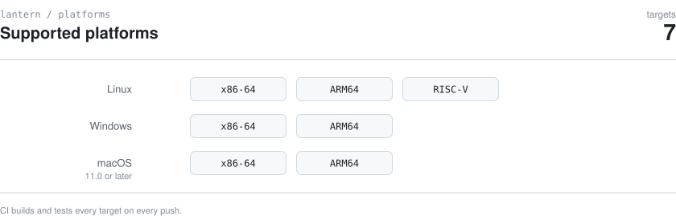
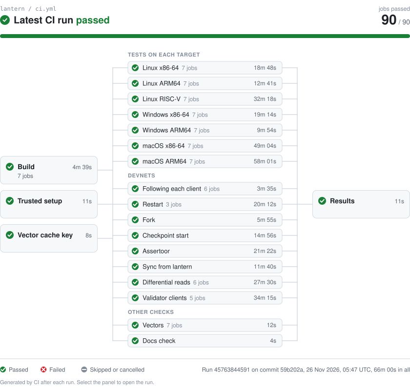

# lantern

An Ethereum consensus client, a beacon node, in assembly.

Standard: [asm-standard@0db3e07](https://github.com/bitminetech/asm-standard/blob/0db3e07f58a9ba89c5b6a46925b179de265ee7e8/ARCHITECTURE.md)

<!-- CI generates the supported platforms panel here. -->
<table><tr><td>

<picture><source media="(prefers-color-scheme: dark)" srcset="docs/readme/platforms-dark.svg"></picture>

</td></tr></table>
<!-- End of the supported platforms panel. -->

<!-- CI generates the verification heatmap here. -->
<table><tr><td>

<picture><source media="(prefers-color-scheme: dark)" srcset="docs/heatmap/header-dark.svg"></picture>

<picture><source media="(prefers-color-scheme: dark)" srcset="docs/heatmap/label-app-dark.svg"></picture><a href="docs/reference/app.md#function-lantern_app_options"><picture><source media="(prefers-color-scheme: dark)" srcset="docs/heatmap/cell-0-dark.svg"></picture></a><a href="docs/reference/app.md#function-lantern_app_main"><picture><source media="(prefers-color-scheme: dark)" srcset="docs/heatmap/cell-0-dark.svg"></picture></a><a href="docs/reference/app.md#function-lantern_app_actions"><picture><source media="(prefers-color-scheme: dark)" srcset="docs/heatmap/cell-0-dark.svg"></picture></a><a href="docs/reference/app.md#function-lantern_app_alloc"><picture><source media="(prefers-color-scheme: dark)" srcset="docs/heatmap/cell-0-dark.svg"></picture></a><a href="docs/reference/app.md#function-lantern_app_api_action"><picture><source media="(prefers-color-scheme: dark)" srcset="docs/heatmap/cell-0-dark.svg"></picture></a><a href="docs/reference/app.md#function-lantern_app_api_close"><picture><source media="(prefers-color-scheme: dark)" srcset="docs/heatmap/cell-0-dark.svg"></picture></a><a href="docs/reference/app.md#function-lantern_app_api_due"><picture><source media="(prefers-color-scheme: dark)" srcset="docs/heatmap/cell-0-dark.svg"></picture></a><a href="docs/reference/app.md#function-lantern_app_api_flush"><picture><source media="(prefers-color-scheme: dark)" srcset="docs/heatmap/cell-0-dark.svg"></picture></a><a href="docs/reference/app.md#function-lantern_app_api_note"><picture><source media="(prefers-color-scheme: dark)" srcset="docs/heatmap/cell-0-dark.svg"></picture></a><a href="docs/reference/app.md#function-lantern_app_api_poll"><picture><source media="(prefers-color-scheme: dark)" srcset="docs/heatmap/cell-0-dark.svg"></picture></a><a href="docs/reference/app.md#function-lantern_app_api_read"><picture><source media="(prefers-color-scheme: dark)" srcset="docs/heatmap/cell-0-dark.svg"></picture></a><a href="docs/reference/app.md#function-lantern_app_api_room"><picture><source media="(prefers-color-scheme: dark)" srcset="docs/heatmap/cell-0-dark.svg"></picture></a><a href="docs/reference/app.md#function-lantern_app_api_slot"><picture><source media="(prefers-color-scheme: dark)" srcset="docs/heatmap/cell-0-dark.svg"></picture></a><a href="docs/reference/app.md#function-lantern_app_api_start"><picture><source media="(prefers-color-scheme: dark)" srcset="docs/heatmap/cell-0-dark.svg"></picture></a><a href="docs/reference/app.md#function-lantern_app_arg_path"><picture><source media="(prefers-color-scheme: dark)" srcset="docs/heatmap/cell-0-dark.svg"></picture></a><a href="docs/reference/app.md#function-lantern_app_base58"><picture><source media="(prefers-color-scheme: dark)" srcset="docs/heatmap/cell-0-dark.svg"></picture></a><a href="docs/reference/app.md#function-lantern_app_base64url"><picture><source media="(prefers-color-scheme: dark)" srcset="docs/heatmap/cell-0-dark.svg"></picture></a><a href="docs/reference/app.md#function-lantern_app_boot_nodes"><picture><source media="(prefers-color-scheme: dark)" srcset="docs/heatmap/cell-0-dark.svg"></picture></a><a href="docs/reference/app.md#function-lantern_app_buf_add"><picture><source media="(prefers-color-scheme: dark)" srcset="docs/heatmap/cell-0-dark.svg"></picture></a><a href="docs/reference/app.md#function-lantern_app_buf_drop"><picture><source media="(prefers-color-scheme: dark)" srcset="docs/heatmap/cell-0-dark.svg"></picture></a><a href="docs/reference/app.md#function-lantern_app_buf_find"><picture><source media="(prefers-color-scheme: dark)" srcset="docs/heatmap/cell-0-dark.svg"></picture></a><a href="docs/reference/app.md#function-lantern_app_buf_grow"><picture><source media="(prefers-color-scheme: dark)" srcset="docs/heatmap/cell-0-dark.svg"></picture></a><a href="docs/reference/app.md#function-lantern_app_builder_answer"><picture><source media="(prefers-color-scheme: dark)" srcset="docs/heatmap/cell-0-dark.svg"></picture></a><a href="docs/reference/app.md#function-lantern_app_builder_conf"><picture><source media="(prefers-color-scheme: dark)" srcset="docs/heatmap/cell-0-dark.svg"></picture></a><a href="docs/reference/app.md#function-lantern_app_builder_due"><picture><source media="(prefers-color-scheme: dark)" srcset="docs/heatmap/cell-0-dark.svg"></picture></a><a href="docs/reference/app.md#function-lantern_app_builder_event"><picture><source media="(prefers-color-scheme: dark)" srcset="docs/heatmap/cell-0-dark.svg"></picture></a><a href="docs/reference/app.md#function-lantern_app_builder_fail"><picture><source media="(prefers-color-scheme: dark)" srcset="docs/heatmap/cell-0-dark.svg"></picture></a><a href="docs/reference/app.md#function-lantern_app_builder_handle"><picture><source media="(prefers-color-scheme: dark)" srcset="docs/heatmap/cell-0-dark.svg"></picture></a> 
<picture><source media="(prefers-color-scheme: dark)" srcset="docs/heatmap/label-dark.svg"></picture><a href="docs/reference/app.md#function-lantern_app_builder_request"><picture><source media="(prefers-color-scheme: dark)" srcset="docs/heatmap/cell-0-dark.svg"></picture></a><a href="docs/reference/app.md#function-lantern_app_bytes_join"><picture><source media="(prefers-color-scheme: dark)" srcset="docs/heatmap/cell-0-dark.svg"></picture></a><a href="docs/reference/app.md#function-lantern_app_categories"><picture><source media="(prefers-color-scheme: dark)" srcset="docs/heatmap/cell-0-dark.svg"></picture></a><a href="docs/reference/app.md#function-lantern_app_checkpoint"><picture><source media="(prefers-color-scheme: dark)" srcset="docs/heatmap/cell-0-dark.svg"></picture></a><a href="docs/reference/app.md#function-lantern_app_db_append"><picture><source media="(prefers-color-scheme: dark)" srcset="docs/heatmap/cell-0-dark.svg"></picture></a><a href="docs/reference/app.md#function-lantern_app_db_archive"><picture><source media="(prefers-color-scheme: dark)" srcset="docs/heatmap/cell-0-dark.svg"></picture></a><a href="docs/reference/app.md#function-lantern_app_db_custody"><picture><source media="(prefers-color-scheme: dark)" srcset="docs/heatmap/cell-0-dark.svg"></picture></a><a href="docs/reference/app.md#function-lantern_app_db_drop"><picture><source media="(prefers-color-scheme: dark)" srcset="docs/heatmap/cell-0-dark.svg"></picture></a><a href="docs/reference/app.md#function-lantern_app_db_exists"><picture><source media="(prefers-color-scheme: dark)" srcset="docs/heatmap/cell-0-dark.svg"></picture></a><a href="docs/reference/app.md#function-lantern_app_db_file"><picture><source media="(prefers-color-scheme: dark)" srcset="docs/heatmap/cell-0-dark.svg"></picture></a><a href="docs/reference/app.md#function-lantern_app_db_fit"><picture><source media="(prefers-color-scheme: dark)" srcset="docs/heatmap/cell-0-dark.svg"></picture></a><a href="docs/reference/app.md#function-lantern_app_db_history"><picture><source media="(prefers-color-scheme: dark)" srcset="docs/heatmap/cell-0-dark.svg"></picture></a><a href="docs/reference/app.md#function-lantern_app_db_path"><picture><source media="(prefers-color-scheme: dark)" srcset="docs/heatmap/cell-0-dark.svg"></picture></a><a href="docs/reference/app.md#function-lantern_app_db_record"><picture><source media="(prefers-color-scheme: dark)" srcset="docs/heatmap/cell-0-dark.svg"></picture></a><a href="docs/reference/app.md#function-lantern_app_db_scan_all"><picture><source media="(prefers-color-scheme: dark)" srcset="docs/heatmap/cell-0-dark.svg"></picture></a><a href="docs/reference/app.md#function-lantern_app_db_start"><picture><source media="(prefers-color-scheme: dark)" srcset="docs/heatmap/cell-0-dark.svg"></picture></a><a href="docs/reference/app.md#function-lantern_app_db_state"><picture><source media="(prefers-color-scheme: dark)" srcset="docs/heatmap/cell-0-dark.svg"></picture></a><a href="docs/reference/app.md#function-lantern_app_db_write"><picture><source media="(prefers-color-scheme: dark)" srcset="docs/heatmap/cell-0-dark.svg"></picture></a><a href="docs/reference/app.md#function-lantern_app_decimal"><picture><source media="(prefers-color-scheme: dark)" srcset="docs/heatmap/cell-0-dark.svg"></picture></a><a href="docs/reference/app.md#function-lantern_app_digits"><picture><source media="(prefers-color-scheme: dark)" srcset="docs/heatmap/cell-0-dark.svg"></picture></a><a href="docs/reference/app.md#function-lantern_app_discv5"><picture><source media="(prefers-color-scheme: dark)" srcset="docs/heatmap/cell-0-dark.svg"></picture></a><a href="docs/reference/app.md#function-lantern_app_dotted"><picture><source media="(prefers-color-scheme: dark)" srcset="docs/heatmap/cell-0-dark.svg"></picture></a><a href="docs/reference/app.md#function-lantern_app_dup"><picture><source media="(prefers-color-scheme: dark)" srcset="docs/heatmap/cell-0-dark.svg"></picture></a><a href="docs/reference/app.md#function-lantern_app_dv_datagram"><picture><source media="(prefers-color-scheme: dark)" srcset="docs/heatmap/cell-0-dark.svg"></picture></a><a href="docs/reference/app.md#function-lantern_app_dv_put"><picture><source media="(prefers-color-scheme: dark)" srcset="docs/heatmap/cell-0-dark.svg"></picture></a><a href="docs/reference/app.md#function-lantern_app_dv_start"><picture><source media="(prefers-color-scheme: dark)" srcset="docs/heatmap/cell-0-dark.svg"></picture></a><a href="docs/reference/app.md#function-lantern_app_engine_conf"><picture><source media="(prefers-color-scheme: dark)" srcset="docs/heatmap/cell-0-dark.svg"></picture></a><a href="docs/reference/app.md#function-lantern_app_engine_event"><picture><source media="(prefers-color-scheme: dark)" srcset="docs/heatmap/cell-0-dark.svg"></picture></a> 
<picture><source media="(prefers-color-scheme: dark)" srcset="docs/heatmap/label-dark.svg"></picture><a href="docs/reference/app.md#function-lantern_app_engine_handle"><picture><source media="(prefers-color-scheme: dark)" srcset="docs/heatmap/cell-0-dark.svg"></picture></a><a href="docs/reference/app.md#function-lantern_app_engine_perform"><picture><source media="(prefers-color-scheme: dark)" srcset="docs/heatmap/cell-0-dark.svg"></picture></a><a href="docs/reference/app.md#function-lantern_app_engine_request"><picture><source media="(prefers-color-scheme: dark)" srcset="docs/heatmap/cell-0-dark.svg"></picture></a><a href="docs/reference/app.md#function-lantern_app_engine_send"><picture><source media="(prefers-color-scheme: dark)" srcset="docs/heatmap/cell-0-dark.svg"></picture></a><a href="docs/reference/app.md#function-lantern_app_event_put"><picture><source media="(prefers-color-scheme: dark)" srcset="docs/heatmap/cell-0-dark.svg"></picture></a><a href="docs/reference/app.md#function-lantern_app_fail_status"><picture><source media="(prefers-color-scheme: dark)" srcset="docs/heatmap/cell-0-dark.svg"></picture></a><a href="docs/reference/app.md#function-lantern_app_file_free"><picture><source media="(prefers-color-scheme: dark)" srcset="docs/heatmap/cell-0-dark.svg"></picture></a><a href="docs/reference/app.md#function-lantern_app_fork"><picture><source media="(prefers-color-scheme: dark)" srcset="docs/heatmap/cell-0-dark.svg"></picture></a><a href="docs/reference/app.md#function-lantern_app_grow"><picture><source media="(prefers-color-scheme: dark)" srcset="docs/heatmap/cell-0-dark.svg"></picture></a><a href="docs/reference/app.md#function-lantern_app_hex_digit"><picture><source media="(prefers-color-scheme: dark)" srcset="docs/heatmap/cell-0-dark.svg"></picture></a><a href="docs/reference/app.md#function-lantern_app_identity_put"><picture><source media="(prefers-color-scheme: dark)" srcset="docs/heatmap/cell-0-dark.svg"></picture></a><a href="docs/reference/app.md#function-lantern_app_ipv4"><picture><source media="(prefers-color-scheme: dark)" srcset="docs/heatmap/cell-0-dark.svg"></picture></a><a href="docs/reference/app.md#function-lantern_app_key"><picture><source media="(prefers-color-scheme: dark)" srcset="docs/heatmap/cell-0-dark.svg"></picture></a><a href="docs/reference/app.md#function-lantern_app_lc_grow"><picture><source media="(prefers-color-scheme: dark)" srcset="docs/heatmap/cell-0-dark.svg"></picture></a><a href="docs/reference/app.md#function-lantern_app_no_memory"><picture><source media="(prefers-color-scheme: dark)" srcset="docs/heatmap/cell-0-dark.svg"></picture></a><a href="docs/reference/app.md#function-lantern_app_lc_start"><picture><source media="(prefers-color-scheme: dark)" srcset="docs/heatmap/cell-0-dark.svg"></picture></a><a href="docs/reference/app.md#function-lantern_app_line_base64url"><picture><source media="(prefers-color-scheme: dark)" srcset="docs/heatmap/cell-0-dark.svg"></picture></a><a href="docs/reference/app.md#function-lantern_app_line_clear"><picture><source media="(prefers-color-scheme: dark)" srcset="docs/heatmap/cell-0-dark.svg"></picture></a><a href="docs/reference/app.md#function-lantern_app_line_end"><picture><source media="(prefers-color-scheme: dark)" srcset="docs/heatmap/cell-0-dark.svg"></picture></a><a href="docs/reference/app.md#function-lantern_app_line_hex"><picture><source media="(prefers-color-scheme: dark)" srcset="docs/heatmap/cell-0-dark.svg"></picture></a><a href="docs/reference/app.md#function-lantern_app_line_ip4"><picture><source media="(prefers-color-scheme: dark)" srcset="docs/heatmap/cell-0-dark.svg"></picture></a><a href="docs/reference/app.md#function-lantern_app_line_path"><picture><source media="(prefers-color-scheme: dark)" srcset="docs/heatmap/cell-0-dark.svg"></picture></a><a href="docs/reference/app.md#function-lantern_app_line_start"><picture><source media="(prefers-color-scheme: dark)" srcset="docs/heatmap/cell-0-dark.svg"></picture></a><a href="docs/reference/app.md#function-lantern_app_line_text"><picture><source media="(prefers-color-scheme: dark)" srcset="docs/heatmap/cell-0-dark.svg"></picture></a><a href="docs/reference/app.md#function-lantern_app_line_to"><picture><source media="(prefers-color-scheme: dark)" srcset="docs/heatmap/cell-0-dark.svg"></picture></a><a href="docs/reference/app.md#function-lantern_app_line_u64"><picture><source media="(prefers-color-scheme: dark)" srcset="docs/heatmap/cell-0-dark.svg"></picture></a><a href="docs/reference/app.md#function-lantern_app_log_work"><picture><source media="(prefers-color-scheme: dark)" srcset="docs/heatmap/cell-0-dark.svg"></picture></a><a href="docs/reference/app.md#function-lantern_app_loop"><picture><source media="(prefers-color-scheme: dark)" srcset="docs/heatmap/cell-0-dark.svg"></picture></a> 
<picture><source media="(prefers-color-scheme: dark)" srcset="docs/heatmap/label-dark.svg"></picture><a href="docs/reference/app.md#function-lantern_app_map"><picture><source media="(prefers-color-scheme: dark)" srcset="docs/heatmap/cell-0-dark.svg"></picture></a><a href="docs/reference/app.md#function-lantern_app_met_answer"><picture><source media="(prefers-color-scheme: dark)" srcset="docs/heatmap/cell-0-dark.svg"></picture></a><a href="docs/reference/app.md#function-lantern_app_met_close"><picture><source media="(prefers-color-scheme: dark)" srcset="docs/heatmap/cell-0-dark.svg"></picture></a><a href="docs/reference/app.md#function-lantern_app_met_delay"><picture><source media="(prefers-color-scheme: dark)" srcset="docs/heatmap/cell-0-dark.svg"></picture></a><a href="docs/reference/app.md#function-lantern_app_met_flush"><picture><source media="(prefers-color-scheme: dark)" srcset="docs/heatmap/cell-0-dark.svg"></picture></a><a href="docs/reference/app.md#function-lantern_app_met_obs"><picture><source media="(prefers-color-scheme: dark)" srcset="docs/heatmap/cell-0-dark.svg"></picture></a><a href="docs/reference/app.md#function-lantern_app_met_poll"><picture><source media="(prefers-color-scheme: dark)" srcset="docs/heatmap/cell-0-dark.svg"></picture></a><a href="docs/reference/app.md#function-lantern_app_met_room"><picture><source media="(prefers-color-scheme: dark)" srcset="docs/heatmap/cell-0-dark.svg"></picture></a><a href="docs/reference/app.md#function-lantern_app_met_send"><picture><source media="(prefers-color-scheme: dark)" srcset="docs/heatmap/cell-0-dark.svg"></picture></a><a href="docs/reference/app.md#function-lantern_app_met_slot"><picture><source media="(prefers-color-scheme: dark)" srcset="docs/heatmap/cell-0-dark.svg"></picture></a><a href="docs/reference/app.md#function-lantern_app_met_sources"><picture><source media="(prefers-color-scheme: dark)" srcset="docs/heatmap/cell-0-dark.svg"></picture></a><a href="docs/reference/app.md#function-lantern_app_met_start"><picture><source media="(prefers-color-scheme: dark)" srcset="docs/heatmap/cell-0-dark.svg"></picture></a><a href="docs/reference/app.md#function-lantern_app_met_us"><picture><source media="(prefers-color-scheme: dark)" srcset="docs/heatmap/cell-0-dark.svg"></picture></a><a href="docs/reference/app.md#function-lantern_app_met_work"><picture><source media="(prefers-color-scheme: dark)" srcset="docs/heatmap/cell-0-dark.svg"></picture></a><a href="docs/reference/app.md#function-lantern_app_multiaddr"><picture><source media="(prefers-color-scheme: dark)" srcset="docs/heatmap/cell-0-dark.svg"></picture></a><a href="docs/reference/app.md#function-lantern_app_name_is"><picture><source media="(prefers-color-scheme: dark)" srcset="docs/heatmap/cell-0-dark.svg"></picture></a><a href="docs/reference/app.md#function-lantern_app_net"><picture><source media="(prefers-color-scheme: dark)" srcset="docs/heatmap/cell-0-dark.svg"></picture></a><a href="docs/reference/app.md#function-lantern_app_number"><picture><source media="(prefers-color-scheme: dark)" srcset="docs/heatmap/cell-0-dark.svg"></picture></a><a href="docs/reference/app.md#function-lantern_app_p2p_events"><picture><source media="(prefers-color-scheme: dark)" srcset="docs/heatmap/cell-0-dark.svg"></picture></a><a href="docs/reference/app.md#function-lantern_app_path"><picture><source media="(prefers-color-scheme: dark)" srcset="docs/heatmap/cell-0-dark.svg"></picture></a><a href="docs/reference/app.md#function-lantern_app_read"><picture><source media="(prefers-color-scheme: dark)" srcset="docs/heatmap/cell-0-dark.svg"></picture></a><a href="docs/reference/app.md#function-lantern_app_regrow"><picture><source media="(prefers-color-scheme: dark)" srcset="docs/heatmap/cell-0-dark.svg"></picture></a><a href="docs/reference/app.md#function-lantern_app_space"><picture><source media="(prefers-color-scheme: dark)" srcset="docs/heatmap/cell-0-dark.svg"></picture></a><a href="docs/reference/app.md#function-lantern_app_start"><picture><source media="(prefers-color-scheme: dark)" srcset="docs/heatmap/cell-0-dark.svg"></picture></a><a href="docs/reference/app.md#function-lantern_app_state_bytes"><picture><source media="(prefers-color-scheme: dark)" srcset="docs/heatmap/cell-0-dark.svg"></picture></a><a href="docs/reference/app.md#function-lantern_app_state_cache"><picture><source media="(prefers-color-scheme: dark)" srcset="docs/heatmap/cell-0-dark.svg"></picture></a><a href="docs/reference/app.md#function-lantern_app_step"><picture><source media="(prefers-color-scheme: dark)" srcset="docs/heatmap/cell-0-dark.svg"></picture></a><a href="docs/reference/app.md#function-lantern_app_store_slot"><picture><source media="(prefers-color-scheme: dark)" srcset="docs/heatmap/cell-0-dark.svg"></picture></a> 
<picture><source media="(prefers-color-scheme: dark)" srcset="docs/heatmap/label-dark.svg"></picture><a href="docs/reference/app.md#function-lantern_app_time_text"><picture><source media="(prefers-color-scheme: dark)" srcset="docs/heatmap/cell-0-dark.svg"></picture></a><a href="docs/reference/app.md#function-lantern_app_unmap"><picture><source media="(prefers-color-scheme: dark)" srcset="docs/heatmap/cell-0-dark.svg"></picture></a><a href="docs/reference/app.md#function-lantern_app_work"><picture><source media="(prefers-color-scheme: dark)" srcset="docs/heatmap/cell-0-dark.svg"></picture></a><a href="docs/reference/app.md#function-lantern_app_work_data"><picture><source media="(prefers-color-scheme: dark)" srcset="docs/heatmap/cell-0-dark.svg"></picture></a><a href="docs/reference/app.md#function-lantern_app_work_entry"><picture><source media="(prefers-color-scheme: dark)" srcset="docs/heatmap/cell-0-dark.svg"></picture></a> 
<picture><source media="(prefers-color-scheme: dark)" srcset="docs/heatmap/label-beacon-api-dark.svg"></picture><a href="docs/reference/beacon-api.md#function-lantern_api_route"><picture><source media="(prefers-color-scheme: dark)" srcset="docs/heatmap/cell-0-dark.svg"></picture></a><a href="docs/reference/beacon-api.md#function-lantern_http_request"><picture><source media="(prefers-color-scheme: dark)" srcset="docs/heatmap/cell-0-dark.svg"></picture></a><a href="docs/reference/beacon-api.md#function-lantern_json_decode"><picture><source media="(prefers-color-scheme: dark)" srcset="docs/heatmap/cell-0-dark.svg"></picture></a><a href="docs/reference/beacon-api.md#function-lantern_json_encode"><picture><source media="(prefers-color-scheme: dark)" srcset="docs/heatmap/cell-0-dark.svg"></picture></a><a href="docs/reference/beacon-api.md#function-lantern_json_encode_ssz"><picture><source media="(prefers-color-scheme: dark)" srcset="docs/heatmap/cell-0-dark.svg"></picture></a><a href="docs/reference/beacon-api.md#function-lantern_api_lc_event_text"><picture><source media="(prefers-color-scheme: dark)" srcset="docs/heatmap/cell-0-dark.svg"></picture></a><a href="docs/reference/beacon-api.md#function-lantern_api_lc_updates_body"><picture><source media="(prefers-color-scheme: dark)" srcset="docs/heatmap/cell-0-dark.svg"></picture></a><a href="docs/reference/beacon-api.md#function-lantern_bld_dec"><picture><source media="(prefers-color-scheme: dark)" srcset="docs/heatmap/cell-0-dark.svg"></picture></a><a href="docs/reference/beacon-api.md#function-lantern_bld_digits"><picture><source media="(prefers-color-scheme: dark)" srcset="docs/heatmap/cell-0-dark.svg"></picture></a><a href="docs/reference/beacon-api.md#function-lantern_bld_hex"><picture><source media="(prefers-color-scheme: dark)" srcset="docs/heatmap/cell-0-dark.svg"></picture></a><a href="docs/reference/beacon-api.md#function-lantern_bld_put"><picture><source media="(prefers-color-scheme: dark)" srcset="docs/heatmap/cell-0-dark.svg"></picture></a><a href="docs/reference/beacon-api.md#function-lantern_bld_reg_json"><picture><source media="(prefers-color-scheme: dark)" srcset="docs/heatmap/cell-0-dark.svg"></picture></a><a href="docs/reference/beacon-api.md#function-lantern_bld_reg_len"><picture><source media="(prefers-color-scheme: dark)" srcset="docs/heatmap/cell-0-dark.svg"></picture></a><a href="docs/reference/beacon-api.md#function-lantern_bld_same"><picture><source media="(prefers-color-scheme: dark)" srcset="docs/heatmap/cell-0-dark.svg"></picture></a><a href="docs/reference/beacon-api.md#function-lantern_bld_status"><picture><source media="(prefers-color-scheme: dark)" srcset="docs/heatmap/cell-0-dark.svg"></picture></a><a href="docs/reference/beacon-api.md#function-lantern_http_chunks"><picture><source media="(prefers-color-scheme: dark)" srcset="docs/heatmap/cell-0-dark.svg"></picture></a><a href="docs/reference/beacon-api.md#function-lantern_http_crlf"><picture><source media="(prefers-color-scheme: dark)" srcset="docs/heatmap/cell-0-dark.svg"></picture></a><a href="docs/reference/beacon-api.md#function-lantern_http_find"><picture><source media="(prefers-color-scheme: dark)" srcset="docs/heatmap/cell-0-dark.svg"></picture></a><a href="docs/reference/beacon-api.md#function-lantern_http_joined"><picture><source media="(prefers-color-scheme: dark)" srcset="docs/heatmap/cell-0-dark.svg"></picture></a><a href="docs/reference/beacon-api.md#function-lantern_http_part"><picture><source media="(prefers-color-scheme: dark)" srcset="docs/heatmap/cell-0-dark.svg"></picture></a><a href="docs/reference/beacon-api.md#function-lantern_http_same"><picture><source media="(prefers-color-scheme: dark)" srcset="docs/heatmap/cell-0-dark.svg"></picture></a><a href="docs/reference/beacon-api.md#function-lantern_http_token"><picture><source media="(prefers-color-scheme: dark)" srcset="docs/heatmap/cell-0-dark.svg"></picture></a><a href="docs/reference/beacon-api.md#function-lantern_http_trim"><picture><source media="(prefers-color-scheme: dark)" srcset="docs/heatmap/cell-0-dark.svg"></picture></a><a href="docs/reference/beacon-api.md#function-lantern_jd_fault"><picture><source media="(prefers-color-scheme: dark)" srcset="docs/heatmap/cell-0-dark.svg"></picture></a><a href="docs/reference/beacon-api.md#function-lantern_jd_hexdigit"><picture><source media="(prefers-color-scheme: dark)" srcset="docs/heatmap/cell-0-dark.svg"></picture></a><a href="docs/reference/beacon-api.md#function-lantern_jd_key"><picture><source media="(prefers-color-scheme: dark)" srcset="docs/heatmap/cell-0-dark.svg"></picture></a><a href="docs/reference/beacon-api.md#function-lantern_jd_literal"><picture><source media="(prefers-color-scheme: dark)" srcset="docs/heatmap/cell-0-dark.svg"></picture></a><a href="docs/reference/beacon-api.md#function-lantern_jd_number"><picture><source media="(prefers-color-scheme: dark)" srcset="docs/heatmap/cell-0-dark.svg"></picture></a> 
<picture><source media="(prefers-color-scheme: dark)" srcset="docs/heatmap/label-dark.svg"></picture><a href="docs/reference/beacon-api.md#function-lantern_jd_offset"><picture><source media="(prefers-color-scheme: dark)" srcset="docs/heatmap/cell-0-dark.svg"></picture></a><a href="docs/reference/beacon-api.md#function-lantern_jd_out"><picture><source media="(prefers-color-scheme: dark)" srcset="docs/heatmap/cell-0-dark.svg"></picture></a><a href="docs/reference/beacon-api.md#function-lantern_jd_skip"><picture><source media="(prefers-color-scheme: dark)" srcset="docs/heatmap/cell-0-dark.svg"></picture></a><a href="docs/reference/beacon-api.md#function-lantern_jd_string"><picture><source media="(prefers-color-scheme: dark)" srcset="docs/heatmap/cell-0-dark.svg"></picture></a><a href="docs/reference/beacon-api.md#function-lantern_jd_value"><picture><source media="(prefers-color-scheme: dark)" srcset="docs/heatmap/cell-0-dark.svg"></picture></a><a href="docs/reference/beacon-api.md#function-lantern_jd_ws"><picture><source media="(prefers-color-scheme: dark)" srcset="docs/heatmap/cell-0-dark.svg"></picture></a><a href="docs/reference/beacon-api.md#function-lantern_json_child"><picture><source media="(prefers-color-scheme: dark)" srcset="docs/heatmap/cell-0-dark.svg"></picture></a><a href="docs/reference/beacon-api.md#function-lantern_json_decode_mode"><picture><source media="(prefers-color-scheme: dark)" srcset="docs/heatmap/cell-0-dark.svg"></picture></a><a href="docs/reference/beacon-api.md#function-lantern_json_hex"><picture><source media="(prefers-color-scheme: dark)" srcset="docs/heatmap/cell-0-dark.svg"></picture></a><a href="docs/reference/beacon-api.md#function-lantern_json_main"><picture><source media="(prefers-color-scheme: dark)" srcset="docs/heatmap/cell-0-dark.svg"></picture></a><a href="docs/reference/beacon-api.md#function-lantern_json_number"><picture><source media="(prefers-color-scheme: dark)" srcset="docs/heatmap/cell-0-dark.svg"></picture></a><a href="docs/reference/beacon-api.md#function-lantern_json_open"><picture><source media="(prefers-color-scheme: dark)" srcset="docs/heatmap/cell-0-dark.svg"></picture></a><a href="docs/reference/beacon-api.md#function-lantern_json_put"><picture><source media="(prefers-color-scheme: dark)" srcset="docs/heatmap/cell-0-dark.svg"></picture></a><a href="docs/reference/beacon-api.md#function-lantern_jss_child"><picture><source media="(prefers-color-scheme: dark)" srcset="docs/heatmap/cell-0-dark.svg"></picture></a><a href="docs/reference/beacon-api.md#function-lantern_jss_field_end"><picture><source media="(prefers-color-scheme: dark)" srcset="docs/heatmap/cell-0-dark.svg"></picture></a><a href="docs/reference/beacon-api.md#function-lantern_jss_open"><picture><source media="(prefers-color-scheme: dark)" srcset="docs/heatmap/cell-0-dark.svg"></picture></a><a href="docs/reference/beacon-api.md#function-lantern_node_bid_data"><picture><source media="(prefers-color-scheme: dark)" srcset="docs/heatmap/cell-0-dark.svg"></picture></a><a href="docs/reference/beacon-api.md#function-lantern_node_builder_call"><picture><source media="(prefers-color-scheme: dark)" srcset="docs/heatmap/cell-0-dark.svg"></picture></a><a href="docs/reference/beacon-api.md#function-lantern_node_builder_event"><picture><source media="(prefers-color-scheme: dark)" srcset="docs/heatmap/cell-0-dark.svg"></picture></a><a href="docs/reference/beacon-api.md#function-lantern_node_builder_register"><picture><source media="(prefers-color-scheme: dark)" srcset="docs/heatmap/cell-0-dark.svg"></picture></a><a href="docs/reference/beacon-api.md#function-lantern_node_produce_header"><picture><source media="(prefers-color-scheme: dark)" srcset="docs/heatmap/cell-0-dark.svg"></picture></a><a href="docs/reference/beacon-api.md#function-lantern_node_publish_submit"><picture><source media="(prefers-color-scheme: dark)" srcset="docs/heatmap/cell-0-dark.svg"></picture></a><a href="docs/reference/beacon-api.md#function-lantern_node_registration_put"><picture><source media="(prefers-color-scheme: dark)" srcset="docs/heatmap/cell-0-dark.svg"></picture></a><a href="docs/reference/beacon-api.md#function-lantern_node_registrations_find"><picture><source media="(prefers-color-scheme: dark)" srcset="docs/heatmap/cell-0-dark.svg"></picture></a><a href="docs/reference/beacon-api.md#function-lantern_route_decode"><picture><source media="(prefers-color-scheme: dark)" srcset="docs/heatmap/cell-0-dark.svg"></picture></a><a href="docs/reference/beacon-api.md#function-lantern_route_hex"><picture><source media="(prefers-color-scheme: dark)" srcset="docs/heatmap/cell-0-dark.svg"></picture></a><a href="docs/reference/beacon-api.md#function-lantern_route_ids_array"><picture><source media="(prefers-color-scheme: dark)" srcset="docs/heatmap/cell-0-dark.svg"></picture></a><a href="docs/reference/beacon-api.md#function-lantern_route_key"><picture><source media="(prefers-color-scheme: dark)" srcset="docs/heatmap/cell-0-dark.svg"></picture></a> 
<picture><source media="(prefers-color-scheme: dark)" srcset="docs/heatmap/label-dark.svg"></picture><a href="docs/reference/beacon-api.md#function-lantern_route_lit"><picture><source media="(prefers-color-scheme: dark)" srcset="docs/heatmap/cell-0-dark.svg"></picture></a><a href="docs/reference/beacon-api.md#function-lantern_route_match"><picture><source media="(prefers-color-scheme: dark)" srcset="docs/heatmap/cell-0-dark.svg"></picture></a><a href="docs/reference/beacon-api.md#function-lantern_route_next_item"><picture><source media="(prefers-color-scheme: dark)" srcset="docs/heatmap/cell-0-dark.svg"></picture></a><a href="docs/reference/beacon-api.md#function-lantern_route_number"><picture><source media="(prefers-color-scheme: dark)" srcset="docs/heatmap/cell-0-dark.svg"></picture></a><a href="docs/reference/beacon-api.md#function-lantern_route_pct_ok"><picture><source media="(prefers-color-scheme: dark)" srcset="docs/heatmap/cell-0-dark.svg"></picture></a><a href="docs/reference/beacon-api.md#function-lantern_route_string"><picture><source media="(prefers-color-scheme: dark)" srcset="docs/heatmap/cell-0-dark.svg"></picture></a><a href="docs/reference/beacon-api.md#function-lantern_route_value"><picture><source media="(prefers-color-scheme: dark)" srcset="docs/heatmap/cell-0-dark.svg"></picture></a><a href="docs/reference/beacon-api.md#function-lantern_route_weight"><picture><source media="(prefers-color-scheme: dark)" srcset="docs/heatmap/cell-0-dark.svg"></picture></a><a href="docs/reference/beacon-api.md#function-lantern_route_word"><picture><source media="(prefers-color-scheme: dark)" srcset="docs/heatmap/cell-0-dark.svg"></picture></a><a href="docs/reference/beacon-api.md#function-lantern_route_ws"><picture><source media="(prefers-color-scheme: dark)" srcset="docs/heatmap/cell-0-dark.svg"></picture></a><a href="docs/reference/beacon-api.md#function-lantern_api_base58"><picture><source media="(prefers-color-scheme: dark)" srcset="docs/heatmap/cell-0-dark.svg"></picture></a><a href="docs/reference/beacon-api.md#function-lantern_api_blob_body"><picture><source media="(prefers-color-scheme: dark)" srcset="docs/heatmap/cell-0-dark.svg"></picture></a><a href="docs/reference/beacon-api.md#function-lantern_api_blob_wanted"><picture><source media="(prefers-color-scheme: dark)" srcset="docs/heatmap/cell-0-dark.svg"></picture></a><a href="docs/reference/beacon-api.md#function-lantern_api_body"><picture><source media="(prefers-color-scheme: dark)" srcset="docs/heatmap/cell-0-dark.svg"></picture></a><a href="docs/reference/beacon-api.md#function-lantern_api_bool"><picture><source media="(prefers-color-scheme: dark)" srcset="docs/heatmap/cell-0-dark.svg"></picture></a><a href="docs/reference/beacon-api.md#function-lantern_api_checkpoint"><picture><source media="(prefers-color-scheme: dark)" srcset="docs/heatmap/cell-0-dark.svg"></picture></a><a href="docs/reference/beacon-api.md#function-lantern_api_code"><picture><source media="(prefers-color-scheme: dark)" srcset="docs/heatmap/cell-0-dark.svg"></picture></a><a href="docs/reference/beacon-api.md#function-lantern_api_code_text"><picture><source media="(prefers-color-scheme: dark)" srcset="docs/heatmap/cell-0-dark.svg"></picture></a><a href="docs/reference/beacon-api.md#function-lantern_api_committees_json"><picture><source media="(prefers-color-scheme: dark)" srcset="docs/heatmap/cell-0-dark.svg"></picture></a><a href="docs/reference/beacon-api.md#function-lantern_api_dec"><picture><source media="(prefers-color-scheme: dark)" srcset="docs/heatmap/cell-0-dark.svg"></picture></a><a href="docs/reference/beacon-api.md#function-lantern_api_dec256"><picture><source media="(prefers-color-scheme: dark)" srcset="docs/heatmap/cell-0-dark.svg"></picture></a><a href="docs/reference/beacon-api.md#function-lantern_api_duties_json"><picture><source media="(prefers-color-scheme: dark)" srcset="docs/heatmap/cell-0-dark.svg"></picture></a><a href="docs/reference/beacon-api.md#function-lantern_api_event_text"><picture><source media="(prefers-color-scheme: dark)" srcset="docs/heatmap/cell-0-dark.svg"></picture></a><a href="docs/reference/beacon-api.md#function-lantern_api_failures"><picture><source media="(prefers-color-scheme: dark)" srcset="docs/heatmap/cell-0-dark.svg"></picture></a><a href="docs/reference/beacon-api.md#function-lantern_api_fork_choice_body"><picture><source media="(prefers-color-scheme: dark)" srcset="docs/heatmap/cell-0-dark.svg"></picture></a><a href="docs/reference/beacon-api.md#function-lantern_api_fork_name"><picture><source media="(prefers-color-scheme: dark)" srcset="docs/heatmap/cell-0-dark.svg"></picture></a><a href="docs/reference/beacon-api.md#function-lantern_api_fork_schedule"><picture><source media="(prefers-color-scheme: dark)" srcset="docs/heatmap/cell-0-dark.svg"></picture></a><a href="docs/reference/beacon-api.md#function-lantern_api_header_json"><picture><source media="(prefers-color-scheme: dark)" srcset="docs/heatmap/cell-0-dark.svg"></picture></a> 
<picture><source media="(prefers-color-scheme: dark)" srcset="docs/heatmap/label-dark.svg"></picture><a href="docs/reference/beacon-api.md#function-lantern_api_headers_json"><picture><source media="(prefers-color-scheme: dark)" srcset="docs/heatmap/cell-0-dark.svg"></picture></a><a href="docs/reference/beacon-api.md#function-lantern_api_heads_body"><picture><source media="(prefers-color-scheme: dark)" srcset="docs/heatmap/cell-0-dark.svg"></picture></a><a href="docs/reference/beacon-api.md#function-lantern_api_hex16"><picture><source media="(prefers-color-scheme: dark)" srcset="docs/heatmap/cell-0-dark.svg"></picture></a><a href="docs/reference/beacon-api.md#function-lantern_api_hex4"><picture><source media="(prefers-color-scheme: dark)" srcset="docs/heatmap/cell-0-dark.svg"></picture></a><a href="docs/reference/beacon-api.md#function-lantern_api_liveness_body"><picture><source media="(prefers-color-scheme: dark)" srcset="docs/heatmap/cell-0-dark.svg"></picture></a><a href="docs/reference/beacon-api.md#function-lantern_api_names"><picture><source media="(prefers-color-scheme: dark)" srcset="docs/heatmap/cell-0-dark.svg"></picture></a><a href="docs/reference/beacon-api.md#function-lantern_api_op_event_text"><picture><source media="(prefers-color-scheme: dark)" srcset="docs/heatmap/cell-0-dark.svg"></picture></a><a href="docs/reference/beacon-api.md#function-lantern_api_payload_event_text"><picture><source media="(prefers-color-scheme: dark)" srcset="docs/heatmap/cell-0-dark.svg"></picture></a><a href="docs/reference/beacon-api.md#function-lantern_api_peer_item"><picture><source media="(prefers-color-scheme: dark)" srcset="docs/heatmap/cell-0-dark.svg"></picture></a><a href="docs/reference/beacon-api.md#function-lantern_api_peers_body"><picture><source media="(prefers-color-scheme: dark)" srcset="docs/heatmap/cell-0-dark.svg"></picture></a><a href="docs/reference/beacon-api.md#function-lantern_api_pending_item"><picture><source media="(prefers-color-scheme: dark)" srcset="docs/heatmap/cell-0-dark.svg"></picture></a><a href="docs/reference/beacon-api.md#function-lantern_api_pending_json"><picture><source media="(prefers-color-scheme: dark)" srcset="docs/heatmap/cell-0-dark.svg"></picture></a><a href="docs/reference/beacon-api.md#function-lantern_api_pool_json"><picture><source media="(prefers-color-scheme: dark)" srcset="docs/heatmap/cell-0-dark.svg"></picture></a><a href="docs/reference/beacon-api.md#function-lantern_api_put"><picture><source media="(prefers-color-scheme: dark)" srcset="docs/heatmap/cell-0-dark.svg"></picture></a><a href="docs/reference/beacon-api.md#function-lantern_api_qdec"><picture><source media="(prefers-color-scheme: dark)" srcset="docs/heatmap/cell-0-dark.svg"></picture></a><a href="docs/reference/beacon-api.md#function-lantern_api_qdec256"><picture><source media="(prefers-color-scheme: dark)" srcset="docs/heatmap/cell-0-dark.svg"></picture></a><a href="docs/reference/beacon-api.md#function-lantern_api_qhex"><picture><source media="(prefers-color-scheme: dark)" srcset="docs/heatmap/cell-0-dark.svg"></picture></a><a href="docs/reference/beacon-api.md#function-lantern_api_qint"><picture><source media="(prefers-color-scheme: dark)" srcset="docs/heatmap/cell-0-dark.svg"></picture></a><a href="docs/reference/beacon-api.md#function-lantern_api_respond"><picture><source media="(prefers-color-scheme: dark)" srcset="docs/heatmap/cell-0-dark.svg"></picture></a><a href="docs/reference/beacon-api.md#function-lantern_api_reward_fields"><picture><source media="(prefers-color-scheme: dark)" srcset="docs/heatmap/cell-0-dark.svg"></picture></a><a href="docs/reference/beacon-api.md#function-lantern_api_rewards_body"><picture><source media="(prefers-color-scheme: dark)" srcset="docs/heatmap/cell-0-dark.svg"></picture></a><a href="docs/reference/beacon-api.md#function-lantern_api_rewards_json"><picture><source media="(prefers-color-scheme: dark)" srcset="docs/heatmap/cell-0-dark.svg"></picture></a><a href="docs/reference/beacon-api.md#function-lantern_api_sidecar_body"><picture><source media="(prefers-color-scheme: dark)" srcset="docs/heatmap/cell-0-dark.svg"></picture></a><a href="docs/reference/beacon-api.md#function-lantern_api_sidecar_event_text"><picture><source media="(prefers-color-scheme: dark)" srcset="docs/heatmap/cell-0-dark.svg"></picture></a><a href="docs/reference/beacon-api.md#function-lantern_api_spec"><picture><source media="(prefers-color-scheme: dark)" srcset="docs/heatmap/cell-0-dark.svg"></picture></a><a href="docs/reference/beacon-api.md#function-lantern_api_sse_head"><picture><source media="(prefers-color-scheme: dark)" srcset="docs/heatmap/cell-0-dark.svg"></picture></a><a href="docs/reference/beacon-api.md#function-lantern_api_state_read_body"><picture><source media="(prefers-color-scheme: dark)" srcset="docs/heatmap/cell-0-dark.svg"></picture></a><a href="docs/reference/beacon-api.md#function-lantern_api_stream_head"><picture><source media="(prefers-color-scheme: dark)" srcset="docs/heatmap/cell-0-dark.svg"></picture></a> 
<picture><source media="(prefers-color-scheme: dark)" srcset="docs/heatmap/label-dark.svg"></picture><a href="docs/reference/beacon-api.md#function-lantern_api_stream_json"><picture><source media="(prefers-color-scheme: dark)" srcset="docs/heatmap/cell-0-dark.svg"></picture></a><a href="docs/reference/beacon-api.md#function-lantern_api_sync_duties_body"><picture><source media="(prefers-color-scheme: dark)" srcset="docs/heatmap/cell-0-dark.svg"></picture></a><a href="docs/reference/beacon-api.md#function-lantern_api_sync_rewards_body"><picture><source media="(prefers-color-scheme: dark)" srcset="docs/heatmap/cell-0-dark.svg"></picture></a><a href="docs/reference/beacon-api.md#function-lantern_api_text"><picture><source media="(prefers-color-scheme: dark)" srcset="docs/heatmap/cell-0-dark.svg"></picture></a><a href="docs/reference/beacon-api.md#function-lantern_api_validator_item"><picture><source media="(prefers-color-scheme: dark)" srcset="docs/heatmap/cell-0-dark.svg"></picture></a><a href="docs/reference/beacon-api.md#function-lantern_api_validator_status"><picture><source media="(prefers-color-scheme: dark)" srcset="docs/heatmap/cell-0-dark.svg"></picture></a><a href="docs/reference/beacon-api.md#function-lantern_api_validators_json"><picture><source media="(prefers-color-scheme: dark)" srcset="docs/heatmap/cell-0-dark.svg"></picture></a><a href="docs/reference/beacon-api.md#function-lantern_api_view_finalized"><picture><source media="(prefers-color-scheme: dark)" srcset="docs/heatmap/cell-0-dark.svg"></picture></a><a href="docs/reference/beacon-api.md#function-lantern_api_wei"><picture><source media="(prefers-color-scheme: dark)" srcset="docs/heatmap/cell-0-dark.svg"></picture></a><a href="docs/reference/beacon-api.md#function-lantern_copy_root"><picture><source media="(prefers-color-scheme: dark)" srcset="docs/heatmap/cell-0-dark.svg"></picture></a><a href="docs/reference/beacon-api.md#function-lantern_node_api_advance"><picture><source media="(prefers-color-scheme: dark)" srcset="docs/heatmap/cell-0-dark.svg"></picture></a><a href="docs/reference/beacon-api.md#function-lantern_node_api_aggregate"><picture><source media="(prefers-color-scheme: dark)" srcset="docs/heatmap/cell-0-dark.svg"></picture></a><a href="docs/reference/beacon-api.md#function-lantern_node_api_below"><picture><source media="(prefers-color-scheme: dark)" srcset="docs/heatmap/cell-0-dark.svg"></picture></a><a href="docs/reference/beacon-api.md#function-lantern_node_api_blob_stream"><picture><source media="(prefers-color-scheme: dark)" srcset="docs/heatmap/cell-0-dark.svg"></picture></a><a href="docs/reference/beacon-api.md#function-lantern_node_api_block"><picture><source media="(prefers-color-scheme: dark)" srcset="docs/heatmap/cell-0-dark.svg"></picture></a><a href="docs/reference/beacon-api.md#function-lantern_node_api_block_event"><picture><source media="(prefers-color-scheme: dark)" srcset="docs/heatmap/cell-0-dark.svg"></picture></a><a href="docs/reference/beacon-api.md#function-lantern_node_api_check"><picture><source media="(prefers-color-scheme: dark)" srcset="docs/heatmap/cell-0-dark.svg"></picture></a><a href="docs/reference/beacon-api.md#function-lantern_node_api_chunk_done"><picture><source media="(prefers-color-scheme: dark)" srcset="docs/heatmap/cell-0-dark.svg"></picture></a><a href="docs/reference/beacon-api.md#function-lantern_node_api_chunk_run"><picture><source media="(prefers-color-scheme: dark)" srcset="docs/heatmap/cell-0-dark.svg"></picture></a><a href="docs/reference/beacon-api.md#function-lantern_node_api_chunk_work"><picture><source media="(prefers-color-scheme: dark)" srcset="docs/heatmap/cell-0-dark.svg"></picture></a><a href="docs/reference/beacon-api.md#function-lantern_node_api_closed"><picture><source media="(prefers-color-scheme: dark)" srcset="docs/heatmap/cell-0-dark.svg"></picture></a><a href="docs/reference/beacon-api.md#function-lantern_node_api_committees_check"><picture><source media="(prefers-color-scheme: dark)" srcset="docs/heatmap/cell-0-dark.svg"></picture></a><a href="docs/reference/beacon-api.md#function-lantern_node_api_committees_cursor"><picture><source media="(prefers-color-scheme: dark)" srcset="docs/heatmap/cell-0-dark.svg"></picture></a><a href="docs/reference/beacon-api.md#function-lantern_node_api_committees_prep"><picture><source media="(prefers-color-scheme: dark)" srcset="docs/heatmap/cell-0-dark.svg"></picture></a><a href="docs/reference/beacon-api.md#function-lantern_node_api_contribution"><picture><source media="(prefers-color-scheme: dark)" srcset="docs/heatmap/cell-0-dark.svg"></picture></a><a href="docs/reference/beacon-api.md#function-lantern_node_api_db_ref"><picture><source media="(prefers-color-scheme: dark)" srcset="docs/heatmap/cell-0-dark.svg"></picture></a><a href="docs/reference/beacon-api.md#function-lantern_node_api_done"><picture><source media="(prefers-color-scheme: dark)" srcset="docs/heatmap/cell-0-dark.svg"></picture></a><a href="docs/reference/beacon-api.md#function-lantern_node_api_encode"><picture><source media="(prefers-color-scheme: dark)" srcset="docs/heatmap/cell-0-dark.svg"></picture></a> 
<picture><source media="(prefers-color-scheme: dark)" srcset="docs/heatmap/label-dark.svg"></picture><a href="docs/reference/beacon-api.md#function-lantern_node_api_end"><picture><source media="(prefers-color-scheme: dark)" srcset="docs/heatmap/cell-0-dark.svg"></picture></a><a href="docs/reference/beacon-api.md#function-lantern_node_api_event"><picture><source media="(prefers-color-scheme: dark)" srcset="docs/heatmap/cell-0-dark.svg"></picture></a><a href="docs/reference/beacon-api.md#function-lantern_node_api_event_count"><picture><source media="(prefers-color-scheme: dark)" srcset="docs/heatmap/cell-0-dark.svg"></picture></a><a href="docs/reference/beacon-api.md#function-lantern_node_api_event_done"><picture><source media="(prefers-color-scheme: dark)" srcset="docs/heatmap/cell-0-dark.svg"></picture></a><a href="docs/reference/beacon-api.md#function-lantern_node_api_event_run"><picture><source media="(prefers-color-scheme: dark)" srcset="docs/heatmap/cell-0-dark.svg"></picture></a><a href="docs/reference/beacon-api.md#function-lantern_node_api_events"><picture><source media="(prefers-color-scheme: dark)" srcset="docs/heatmap/cell-0-dark.svg"></picture></a><a href="docs/reference/beacon-api.md#function-lantern_node_api_final_block"><picture><source media="(prefers-color-scheme: dark)" srcset="docs/heatmap/cell-0-dark.svg"></picture></a><a href="docs/reference/beacon-api.md#function-lantern_node_api_find"><picture><source media="(prefers-color-scheme: dark)" srcset="docs/heatmap/cell-0-dark.svg"></picture></a><a href="docs/reference/beacon-api.md#function-lantern_node_api_find_peer"><picture><source media="(prefers-color-scheme: dark)" srcset="docs/heatmap/cell-0-dark.svg"></picture></a><a href="docs/reference/beacon-api.md#function-lantern_node_api_find_validator"><picture><source media="(prefers-color-scheme: dark)" srcset="docs/heatmap/cell-0-dark.svg"></picture></a><a href="docs/reference/beacon-api.md#function-lantern_node_api_fold"><picture><source media="(prefers-color-scheme: dark)" srcset="docs/heatmap/cell-0-dark.svg"></picture></a><a href="docs/reference/beacon-api.md#function-lantern_node_api_free"><picture><source media="(prefers-color-scheme: dark)" srcset="docs/heatmap/cell-0-dark.svg"></picture></a><a href="docs/reference/beacon-api.md#function-lantern_node_api_head_events"><picture><source media="(prefers-color-scheme: dark)" srcset="docs/heatmap/cell-0-dark.svg"></picture></a><a href="docs/reference/beacon-api.md#function-lantern_node_api_headers_stream"><picture><source media="(prefers-color-scheme: dark)" srcset="docs/heatmap/cell-0-dark.svg"></picture></a><a href="docs/reference/beacon-api.md#function-lantern_node_api_ids"><picture><source media="(prefers-color-scheme: dark)" srcset="docs/heatmap/cell-0-dark.svg"></picture></a><a href="docs/reference/beacon-api.md#function-lantern_node_api_lookup"><picture><source media="(prefers-color-scheme: dark)" srcset="docs/heatmap/cell-0-dark.svg"></picture></a><a href="docs/reference/beacon-api.md#function-lantern_node_api_lookup_done"><picture><source media="(prefers-color-scheme: dark)" srcset="docs/heatmap/cell-0-dark.svg"></picture></a><a href="docs/reference/beacon-api.md#function-lantern_node_api_lookup_run"><picture><source media="(prefers-color-scheme: dark)" srcset="docs/heatmap/cell-0-dark.svg"></picture></a><a href="docs/reference/beacon-api.md#function-lantern_node_api_new"><picture><source media="(prefers-color-scheme: dark)" srcset="docs/heatmap/cell-0-dark.svg"></picture></a><a href="docs/reference/beacon-api.md#function-lantern_node_api_on_chain"><picture><source media="(prefers-color-scheme: dark)" srcset="docs/heatmap/cell-0-dark.svg"></picture></a><a href="docs/reference/beacon-api.md#function-lantern_node_api_parent"><picture><source media="(prefers-color-scheme: dark)" srcset="docs/heatmap/cell-0-dark.svg"></picture></a><a href="docs/reference/beacon-api.md#function-lantern_node_api_pool_advance"><picture><source media="(prefers-color-scheme: dark)" srcset="docs/heatmap/cell-0-dark.svg"></picture></a><a href="docs/reference/beacon-api.md#function-lantern_node_api_pool_stream"><picture><source media="(prefers-color-scheme: dark)" srcset="docs/heatmap/cell-0-dark.svg"></picture></a><a href="docs/reference/beacon-api.md#function-lantern_node_api_produce"><picture><source media="(prefers-color-scheme: dark)" srcset="docs/heatmap/cell-0-dark.svg"></picture></a><a href="docs/reference/beacon-api.md#function-lantern_node_api_publish"><picture><source media="(prefers-color-scheme: dark)" srcset="docs/heatmap/cell-0-dark.svg"></picture></a><a href="docs/reference/beacon-api.md#function-lantern_node_api_publish_count"><picture><source media="(prefers-color-scheme: dark)" srcset="docs/heatmap/cell-0-dark.svg"></picture></a><a href="docs/reference/beacon-api.md#function-lantern_node_api_put8"><picture><source media="(prefers-color-scheme: dark)" srcset="docs/heatmap/cell-0-dark.svg"></picture></a><a href="docs/reference/beacon-api.md#function-lantern_node_api_reorg"><picture><source media="(prefers-color-scheme: dark)" srcset="docs/heatmap/cell-0-dark.svg"></picture></a> 
<picture><source media="(prefers-color-scheme: dark)" srcset="docs/heatmap/label-dark.svg"></picture><a href="docs/reference/beacon-api.md#function-lantern_node_api_rerun"><picture><source media="(prefers-color-scheme: dark)" srcset="docs/heatmap/cell-0-dark.svg"></picture></a><a href="docs/reference/beacon-api.md#function-lantern_node_api_rewards"><picture><source media="(prefers-color-scheme: dark)" srcset="docs/heatmap/cell-0-dark.svg"></picture></a><a href="docs/reference/beacon-api.md#function-lantern_node_api_rewards_state"><picture><source media="(prefers-color-scheme: dark)" srcset="docs/heatmap/cell-0-dark.svg"></picture></a><a href="docs/reference/beacon-api.md#function-lantern_node_api_root_event"><picture><source media="(prefers-color-scheme: dark)" srcset="docs/heatmap/cell-0-dark.svg"></picture></a><a href="docs/reference/beacon-api.md#function-lantern_node_api_run"><picture><source media="(prefers-color-scheme: dark)" srcset="docs/heatmap/cell-0-dark.svg"></picture></a><a href="docs/reference/beacon-api.md#function-lantern_node_api_same_root"><picture><source media="(prefers-color-scheme: dark)" srcset="docs/heatmap/cell-0-dark.svg"></picture></a><a href="docs/reference/beacon-api.md#function-lantern_node_api_send"><picture><source media="(prefers-color-scheme: dark)" srcset="docs/heatmap/cell-0-dark.svg"></picture></a><a href="docs/reference/beacon-api.md#function-lantern_node_api_sent"><picture><source media="(prefers-color-scheme: dark)" srcset="docs/heatmap/cell-0-dark.svg"></picture></a><a href="docs/reference/beacon-api.md#function-lantern_node_api_sidecar_stream"><picture><source media="(prefers-color-scheme: dark)" srcset="docs/heatmap/cell-0-dark.svg"></picture></a><a href="docs/reference/beacon-api.md#function-lantern_node_api_state"><picture><source media="(prefers-color-scheme: dark)" srcset="docs/heatmap/cell-0-dark.svg"></picture></a><a href="docs/reference/beacon-api.md#function-lantern_node_api_state_answer"><picture><source media="(prefers-color-scheme: dark)" srcset="docs/heatmap/cell-0-dark.svg"></picture></a><a href="docs/reference/beacon-api.md#function-lantern_node_api_stream"><picture><source media="(prefers-color-scheme: dark)" srcset="docs/heatmap/cell-0-dark.svg"></picture></a><a href="docs/reference/beacon-api.md#function-lantern_node_api_submit"><picture><source media="(prefers-color-scheme: dark)" srcset="docs/heatmap/cell-0-dark.svg"></picture></a><a href="docs/reference/beacon-api.md#function-lantern_node_api_submit_done"><picture><source media="(prefers-color-scheme: dark)" srcset="docs/heatmap/cell-0-dark.svg"></picture></a><a href="docs/reference/beacon-api.md#function-lantern_node_api_submit_run"><picture><source media="(prefers-color-scheme: dark)" srcset="docs/heatmap/cell-0-dark.svg"></picture></a><a href="docs/reference/beacon-api.md#function-lantern_node_api_subscribe"><picture><source media="(prefers-color-scheme: dark)" srcset="docs/heatmap/cell-0-dark.svg"></picture></a><a href="docs/reference/beacon-api.md#function-lantern_node_api_subscribed"><picture><source media="(prefers-color-scheme: dark)" srcset="docs/heatmap/cell-0-dark.svg"></picture></a><a href="docs/reference/beacon-api.md#function-lantern_node_api_sync_fold"><picture><source media="(prefers-color-scheme: dark)" srcset="docs/heatmap/cell-0-dark.svg"></picture></a><a href="docs/reference/beacon-api.md#function-lantern_node_api_validators_prep"><picture><source media="(prefers-color-scheme: dark)" srcset="docs/heatmap/cell-0-dark.svg"></picture></a><a href="docs/reference/beacon-api.md#function-lantern_node_api_view"><picture><source media="(prefers-color-scheme: dark)" srcset="docs/heatmap/cell-0-dark.svg"></picture></a><a href="docs/reference/beacon-api.md#function-lantern_node_blob_advance"><picture><source media="(prefers-color-scheme: dark)" srcset="docs/heatmap/cell-0-dark.svg"></picture></a><a href="docs/reference/beacon-api.md#function-lantern_node_headers_next"><picture><source media="(prefers-color-scheme: dark)" srcset="docs/heatmap/cell-0-dark.svg"></picture></a><a href="docs/reference/beacon-api.md#function-lantern_node_op_event"><picture><source media="(prefers-color-scheme: dark)" srcset="docs/heatmap/cell-0-dark.svg"></picture></a><a href="docs/reference/beacon-api.md#function-lantern_node_pool_attestation"><picture><source media="(prefers-color-scheme: dark)" srcset="docs/heatmap/cell-0-dark.svg"></picture></a><a href="docs/reference/beacon-api.md#function-lantern_node_pool_kind"><picture><source media="(prefers-color-scheme: dark)" srcset="docs/heatmap/cell-0-dark.svg"></picture></a><a href="docs/reference/beacon-api.md#function-lantern_node_pool_next"><picture><source media="(prefers-color-scheme: dark)" srcset="docs/heatmap/cell-0-dark.svg"></picture></a><a href="docs/reference/beacon-api.md#function-lantern_node_produce_answer"><picture><source media="(prefers-color-scheme: dark)" srcset="docs/heatmap/cell-0-dark.svg"></picture></a><a href="docs/reference/beacon-api.md#function-lantern_node_produce_bid_go"><picture><source media="(prefers-color-scheme: dark)" srcset="docs/heatmap/cell-0-dark.svg"></picture></a> 
<picture><source media="(prefers-color-scheme: dark)" srcset="docs/heatmap/label-dark.svg"></picture><a href="docs/reference/beacon-api.md#function-lantern_node_produce_build"><picture><source media="(prefers-color-scheme: dark)" srcset="docs/heatmap/cell-0-dark.svg"></picture></a><a href="docs/reference/beacon-api.md#function-lantern_node_produce_done"><picture><source media="(prefers-color-scheme: dark)" srcset="docs/heatmap/cell-0-dark.svg"></picture></a><a href="docs/reference/beacon-api.md#function-lantern_node_produce_due"><picture><source media="(prefers-color-scheme: dark)" srcset="docs/heatmap/cell-0-dark.svg"></picture></a><a href="docs/reference/beacon-api.md#function-lantern_node_produce_fail"><picture><source media="(prefers-color-scheme: dark)" srcset="docs/heatmap/cell-0-dark.svg"></picture></a><a href="docs/reference/beacon-api.md#function-lantern_node_produce_next"><picture><source media="(prefers-color-scheme: dark)" srcset="docs/heatmap/cell-0-dark.svg"></picture></a><a href="docs/reference/beacon-api.md#function-lantern_node_produce_release"><picture><source media="(prefers-color-scheme: dark)" srcset="docs/heatmap/cell-0-dark.svg"></picture></a><a href="docs/reference/beacon-api.md#function-lantern_node_proposer_put"><picture><source media="(prefers-color-scheme: dark)" srcset="docs/heatmap/cell-0-dark.svg"></picture></a><a href="docs/reference/beacon-api.md#function-lantern_node_publish"><picture><source media="(prefers-color-scheme: dark)" srcset="docs/heatmap/cell-0-dark.svg"></picture></a><a href="docs/reference/beacon-api.md#function-lantern_node_publish_answer"><picture><source media="(prefers-color-scheme: dark)" srcset="docs/heatmap/cell-0-dark.svg"></picture></a><a href="docs/reference/beacon-api.md#function-lantern_node_publish_check_work"><picture><source media="(prefers-color-scheme: dark)" srcset="docs/heatmap/cell-0-dark.svg"></picture></a><a href="docs/reference/beacon-api.md#function-lantern_node_publish_done"><picture><source media="(prefers-color-scheme: dark)" srcset="docs/heatmap/cell-0-dark.svg"></picture></a><a href="docs/reference/beacon-api.md#function-lantern_node_publish_drop"><picture><source media="(prefers-color-scheme: dark)" srcset="docs/heatmap/cell-0-dark.svg"></picture></a><a href="docs/reference/beacon-api.md#function-lantern_node_publish_end"><picture><source media="(prefers-color-scheme: dark)" srcset="docs/heatmap/cell-0-dark.svg"></picture></a><a href="docs/reference/beacon-api.md#function-lantern_node_publish_poll"><picture><source media="(prefers-color-scheme: dark)" srcset="docs/heatmap/cell-0-dark.svg"></picture></a><a href="docs/reference/beacon-api.md#function-lantern_node_publish_sidecar_done"><picture><source media="(prefers-color-scheme: dark)" srcset="docs/heatmap/cell-0-dark.svg"></picture></a><a href="docs/reference/beacon-api.md#function-lantern_node_publish_sidecar_work"><picture><source media="(prefers-color-scheme: dark)" srcset="docs/heatmap/cell-0-dark.svg"></picture></a><a href="docs/reference/beacon-api.md#function-lantern_node_publish_sidecars_work"><picture><source media="(prefers-color-scheme: dark)" srcset="docs/heatmap/cell-0-dark.svg"></picture></a><a href="docs/reference/beacon-api.md#function-lantern_node_recon_sidecar_done"><picture><source media="(prefers-color-scheme: dark)" srcset="docs/heatmap/cell-0-dark.svg"></picture></a><a href="docs/reference/beacon-api.md#function-lantern_node_replay_block"><picture><source media="(prefers-color-scheme: dark)" srcset="docs/heatmap/cell-0-dark.svg"></picture></a><a href="docs/reference/beacon-api.md#function-lantern_node_replay_due"><picture><source media="(prefers-color-scheme: dark)" srcset="docs/heatmap/cell-0-dark.svg"></picture></a><a href="docs/reference/beacon-api.md#function-lantern_node_replay_get"><picture><source media="(prefers-color-scheme: dark)" srcset="docs/heatmap/cell-0-dark.svg"></picture></a><a href="docs/reference/beacon-api.md#function-lantern_node_sidecar_next"><picture><source media="(prefers-color-scheme: dark)" srcset="docs/heatmap/cell-0-dark.svg"></picture></a><a href="docs/reference/beacon-api.md#function-lantern_node_sidecar_of"><picture><source media="(prefers-color-scheme: dark)" srcset="docs/heatmap/cell-0-dark.svg"></picture></a><a href="docs/reference/beacon-api.md#function-lantern_node_submit_check"><picture><source media="(prefers-color-scheme: dark)" srcset="docs/heatmap/cell-0-dark.svg"></picture></a><a href="docs/reference/beacon-api.md#function-lantern_node_submit_copy"><picture><source media="(prefers-color-scheme: dark)" srcset="docs/heatmap/cell-0-dark.svg"></picture></a><a href="docs/reference/beacon-api.md#function-lantern_node_submit_decode"><picture><source media="(prefers-color-scheme: dark)" srcset="docs/heatmap/cell-0-dark.svg"></picture></a><a href="docs/reference/beacon-api.md#function-lantern_node_submit_topic"><picture><source media="(prefers-color-scheme: dark)" srcset="docs/heatmap/cell-0-dark.svg"></picture></a><a href="docs/reference/beacon-api.md#function-lantern_submit_ws"><picture><source media="(prefers-color-scheme: dark)" srcset="docs/heatmap/cell-0-dark.svg"></picture></a> 
<picture><source media="(prefers-color-scheme: dark)" srcset="docs/heatmap/label-block-processing-dark.svg"></picture><a href="docs/reference/block-processing.md#function-lantern_process_block"><picture><source media="(prefers-color-scheme: dark)" srcset="docs/heatmap/cell-0-dark.svg"></picture></a><a href="docs/reference/block-processing.md#function-lantern_process_block_header"><picture><source media="(prefers-color-scheme: dark)" srcset="docs/heatmap/cell-0-dark.svg"></picture></a><a href="docs/reference/block-processing.md#function-lantern_process_withdrawals"><picture><source media="(prefers-color-scheme: dark)" srcset="docs/heatmap/cell-0-dark.svg"></picture></a><a href="docs/reference/block-processing.md#function-lantern_get_expected_withdrawals"><picture><source media="(prefers-color-scheme: dark)" srcset="docs/heatmap/cell-0-dark.svg"></picture></a><a href="docs/reference/block-processing.md#function-lantern_get_pending_partial_withdrawals"><picture><source media="(prefers-color-scheme: dark)" srcset="docs/heatmap/cell-0-dark.svg"></picture></a><a href="docs/reference/block-processing.md#function-lantern_get_validators_sweep_withdrawals"><picture><source media="(prefers-color-scheme: dark)" srcset="docs/heatmap/cell-0-dark.svg"></picture></a><a href="docs/reference/block-processing.md#function-lantern_get_balance_after_withdrawals"><picture><source media="(prefers-color-scheme: dark)" srcset="docs/heatmap/cell-0-dark.svg"></picture></a><a href="docs/reference/block-processing.md#function-lantern_apply_withdrawals"><picture><source media="(prefers-color-scheme: dark)" srcset="docs/heatmap/cell-0-dark.svg"></picture></a><a href="docs/reference/block-processing.md#function-lantern_update_next_withdrawal_index"><picture><source media="(prefers-color-scheme: dark)" srcset="docs/heatmap/cell-0-dark.svg"></picture></a><a href="docs/reference/block-processing.md#function-lantern_update_pending_partial_withdrawals"><picture><source media="(prefers-color-scheme: dark)" srcset="docs/heatmap/cell-0-dark.svg"></picture></a><a href="docs/reference/block-processing.md#function-lantern_update_next_withdrawal_validator_index"><picture><source media="(prefers-color-scheme: dark)" srcset="docs/heatmap/cell-0-dark.svg"></picture></a><a href="docs/reference/block-processing.md#function-lantern_is_fully_withdrawable_validator"><picture><source media="(prefers-color-scheme: dark)" srcset="docs/heatmap/cell-0-dark.svg"></picture></a><a href="docs/reference/block-processing.md#function-lantern_is_partially_withdrawable_validator"><picture><source media="(prefers-color-scheme: dark)" srcset="docs/heatmap/cell-0-dark.svg"></picture></a><a href="docs/reference/block-processing.md#function-lantern_has_eth1_withdrawal_credential"><picture><source media="(prefers-color-scheme: dark)" srcset="docs/heatmap/cell-0-dark.svg"></picture></a><a href="docs/reference/block-processing.md#function-lantern_has_execution_withdrawal_credential"><picture><source media="(prefers-color-scheme: dark)" srcset="docs/heatmap/cell-0-dark.svg"></picture></a><a href="docs/reference/block-processing.md#function-lantern_is_eligible_for_partial_withdrawals"><picture><source media="(prefers-color-scheme: dark)" srcset="docs/heatmap/cell-0-dark.svg"></picture></a><a href="docs/reference/block-processing.md#function-lantern_get_pending_balance_to_withdraw"><picture><source media="(prefers-color-scheme: dark)" srcset="docs/heatmap/cell-0-dark.svg"></picture></a><a href="docs/reference/block-processing.md#function-lantern_process_execution_payload"><picture><source media="(prefers-color-scheme: dark)" srcset="docs/heatmap/cell-0-dark.svg"></picture></a><a href="docs/reference/block-processing.md#function-lantern_is_merge_transition_complete"><picture><source media="(prefers-color-scheme: dark)" srcset="docs/heatmap/cell-0-dark.svg"></picture></a><a href="docs/reference/block-processing.md#function-lantern_is_merge_transition_block"><picture><source media="(prefers-color-scheme: dark)" srcset="docs/heatmap/cell-0-dark.svg"></picture></a><a href="docs/reference/block-processing.md#function-lantern_is_execution_enabled"><picture><source media="(prefers-color-scheme: dark)" srcset="docs/heatmap/cell-0-dark.svg"></picture></a><a href="docs/reference/block-processing.md#function-lantern_get_blob_parameters"><picture><source media="(prefers-color-scheme: dark)" srcset="docs/heatmap/cell-0-dark.svg"></picture></a><a href="docs/reference/block-processing.md#function-lantern_kzg_commitment_to_versioned_hash"><picture><source media="(prefers-color-scheme: dark)" srcset="docs/heatmap/cell-0-dark.svg"></picture></a><a href="docs/reference/block-processing.md#function-lantern_compute_time_at_slot"><picture><source media="(prefers-color-scheme: dark)" srcset="docs/heatmap/cell-0-dark.svg"></picture></a><a href="docs/reference/block-processing.md#function-lantern_process_randao"><picture><source media="(prefers-color-scheme: dark)" srcset="docs/heatmap/cell-0-dark.svg"></picture></a><a href="docs/reference/block-processing.md#function-lantern_process_eth1_data"><picture><source media="(prefers-color-scheme: dark)" srcset="docs/heatmap/cell-0-dark.svg"></picture></a><a href="docs/reference/block-processing.md#function-lantern_process_operations"><picture><source media="(prefers-color-scheme: dark)" srcset="docs/heatmap/cell-0-dark.svg"></picture></a><a href="docs/reference/block-processing.md#function-lantern_process_deposit"><picture><source media="(prefers-color-scheme: dark)" srcset="docs/heatmap/cell-0-dark.svg"></picture></a> 
<picture><source media="(prefers-color-scheme: dark)" srcset="docs/heatmap/label-dark.svg"></picture><a href="docs/reference/block-processing.md#function-lantern_apply_deposit"><picture><source media="(prefers-color-scheme: dark)" srcset="docs/heatmap/cell-0-dark.svg"></picture></a><a href="docs/reference/block-processing.md#function-lantern_process_proposer_slashing"><picture><source media="(prefers-color-scheme: dark)" srcset="docs/heatmap/cell-0-dark.svg"></picture></a><a href="docs/reference/block-processing.md#function-lantern_process_attester_slashing"><picture><source media="(prefers-color-scheme: dark)" srcset="docs/heatmap/cell-0-dark.svg"></picture></a><a href="docs/reference/block-processing.md#function-lantern_process_attestation"><picture><source media="(prefers-color-scheme: dark)" srcset="docs/heatmap/cell-0-dark.svg"></picture></a><a href="docs/reference/block-processing.md#function-lantern_process_voluntary_exit"><picture><source media="(prefers-color-scheme: dark)" srcset="docs/heatmap/cell-0-dark.svg"></picture></a><a href="docs/reference/block-processing.md#function-lantern_process_bls_to_execution_change"><picture><source media="(prefers-color-scheme: dark)" srcset="docs/heatmap/cell-0-dark.svg"></picture></a><a href="docs/reference/block-processing.md#function-lantern_process_deposit_request"><picture><source media="(prefers-color-scheme: dark)" srcset="docs/heatmap/cell-0-dark.svg"></picture></a><a href="docs/reference/block-processing.md#function-lantern_process_withdrawal_request"><picture><source media="(prefers-color-scheme: dark)" srcset="docs/heatmap/cell-0-dark.svg"></picture></a><a href="docs/reference/block-processing.md#function-lantern_process_consolidation_request"><picture><source media="(prefers-color-scheme: dark)" srcset="docs/heatmap/cell-0-dark.svg"></picture></a><a href="docs/reference/block-processing.md#function-lantern_is_valid_switch_to_compounding_request"><picture><source media="(prefers-color-scheme: dark)" srcset="docs/heatmap/cell-0-dark.svg"></picture></a><a href="docs/reference/block-processing.md#function-lantern_switch_to_compounding_validator"><picture><source media="(prefers-color-scheme: dark)" srcset="docs/heatmap/cell-0-dark.svg"></picture></a><a href="docs/reference/block-processing.md#function-lantern_queue_excess_active_balance"><picture><source media="(prefers-color-scheme: dark)" srcset="docs/heatmap/cell-0-dark.svg"></picture></a><a href="docs/reference/block-processing.md#function-lantern_compute_consolidation_epoch_and_update_churn"><picture><source media="(prefers-color-scheme: dark)" srcset="docs/heatmap/cell-0-dark.svg"></picture></a><a href="docs/reference/block-processing.md#function-lantern_process_sync_aggregate"><picture><source media="(prefers-color-scheme: dark)" srcset="docs/heatmap/cell-0-dark.svg"></picture></a><a href="docs/reference/block-processing.md#function-lantern_slash_validator"><picture><source media="(prefers-color-scheme: dark)" srcset="docs/heatmap/cell-0-dark.svg"></picture></a><a href="docs/reference/block-processing.md#function-lantern_is_slashable_attestation_data"><picture><source media="(prefers-color-scheme: dark)" srcset="docs/heatmap/cell-0-dark.svg"></picture></a><a href="docs/reference/block-processing.md#function-lantern_is_valid_indexed_attestation"><picture><source media="(prefers-color-scheme: dark)" srcset="docs/heatmap/cell-0-dark.svg"></picture></a><a href="docs/reference/block-processing.md#function-lantern_get_committee_indices"><picture><source media="(prefers-color-scheme: dark)" srcset="docs/heatmap/cell-0-dark.svg"></picture></a><a href="docs/reference/block-processing.md#function-lantern_get_committee_count_per_slot"><picture><source media="(prefers-color-scheme: dark)" srcset="docs/heatmap/cell-0-dark.svg"></picture></a><a href="docs/reference/block-processing.md#function-lantern_compute_committee"><picture><source media="(prefers-color-scheme: dark)" srcset="docs/heatmap/cell-0-dark.svg"></picture></a><a href="docs/reference/block-processing.md#function-lantern_get_beacon_committee"><picture><source media="(prefers-color-scheme: dark)" srcset="docs/heatmap/cell-0-dark.svg"></picture></a><a href="docs/reference/block-processing.md#function-lantern_get_attesting_indices"><picture><source media="(prefers-color-scheme: dark)" srcset="docs/heatmap/cell-0-dark.svg"></picture></a><a href="docs/reference/block-processing.md#function-lantern_get_indexed_attestation"><picture><source media="(prefers-color-scheme: dark)" srcset="docs/heatmap/cell-0-dark.svg"></picture></a><a href="docs/reference/block-processing.md#function-lantern_get_attestation_participation_flag_indices"><picture><source media="(prefers-color-scheme: dark)" srcset="docs/heatmap/cell-0-dark.svg"></picture></a><a href="docs/reference/block-processing.md#function-lantern_get_beacon_proposer_index"><picture><source media="(prefers-color-scheme: dark)" srcset="docs/heatmap/cell-0-dark.svg"></picture></a><a href="docs/reference/block-processing.md#function-lantern_get_set_bit_count"><picture><source media="(prefers-color-scheme: dark)" srcset="docs/heatmap/cell-0-dark.svg"></picture></a><a href="docs/reference/block-processing.md#function-lantern_xor"><picture><source media="(prefers-color-scheme: dark)" srcset="docs/heatmap/cell-0-dark.svg"></picture></a><a href="docs/reference/block-processing.md#function-lantern_committee_cache_size"><picture><source media="(prefers-color-scheme: dark)" srcset="docs/heatmap/cell-0-dark.svg"></picture></a> 
<picture><source media="(prefers-color-scheme: dark)" srcset="docs/heatmap/label-dark.svg"></picture><a href="docs/reference/block-processing.md#function-lantern_committee_cache_init"><picture><source media="(prefers-color-scheme: dark)" srcset="docs/heatmap/cell-0-dark.svg"></picture></a><a href="docs/reference/block-processing.md#function-lantern_pubkey_cache_size"><picture><source media="(prefers-color-scheme: dark)" srcset="docs/heatmap/cell-0-dark.svg"></picture></a><a href="docs/reference/block-processing.md#function-lantern_pubkey_cache_init"><picture><source media="(prefers-color-scheme: dark)" srcset="docs/heatmap/cell-0-dark.svg"></picture></a><a href="docs/reference/block-processing.md#function-lantern_attestation_memo"><picture><source media="(prefers-color-scheme: dark)" srcset="docs/heatmap/cell-0-dark.svg"></picture></a><a href="docs/reference/block-processing.md#function-lantern_indexed_attestation_valid"><picture><source media="(prefers-color-scheme: dark)" srcset="docs/heatmap/cell-0-dark.svg"></picture></a><a href="docs/reference/block-processing.md#function-lantern_attestation_key_sum"><picture><source media="(prefers-color-scheme: dark)" srcset="docs/heatmap/cell-0-dark.svg"></picture></a><a href="docs/reference/block-processing.md#function-lantern_key_sum_make"><picture><source media="(prefers-color-scheme: dark)" srcset="docs/heatmap/cell-0-dark.svg"></picture></a><a href="docs/reference/block-processing.md#function-lantern_key_sum_scan"><picture><source media="(prefers-color-scheme: dark)" srcset="docs/heatmap/cell-0-dark.svg"></picture></a><a href="docs/reference/block-processing.md#function-lantern_committee_find"><picture><source media="(prefers-color-scheme: dark)" srcset="docs/heatmap/cell-0-dark.svg"></picture></a><a href="docs/reference/block-processing.md#function-lantern_committee_key"><picture><source media="(prefers-color-scheme: dark)" srcset="docs/heatmap/cell-0-dark.svg"></picture></a><a href="docs/reference/block-processing.md#function-lantern_find_pubkey"><picture><source media="(prefers-color-scheme: dark)" srcset="docs/heatmap/cell-0-dark.svg"></picture></a><a href="docs/reference/block-processing.md#function-lantern_find_pubkeys"><picture><source media="(prefers-color-scheme: dark)" srcset="docs/heatmap/cell-0-dark.svg"></picture></a><a href="docs/reference/block-processing.md#function-lantern_append_pending_deposit"><picture><source media="(prefers-color-scheme: dark)" srcset="docs/heatmap/cell-0-dark.svg"></picture></a><a href="docs/reference/block-processing.md#function-lantern_append_withdrawal"><picture><source media="(prefers-color-scheme: dark)" srcset="docs/heatmap/cell-0-dark.svg"></picture></a><a href="docs/reference/block-processing.md#function-lantern_concat_withdrawals"><picture><source media="(prefers-color-scheme: dark)" srcset="docs/heatmap/cell-0-dark.svg"></picture></a><a href="docs/reference/block-processing.md#function-lantern_all_zero"><picture><source media="(prefers-color-scheme: dark)" srcset="docs/heatmap/cell-0-dark.svg"></picture></a><a href="docs/reference/block-processing.md#function-lantern_build_payload_header"><picture><source media="(prefers-color-scheme: dark)" srcset="docs/heatmap/cell-0-dark.svg"></picture></a><a href="docs/reference/block-processing.md#function-lantern_check_header_signature"><picture><source media="(prefers-color-scheme: dark)" srcset="docs/heatmap/cell-0-dark.svg"></picture></a><a href="docs/reference/block-processing.md#function-lantern_randao_step"><picture><source media="(prefers-color-scheme: dark)" srcset="docs/heatmap/cell-0-dark.svg"></picture></a><a href="docs/reference/block-processing.md#function-lantern_sort_u64"><picture><source media="(prefers-color-scheme: dark)" srcset="docs/heatmap/cell-0-dark.svg"></picture></a><a href="docs/reference/block-processing.md#function-lantern_validator_room"><picture><source media="(prefers-color-scheme: dark)" srcset="docs/heatmap/cell-0-dark.svg"></picture></a><a href="docs/reference/block-processing.md#function-lantern_verify_root_signature"><picture><source media="(prefers-color-scheme: dark)" srcset="docs/heatmap/cell-0-dark.svg"></picture></a> 
<picture><source media="(prefers-color-scheme: dark)" srcset="docs/heatmap/label-config-dark.svg"></picture><a href="docs/reference/config.md#function-lantern_config_parse"><picture><source media="(prefers-color-scheme: dark)" srcset="docs/heatmap/cell-0-dark.svg"></picture></a><a href="docs/reference/config.md#function-lantern_config_hex_bytes"><picture><source media="(prefers-color-scheme: dark)" srcset="docs/heatmap/cell-0-dark.svg"></picture></a><a href="docs/reference/config.md#function-lantern_config_name_is"><picture><source media="(prefers-color-scheme: dark)" srcset="docs/heatmap/cell-0-dark.svg"></picture></a><a href="docs/reference/config.md#function-lantern_config_scan"><picture><source media="(prefers-color-scheme: dark)" srcset="docs/heatmap/cell-0-dark.svg"></picture></a><a href="docs/reference/config.md#function-lantern_config_text"><picture><source media="(prefers-color-scheme: dark)" srcset="docs/heatmap/cell-0-dark.svg"></picture></a><a href="docs/reference/config.md#function-lantern_config_u64"><picture><source media="(prefers-color-scheme: dark)" srcset="docs/heatmap/cell-0-dark.svg"></picture></a><a href="docs/reference/config.md#function-lantern_config_uint256"><picture><source media="(prefers-color-scheme: dark)" srcset="docs/heatmap/cell-0-dark.svg"></picture></a><a href="docs/reference/config.md#function-lantern_config_unquote"><picture><source media="(prefers-color-scheme: dark)" srcset="docs/heatmap/cell-0-dark.svg"></picture></a><a href="docs/reference/config.md#function-lantern_config_value"><picture><source media="(prefers-color-scheme: dark)" srcset="docs/heatmap/cell-0-dark.svg"></picture></a> 
<picture><source media="(prefers-color-scheme: dark)" srcset="docs/heatmap/label-db-dark.svg"></picture><a href="docs/reference/db.md#function-lantern_db_size"><picture><source media="(prefers-color-scheme: dark)" srcset="docs/heatmap/cell-0-dark.svg"></picture></a><a href="docs/reference/db.md#function-lantern_db_init"><picture><source media="(prefers-color-scheme: dark)" srcset="docs/heatmap/cell-0-dark.svg"></picture></a><a href="docs/reference/db.md#function-lantern_db_copy"><picture><source media="(prefers-color-scheme: dark)" srcset="docs/heatmap/cell-0-dark.svg"></picture></a><a href="docs/reference/db.md#function-lantern_db_add"><picture><source media="(prefers-color-scheme: dark)" srcset="docs/heatmap/cell-0-dark.svg"></picture></a><a href="docs/reference/db.md#function-lantern_db_scan"><picture><source media="(prefers-color-scheme: dark)" srcset="docs/heatmap/cell-0-dark.svg"></picture></a><a href="docs/reference/db.md#function-lantern_db_find_root"><picture><source media="(prefers-color-scheme: dark)" srcset="docs/heatmap/cell-0-dark.svg"></picture></a><a href="docs/reference/db.md#function-lantern_db_prune"><picture><source media="(prefers-color-scheme: dark)" srcset="docs/heatmap/cell-0-dark.svg"></picture></a><a href="docs/reference/db.md#function-lantern_db_drop_sidecars"><picture><source media="(prefers-color-scheme: dark)" srcset="docs/heatmap/cell-0-dark.svg"></picture></a><a href="docs/reference/db.md#function-lantern_db_state_diff"><picture><source media="(prefers-color-scheme: dark)" srcset="docs/heatmap/cell-0-dark.svg"></picture></a><a href="docs/reference/db.md#function-lantern_db_state_patch"><picture><source media="(prefers-color-scheme: dark)" srcset="docs/heatmap/cell-0-dark.svg"></picture></a><a href="docs/reference/db.md#function-lantern_db_differ"><picture><source media="(prefers-color-scheme: dark)" srcset="docs/heatmap/cell-0-dark.svg"></picture></a><a href="docs/reference/db.md#function-lantern_db_find"><picture><source media="(prefers-color-scheme: dark)" srcset="docs/heatmap/cell-0-dark.svg"></picture></a><a href="docs/reference/db.md#function-lantern_db_insert"><picture><source media="(prefers-color-scheme: dark)" srcset="docs/heatmap/cell-0-dark.svg"></picture></a><a href="docs/reference/db.md#function-lantern_db_layout"><picture><source media="(prefers-color-scheme: dark)" srcset="docs/heatmap/cell-0-dark.svg"></picture></a><a href="docs/reference/db.md#function-lantern_db_rehash"><picture><source media="(prefers-color-scheme: dark)" srcset="docs/heatmap/cell-0-dark.svg"></picture></a><a href="docs/reference/db.md#function-lantern_db_word"><picture><source media="(prefers-color-scheme: dark)" srcset="docs/heatmap/cell-0-dark.svg"></picture></a> 
<picture><source media="(prefers-color-scheme: dark)" srcset="docs/heatmap/label-engine-api-dark.svg"></picture><a href="docs/reference/engine-api.md#function-lantern_get_execution_requests_list"><picture><source media="(prefers-color-scheme: dark)" srcset="docs/heatmap/cell-0-dark.svg"></picture></a><a href="docs/reference/engine-api.md#function-lantern_engine_new_payload_size"><picture><source media="(prefers-color-scheme: dark)" srcset="docs/heatmap/cell-0-dark.svg"></picture></a><a href="docs/reference/engine-api.md#function-lantern_engine_new_payload"><picture><source media="(prefers-color-scheme: dark)" srcset="docs/heatmap/cell-0-dark.svg"></picture></a><a href="docs/reference/engine-api.md#function-lantern_engine_forkchoice_updated"><picture><source media="(prefers-color-scheme: dark)" srcset="docs/heatmap/cell-0-dark.svg"></picture></a><a href="docs/reference/engine-api.md#function-lantern_engine_get_payload"><picture><source media="(prefers-color-scheme: dark)" srcset="docs/heatmap/cell-0-dark.svg"></picture></a><a href="docs/reference/engine-api.md#function-lantern_engine_json_decode"><picture><source media="(prefers-color-scheme: dark)" srcset="docs/heatmap/cell-0-dark.svg"></picture></a><a href="docs/reference/engine-api.md#function-lantern_get_execution_requests"><picture><source media="(prefers-color-scheme: dark)" srcset="docs/heatmap/cell-0-dark.svg"></picture></a><a href="docs/reference/engine-api.md#function-lantern_get_payload_attributes"><picture><source media="(prefers-color-scheme: dark)" srcset="docs/heatmap/cell-0-dark.svg"></picture></a><a href="docs/reference/engine-api.md#function-lantern_engine_exchange_capabilities"><picture><source media="(prefers-color-scheme: dark)" srcset="docs/heatmap/cell-0-dark.svg"></picture></a><a href="docs/reference/engine-api.md#function-lantern_engine_parse_response"><picture><source media="(prefers-color-scheme: dark)" srcset="docs/heatmap/cell-0-dark.svg"></picture></a><a href="docs/reference/engine-api.md#function-lantern_jwt_token"><picture><source media="(prefers-color-scheme: dark)" srcset="docs/heatmap/cell-0-dark.svg"></picture></a><a href="docs/reference/engine-api.md#function-lantern_http_post"><picture><source media="(prefers-color-scheme: dark)" srcset="docs/heatmap/cell-0-dark.svg"></picture></a><a href="docs/reference/engine-api.md#function-lantern_http_parse_response"><picture><source media="(prefers-color-scheme: dark)" srcset="docs/heatmap/cell-0-dark.svg"></picture></a><a href="docs/reference/engine-api.md#function-lantern_base64url"><picture><source media="(prefers-color-scheme: dark)" srcset="docs/heatmap/cell-0-dark.svg"></picture></a><a href="docs/reference/engine-api.md#function-lantern_decimal"><picture><source media="(prefers-color-scheme: dark)" srcset="docs/heatmap/cell-0-dark.svg"></picture></a><a href="docs/reference/engine-api.md#function-lantern_find_crlf"><picture><source media="(prefers-color-scheme: dark)" srcset="docs/heatmap/cell-0-dark.svg"></picture></a><a href="docs/reference/engine-api.md#function-lantern_put_bytes"><picture><source media="(prefers-color-scheme: dark)" srcset="docs/heatmap/cell-0-dark.svg"></picture></a><a href="docs/reference/engine-api.md#function-lantern_jdata"><picture><source media="(prefers-color-scheme: dark)" srcset="docs/heatmap/cell-0-dark.svg"></picture></a><a href="docs/reference/engine-api.md#function-lantern_jdecimal"><picture><source media="(prefers-color-scheme: dark)" srcset="docs/heatmap/cell-0-dark.svg"></picture></a><a href="docs/reference/engine-api.md#function-lantern_jput"><picture><source media="(prefers-color-scheme: dark)" srcset="docs/heatmap/cell-0-dark.svg"></picture></a><a href="docs/reference/engine-api.md#function-lantern_jquantity"><picture><source media="(prefers-color-scheme: dark)" srcset="docs/heatmap/cell-0-dark.svg"></picture></a><a href="docs/reference/engine-api.md#function-lantern_jdata_in"><picture><source media="(prefers-color-scheme: dark)" srcset="docs/heatmap/cell-0-dark.svg"></picture></a><a href="docs/reference/engine-api.md#function-lantern_jerror"><picture><source media="(prefers-color-scheme: dark)" srcset="docs/heatmap/cell-0-dark.svg"></picture></a><a href="docs/reference/engine-api.md#function-lantern_jliteral"><picture><source media="(prefers-color-scheme: dark)" srcset="docs/heatmap/cell-0-dark.svg"></picture></a><a href="docs/reference/engine-api.md#function-lantern_jmember"><picture><source media="(prefers-color-scheme: dark)" srcset="docs/heatmap/cell-0-dark.svg"></picture></a><a href="docs/reference/engine-api.md#function-lantern_jnumber"><picture><source media="(prefers-color-scheme: dark)" srcset="docs/heatmap/cell-0-dark.svg"></picture></a><a href="docs/reference/engine-api.md#function-lantern_jpayload_status"><picture><source media="(prefers-color-scheme: dark)" srcset="docs/heatmap/cell-0-dark.svg"></picture></a><a href="docs/reference/engine-api.md#function-lantern_jresult"><picture><source media="(prefers-color-scheme: dark)" srcset="docs/heatmap/cell-0-dark.svg"></picture></a> 
<picture><source media="(prefers-color-scheme: dark)" srcset="docs/heatmap/label-dark.svg"></picture><a href="docs/reference/engine-api.md#function-lantern_jskip"><picture><source media="(prefers-color-scheme: dark)" srcset="docs/heatmap/cell-0-dark.svg"></picture></a><a href="docs/reference/engine-api.md#function-lantern_jstring"><picture><source media="(prefers-color-scheme: dark)" srcset="docs/heatmap/cell-0-dark.svg"></picture></a><a href="docs/reference/engine-api.md#function-lantern_jtable"><picture><source media="(prefers-color-scheme: dark)" srcset="docs/heatmap/cell-0-dark.svg"></picture></a><a href="docs/reference/engine-api.md#function-lantern_jws"><picture><source media="(prefers-color-scheme: dark)" srcset="docs/heatmap/cell-0-dark.svg"></picture></a> 
<picture><source media="(prefers-color-scheme: dark)" srcset="docs/heatmap/label-epoch-processing-dark.svg"></picture><a href="docs/reference/epoch-processing.md#function-lantern_process_justification_and_finalization"><picture><source media="(prefers-color-scheme: dark)" srcset="docs/heatmap/cell-0-dark.svg"></picture></a><a href="docs/reference/epoch-processing.md#function-lantern_get_matching_source_attestations"><picture><source media="(prefers-color-scheme: dark)" srcset="docs/heatmap/cell-0-dark.svg"></picture></a><a href="docs/reference/epoch-processing.md#function-lantern_get_matching_target_attestations"><picture><source media="(prefers-color-scheme: dark)" srcset="docs/heatmap/cell-0-dark.svg"></picture></a><a href="docs/reference/epoch-processing.md#function-lantern_get_matching_head_attestations"><picture><source media="(prefers-color-scheme: dark)" srcset="docs/heatmap/cell-0-dark.svg"></picture></a><a href="docs/reference/epoch-processing.md#function-lantern_get_unslashed_attesting_indices"><picture><source media="(prefers-color-scheme: dark)" srcset="docs/heatmap/cell-0-dark.svg"></picture></a><a href="docs/reference/epoch-processing.md#function-lantern_get_attesting_balance"><picture><source media="(prefers-color-scheme: dark)" srcset="docs/heatmap/cell-0-dark.svg"></picture></a><a href="docs/reference/epoch-processing.md#function-lantern_weigh_justification_and_finalization"><picture><source media="(prefers-color-scheme: dark)" srcset="docs/heatmap/cell-0-dark.svg"></picture></a><a href="docs/reference/epoch-processing.md#function-lantern_process_inactivity_updates"><picture><source media="(prefers-color-scheme: dark)" srcset="docs/heatmap/cell-0-dark.svg"></picture></a><a href="docs/reference/epoch-processing.md#function-lantern_process_rewards_and_penalties"><picture><source media="(prefers-color-scheme: dark)" srcset="docs/heatmap/cell-0-dark.svg"></picture></a><a href="docs/reference/epoch-processing.md#function-lantern_get_flag_index_deltas"><picture><source media="(prefers-color-scheme: dark)" srcset="docs/heatmap/cell-0-dark.svg"></picture></a><a href="docs/reference/epoch-processing.md#function-lantern_get_inactivity_penalty_deltas"><picture><source media="(prefers-color-scheme: dark)" srcset="docs/heatmap/cell-0-dark.svg"></picture></a><a href="docs/reference/epoch-processing.md#function-lantern_get_proposer_reward"><picture><source media="(prefers-color-scheme: dark)" srcset="docs/heatmap/cell-0-dark.svg"></picture></a><a href="docs/reference/epoch-processing.md#function-lantern_get_attestation_component_deltas"><picture><source media="(prefers-color-scheme: dark)" srcset="docs/heatmap/cell-0-dark.svg"></picture></a><a href="docs/reference/epoch-processing.md#function-lantern_get_source_deltas"><picture><source media="(prefers-color-scheme: dark)" srcset="docs/heatmap/cell-0-dark.svg"></picture></a><a href="docs/reference/epoch-processing.md#function-lantern_get_target_deltas"><picture><source media="(prefers-color-scheme: dark)" srcset="docs/heatmap/cell-0-dark.svg"></picture></a><a href="docs/reference/epoch-processing.md#function-lantern_get_head_deltas"><picture><source media="(prefers-color-scheme: dark)" srcset="docs/heatmap/cell-0-dark.svg"></picture></a><a href="docs/reference/epoch-processing.md#function-lantern_get_inclusion_delay_deltas"><picture><source media="(prefers-color-scheme: dark)" srcset="docs/heatmap/cell-0-dark.svg"></picture></a><a href="docs/reference/epoch-processing.md#function-lantern_get_attestation_deltas"><picture><source media="(prefers-color-scheme: dark)" srcset="docs/heatmap/cell-0-dark.svg"></picture></a><a href="docs/reference/epoch-processing.md#function-lantern_process_registry_updates"><picture><source media="(prefers-color-scheme: dark)" srcset="docs/heatmap/cell-0-dark.svg"></picture></a><a href="docs/reference/epoch-processing.md#function-lantern_process_slashings"><picture><source media="(prefers-color-scheme: dark)" srcset="docs/heatmap/cell-0-dark.svg"></picture></a><a href="docs/reference/epoch-processing.md#function-lantern_process_eth1_data_reset"><picture><source media="(prefers-color-scheme: dark)" srcset="docs/heatmap/cell-0-dark.svg"></picture></a><a href="docs/reference/epoch-processing.md#function-lantern_process_pending_consolidations"><picture><source media="(prefers-color-scheme: dark)" srcset="docs/heatmap/cell-0-dark.svg"></picture></a><a href="docs/reference/epoch-processing.md#function-lantern_process_effective_balance_updates"><picture><source media="(prefers-color-scheme: dark)" srcset="docs/heatmap/cell-0-dark.svg"></picture></a><a href="docs/reference/epoch-processing.md#function-lantern_process_slashings_reset"><picture><source media="(prefers-color-scheme: dark)" srcset="docs/heatmap/cell-0-dark.svg"></picture></a><a href="docs/reference/epoch-processing.md#function-lantern_process_randao_mixes_reset"><picture><source media="(prefers-color-scheme: dark)" srcset="docs/heatmap/cell-0-dark.svg"></picture></a><a href="docs/reference/epoch-processing.md#function-lantern_process_historical_roots_update"><picture><source media="(prefers-color-scheme: dark)" srcset="docs/heatmap/cell-0-dark.svg"></picture></a><a href="docs/reference/epoch-processing.md#function-lantern_process_historical_summaries_update"><picture><source media="(prefers-color-scheme: dark)" srcset="docs/heatmap/cell-0-dark.svg"></picture></a><a href="docs/reference/epoch-processing.md#function-lantern_process_participation_flag_updates"><picture><source media="(prefers-color-scheme: dark)" srcset="docs/heatmap/cell-0-dark.svg"></picture></a> 
<picture><source media="(prefers-color-scheme: dark)" srcset="docs/heatmap/label-dark.svg"></picture><a href="docs/reference/epoch-processing.md#function-lantern_process_participation_record_updates"><picture><source media="(prefers-color-scheme: dark)" srcset="docs/heatmap/cell-0-dark.svg"></picture></a><a href="docs/reference/epoch-processing.md#function-lantern_initiate_validator_exit"><picture><source media="(prefers-color-scheme: dark)" srcset="docs/heatmap/cell-0-dark.svg"></picture></a><a href="docs/reference/epoch-processing.md#function-lantern_get_validator_churn_limit"><picture><source media="(prefers-color-scheme: dark)" srcset="docs/heatmap/cell-0-dark.svg"></picture></a><a href="docs/reference/epoch-processing.md#function-lantern_get_validator_activation_churn_limit"><picture><source media="(prefers-color-scheme: dark)" srcset="docs/heatmap/cell-0-dark.svg"></picture></a><a href="docs/reference/epoch-processing.md#function-lantern_compute_exit_epoch_and_update_churn"><picture><source media="(prefers-color-scheme: dark)" srcset="docs/heatmap/cell-0-dark.svg"></picture></a><a href="docs/reference/epoch-processing.md#function-lantern_get_balance_churn_limit"><picture><source media="(prefers-color-scheme: dark)" srcset="docs/heatmap/cell-0-dark.svg"></picture></a><a href="docs/reference/epoch-processing.md#function-lantern_get_activation_exit_churn_limit"><picture><source media="(prefers-color-scheme: dark)" srcset="docs/heatmap/cell-0-dark.svg"></picture></a><a href="docs/reference/epoch-processing.md#function-lantern_get_consolidation_churn_limit"><picture><source media="(prefers-color-scheme: dark)" srcset="docs/heatmap/cell-0-dark.svg"></picture></a><a href="docs/reference/epoch-processing.md#function-lantern_process_pending_deposits"><picture><source media="(prefers-color-scheme: dark)" srcset="docs/heatmap/cell-0-dark.svg"></picture></a><a href="docs/reference/epoch-processing.md#function-lantern_apply_pending_deposit"><picture><source media="(prefers-color-scheme: dark)" srcset="docs/heatmap/cell-0-dark.svg"></picture></a><a href="docs/reference/epoch-processing.md#function-lantern_is_valid_deposit_signature"><picture><source media="(prefers-color-scheme: dark)" srcset="docs/heatmap/cell-0-dark.svg"></picture></a><a href="docs/reference/epoch-processing.md#function-lantern_add_validator_to_registry"><picture><source media="(prefers-color-scheme: dark)" srcset="docs/heatmap/cell-0-dark.svg"></picture></a><a href="docs/reference/epoch-processing.md#function-lantern_get_validator_from_deposit"><picture><source media="(prefers-color-scheme: dark)" srcset="docs/heatmap/cell-0-dark.svg"></picture></a><a href="docs/reference/epoch-processing.md#function-lantern_get_index_for_new_validator"><picture><source media="(prefers-color-scheme: dark)" srcset="docs/heatmap/cell-0-dark.svg"></picture></a><a href="docs/reference/epoch-processing.md#function-lantern_set_or_append_list"><picture><source media="(prefers-color-scheme: dark)" srcset="docs/heatmap/cell-0-dark.svg"></picture></a><a href="docs/reference/epoch-processing.md#function-lantern_process_sync_committee_updates"><picture><source media="(prefers-color-scheme: dark)" srcset="docs/heatmap/cell-0-dark.svg"></picture></a><a href="docs/reference/epoch-processing.md#function-lantern_get_next_sync_committee"><picture><source media="(prefers-color-scheme: dark)" srcset="docs/heatmap/cell-0-dark.svg"></picture></a><a href="docs/reference/epoch-processing.md#function-lantern_get_next_sync_committee_indices"><picture><source media="(prefers-color-scheme: dark)" srcset="docs/heatmap/cell-0-dark.svg"></picture></a><a href="docs/reference/epoch-processing.md#function-lantern_process_proposer_lookahead"><picture><source media="(prefers-color-scheme: dark)" srcset="docs/heatmap/cell-0-dark.svg"></picture></a><a href="docs/reference/epoch-processing.md#function-lantern_process_epoch"><picture><source media="(prefers-color-scheme: dark)" srcset="docs/heatmap/cell-0-dark.svg"></picture></a><a href="docs/reference/epoch-processing.md#function-lantern_add_deltas"><picture><source media="(prefers-color-scheme: dark)" srcset="docs/heatmap/cell-0-dark.svg"></picture></a><a href="docs/reference/epoch-processing.md#function-lantern_record_room"><picture><source media="(prefers-color-scheme: dark)" srcset="docs/heatmap/cell-0-dark.svg"></picture></a><a href="docs/reference/epoch-processing.md#function-lantern_zero_deltas"><picture><source media="(prefers-color-scheme: dark)" srcset="docs/heatmap/cell-0-dark.svg"></picture></a> 
<picture><source media="(prefers-color-scheme: dark)" srcset="docs/heatmap/label-eth1-dark.svg"></picture><a href="docs/reference/eth1.md#function-lantern_eth_get_block_by_number"><picture><source media="(prefers-color-scheme: dark)" srcset="docs/heatmap/cell-0-dark.svg"></picture></a><a href="docs/reference/eth1.md#function-lantern_eth_get_deposit_logs"><picture><source media="(prefers-color-scheme: dark)" srcset="docs/heatmap/cell-0-dark.svg"></picture></a><a href="docs/reference/eth1.md#function-lantern_eth1_block"><picture><source media="(prefers-color-scheme: dark)" srcset="docs/heatmap/cell-0-dark.svg"></picture></a><a href="docs/reference/eth1.md#function-lantern_eth1_deposit_logs"><picture><source media="(prefers-color-scheme: dark)" srcset="docs/heatmap/cell-0-dark.svg"></picture></a><a href="docs/reference/eth1.md#function-lantern_deposit_leaf"><picture><source media="(prefers-color-scheme: dark)" srcset="docs/heatmap/cell-0-dark.svg"></picture></a><a href="docs/reference/eth1.md#function-lantern_deposit_tree_push"><picture><source media="(prefers-color-scheme: dark)" srcset="docs/heatmap/cell-0-dark.svg"></picture></a><a href="docs/reference/eth1.md#function-lantern_deposit_tree_root"><picture><source media="(prefers-color-scheme: dark)" srcset="docs/heatmap/cell-0-dark.svg"></picture></a><a href="docs/reference/eth1.md#function-lantern_deposit_proof"><picture><source media="(prefers-color-scheme: dark)" srcset="docs/heatmap/cell-0-dark.svg"></picture></a><a href="docs/reference/eth1.md#function-lantern_e1_abi_check"><picture><source media="(prefers-color-scheme: dark)" srcset="docs/heatmap/cell-0-dark.svg"></picture></a><a href="docs/reference/eth1.md#function-lantern_e1_close"><picture><source media="(prefers-color-scheme: dark)" srcset="docs/heatmap/cell-0-dark.svg"></picture></a><a href="docs/reference/eth1.md#function-lantern_e1_hash2"><picture><source media="(prefers-color-scheme: dark)" srcset="docs/heatmap/cell-0-dark.svg"></picture></a><a href="docs/reference/eth1.md#function-lantern_e1_hex"><picture><source media="(prefers-color-scheme: dark)" srcset="docs/heatmap/cell-0-dark.svg"></picture></a><a href="docs/reference/eth1.md#function-lantern_e1_qty"><picture><source media="(prefers-color-scheme: dark)" srcset="docs/heatmap/cell-0-dark.svg"></picture></a><a href="docs/reference/eth1.md#function-lantern_e1_qty_in"><picture><source media="(prefers-color-scheme: dark)" srcset="docs/heatmap/cell-0-dark.svg"></picture></a> 
<picture><source media="(prefers-color-scheme: dark)" srcset="docs/heatmap/label-fork-choice-dark.svg"></picture><a href="docs/reference/fork-choice.md#function-lantern_get_forkchoice_store"><picture><source media="(prefers-color-scheme: dark)" srcset="docs/heatmap/cell-0-dark.svg"></picture></a><a href="docs/reference/fork-choice.md#function-lantern_store_size"><picture><source media="(prefers-color-scheme: dark)" srcset="docs/heatmap/cell-0-dark.svg"></picture></a><a href="docs/reference/fork-choice.md#function-lantern_store_copy"><picture><source media="(prefers-color-scheme: dark)" srcset="docs/heatmap/cell-0-dark.svg"></picture></a><a href="docs/reference/fork-choice.md#function-lantern_store_justified_checkpoint_state"><picture><source media="(prefers-color-scheme: dark)" srcset="docs/heatmap/cell-0-dark.svg"></picture></a><a href="docs/reference/fork-choice.md#function-lantern_get_current_slot"><picture><source media="(prefers-color-scheme: dark)" srcset="docs/heatmap/cell-0-dark.svg"></picture></a><a href="docs/reference/fork-choice.md#function-lantern_get_current_store_epoch"><picture><source media="(prefers-color-scheme: dark)" srcset="docs/heatmap/cell-0-dark.svg"></picture></a><a href="docs/reference/fork-choice.md#function-lantern_get_ancestor"><picture><source media="(prefers-color-scheme: dark)" srcset="docs/heatmap/cell-0-dark.svg"></picture></a><a href="docs/reference/fork-choice.md#function-lantern_get_checkpoint_block"><picture><source media="(prefers-color-scheme: dark)" srcset="docs/heatmap/cell-0-dark.svg"></picture></a><a href="docs/reference/fork-choice.md#function-lantern_get_weight"><picture><source media="(prefers-color-scheme: dark)" srcset="docs/heatmap/cell-0-dark.svg"></picture></a><a href="docs/reference/fork-choice.md#function-lantern_get_filtered_node_tree"><picture><source media="(prefers-color-scheme: dark)" srcset="docs/heatmap/cell-0-dark.svg"></picture></a><a href="docs/reference/fork-choice.md#function-lantern_get_head"><picture><source media="(prefers-color-scheme: dark)" srcset="docs/heatmap/cell-0-dark.svg"></picture></a><a href="docs/reference/fork-choice.md#function-lantern_on_tick"><picture><source media="(prefers-color-scheme: dark)" srcset="docs/heatmap/cell-0-dark.svg"></picture></a><a href="docs/reference/fork-choice.md#function-lantern_on_block"><picture><source media="(prefers-color-scheme: dark)" srcset="docs/heatmap/cell-0-dark.svg"></picture></a><a href="docs/reference/fork-choice.md#function-lantern_validate_merge_block"><picture><source media="(prefers-color-scheme: dark)" srcset="docs/heatmap/cell-0-dark.svg"></picture></a><a href="docs/reference/fork-choice.md#function-lantern_is_valid_terminal_pow_block"><picture><source media="(prefers-color-scheme: dark)" srcset="docs/heatmap/cell-0-dark.svg"></picture></a><a href="docs/reference/fork-choice.md#function-lantern_validate_on_attestation"><picture><source media="(prefers-color-scheme: dark)" srcset="docs/heatmap/cell-0-dark.svg"></picture></a><a href="docs/reference/fork-choice.md#function-lantern_store_target_checkpoint_state"><picture><source media="(prefers-color-scheme: dark)" srcset="docs/heatmap/cell-0-dark.svg"></picture></a><a href="docs/reference/fork-choice.md#function-lantern_on_attestation"><picture><source media="(prefers-color-scheme: dark)" srcset="docs/heatmap/cell-0-dark.svg"></picture></a><a href="docs/reference/fork-choice.md#function-lantern_on_attester_slashing"><picture><source media="(prefers-color-scheme: dark)" srcset="docs/heatmap/cell-0-dark.svg"></picture></a><a href="docs/reference/fork-choice.md#function-lantern_get_proposer_head"><picture><source media="(prefers-color-scheme: dark)" srcset="docs/heatmap/cell-0-dark.svg"></picture></a><a href="docs/reference/fork-choice.md#function-lantern_store_payload_status"><picture><source media="(prefers-color-scheme: dark)" srcset="docs/heatmap/cell-0-dark.svg"></picture></a><a href="docs/reference/fork-choice.md#function-lantern_store_prune"><picture><source media="(prefers-color-scheme: dark)" srcset="docs/heatmap/cell-0-dark.svg"></picture></a><a href="docs/reference/fork-choice.md#function-lantern_is_data_available"><picture><source media="(prefers-color-scheme: dark)" srcset="docs/heatmap/cell-0-dark.svg"></picture></a><a href="docs/reference/fork-choice.md#function-lantern_verify_data_column_sidecar"><picture><source media="(prefers-color-scheme: dark)" srcset="docs/heatmap/cell-0-dark.svg"></picture></a><a href="docs/reference/fork-choice.md#function-lantern_verify_data_column_sidecar_kzg_proofs"><picture><source media="(prefers-color-scheme: dark)" srcset="docs/heatmap/cell-0-dark.svg"></picture></a><a href="docs/reference/fork-choice.md#function-lantern_ancestor"><picture><source media="(prefers-color-scheme: dark)" srcset="docs/heatmap/cell-0-dark.svg"></picture></a><a href="docs/reference/fork-choice.md#function-lantern_attestation_score"><picture><source media="(prefers-color-scheme: dark)" srcset="docs/heatmap/cell-0-dark.svg"></picture></a><a href="docs/reference/fork-choice.md#function-lantern_checkpoint_block"><picture><source media="(prefers-color-scheme: dark)" srcset="docs/heatmap/cell-0-dark.svg"></picture></a> 
<picture><source media="(prefers-color-scheme: dark)" srcset="docs/heatmap/label-dark.svg"></picture><a href="docs/reference/fork-choice.md#function-lantern_committee_fraction"><picture><source media="(prefers-color-scheme: dark)" srcset="docs/heatmap/cell-0-dark.svg"></picture></a><a href="docs/reference/fork-choice.md#function-lantern_filter_tree"><picture><source media="(prefers-color-scheme: dark)" srcset="docs/heatmap/cell-0-dark.svg"></picture></a><a href="docs/reference/fork-choice.md#function-lantern_find_node"><picture><source media="(prefers-color-scheme: dark)" srcset="docs/heatmap/cell-0-dark.svg"></picture></a><a href="docs/reference/fork-choice.md#function-lantern_head"><picture><source media="(prefers-color-scheme: dark)" srcset="docs/heatmap/cell-0-dark.svg"></picture></a><a href="docs/reference/fork-choice.md#function-lantern_on_tick_per_slot"><picture><source media="(prefers-color-scheme: dark)" srcset="docs/heatmap/cell-0-dark.svg"></picture></a><a href="docs/reference/fork-choice.md#function-lantern_u256_lo"><picture><source media="(prefers-color-scheme: dark)" srcset="docs/heatmap/cell-0-dark.svg"></picture></a><a href="docs/reference/fork-choice.md#function-lantern_update_checkpoints"><picture><source media="(prefers-color-scheme: dark)" srcset="docs/heatmap/cell-0-dark.svg"></picture></a><a href="docs/reference/fork-choice.md#function-lantern_update_unrealized_checkpoints"><picture><source media="(prefers-color-scheme: dark)" srcset="docs/heatmap/cell-0-dark.svg"></picture></a><a href="docs/reference/fork-choice.md#function-lantern_validate_attestation"><picture><source media="(prefers-color-scheme: dark)" srcset="docs/heatmap/cell-0-dark.svg"></picture></a><a href="docs/reference/fork-choice.md#function-lantern_weight"><picture><source media="(prefers-color-scheme: dark)" srcset="docs/heatmap/cell-0-dark.svg"></picture></a><a href="docs/reference/fork-choice.md#function-lantern_weights"><picture><source media="(prefers-color-scheme: dark)" srcset="docs/heatmap/cell-0-dark.svg"></picture></a> 
<picture><source media="(prefers-color-scheme: dark)" srcset="docs/heatmap/label-fork-upgrades-dark.svg"></picture><a href="docs/reference/fork-upgrades.md#function-lantern_upgrade_size"><picture><source media="(prefers-color-scheme: dark)" srcset="docs/heatmap/cell-0-dark.svg"></picture></a><a href="docs/reference/fork-upgrades.md#function-lantern_upgrade_to_altair"><picture><source media="(prefers-color-scheme: dark)" srcset="docs/heatmap/cell-0-dark.svg"></picture></a><a href="docs/reference/fork-upgrades.md#function-lantern_translate_participation"><picture><source media="(prefers-color-scheme: dark)" srcset="docs/heatmap/cell-0-dark.svg"></picture></a><a href="docs/reference/fork-upgrades.md#function-lantern_upgrade_to_bellatrix"><picture><source media="(prefers-color-scheme: dark)" srcset="docs/heatmap/cell-0-dark.svg"></picture></a><a href="docs/reference/fork-upgrades.md#function-lantern_upgrade_to_capella"><picture><source media="(prefers-color-scheme: dark)" srcset="docs/heatmap/cell-0-dark.svg"></picture></a><a href="docs/reference/fork-upgrades.md#function-lantern_upgrade_to_deneb"><picture><source media="(prefers-color-scheme: dark)" srcset="docs/heatmap/cell-0-dark.svg"></picture></a><a href="docs/reference/fork-upgrades.md#function-lantern_upgrade_to_electra"><picture><source media="(prefers-color-scheme: dark)" srcset="docs/heatmap/cell-0-dark.svg"></picture></a><a href="docs/reference/fork-upgrades.md#function-lantern_upgrade_to_fulu"><picture><source media="(prefers-color-scheme: dark)" srcset="docs/heatmap/cell-0-dark.svg"></picture></a><a href="docs/reference/fork-upgrades.md#function-lantern_initialize_proposer_lookahead"><picture><source media="(prefers-color-scheme: dark)" srcset="docs/heatmap/cell-0-dark.svg"></picture></a><a href="docs/reference/fork-upgrades.md#function-lantern_sort_by_eligibility"><picture><source media="(prefers-color-scheme: dark)" srcset="docs/heatmap/cell-0-dark.svg"></picture></a><a href="docs/reference/fork-upgrades.md#function-lantern_upgrade_deposit_count"><picture><source media="(prefers-color-scheme: dark)" srcset="docs/heatmap/cell-0-dark.svg"></picture></a><a href="docs/reference/fork-upgrades.md#function-lantern_upgrade_empty_header"><picture><source media="(prefers-color-scheme: dark)" srcset="docs/heatmap/cell-0-dark.svg"></picture></a><a href="docs/reference/fork-upgrades.md#function-lantern_upgrade_header"><picture><source media="(prefers-color-scheme: dark)" srcset="docs/heatmap/cell-0-dark.svg"></picture></a> 
<picture><source media="(prefers-color-scheme: dark)" srcset="docs/heatmap/label-genesis-dark.svg"></picture><a href="docs/reference/genesis.md#function-lantern_initialize_beacon_state_from_eth1_size"><picture><source media="(prefers-color-scheme: dark)" srcset="docs/heatmap/cell-0-dark.svg"></picture></a><a href="docs/reference/genesis.md#function-lantern_initialize_beacon_state_from_eth1"><picture><source media="(prefers-color-scheme: dark)" srcset="docs/heatmap/cell-0-dark.svg"></picture></a><a href="docs/reference/genesis.md#function-lantern_is_valid_genesis_state"><picture><source media="(prefers-color-scheme: dark)" srcset="docs/heatmap/cell-0-dark.svg"></picture></a><a href="docs/reference/genesis.md#function-lantern_merkle_add"><picture><source media="(prefers-color-scheme: dark)" srcset="docs/heatmap/cell-0-dark.svg"></picture></a><a href="docs/reference/genesis.md#function-lantern_merkle_root"><picture><source media="(prefers-color-scheme: dark)" srcset="docs/heatmap/cell-0-dark.svg"></picture></a><a href="docs/reference/genesis.md#function-lantern_merkle_zeros"><picture><source media="(prefers-color-scheme: dark)" srcset="docs/heatmap/cell-0-dark.svg"></picture></a> 
<picture><source media="(prefers-color-scheme: dark)" srcset="docs/heatmap/label-helpers-dark.svg"></picture><a href="docs/reference/helpers.md#function-lantern_integer_squareroot"><picture><source media="(prefers-color-scheme: dark)" srcset="docs/heatmap/cell-0-dark.svg"></picture></a><a href="docs/reference/helpers.md#function-lantern_saturating_sub"><picture><source media="(prefers-color-scheme: dark)" srcset="docs/heatmap/cell-0-dark.svg"></picture></a><a href="docs/reference/helpers.md#function-lantern_is_active_validator"><picture><source media="(prefers-color-scheme: dark)" srcset="docs/heatmap/cell-0-dark.svg"></picture></a><a href="docs/reference/helpers.md#function-lantern_is_eligible_for_activation_queue"><picture><source media="(prefers-color-scheme: dark)" srcset="docs/heatmap/cell-0-dark.svg"></picture></a><a href="docs/reference/helpers.md#function-lantern_is_eligible_for_activation"><picture><source media="(prefers-color-scheme: dark)" srcset="docs/heatmap/cell-0-dark.svg"></picture></a><a href="docs/reference/helpers.md#function-lantern_is_slashable_validator"><picture><source media="(prefers-color-scheme: dark)" srcset="docs/heatmap/cell-0-dark.svg"></picture></a><a href="docs/reference/helpers.md#function-lantern_is_compounding_withdrawal_credential"><picture><source media="(prefers-color-scheme: dark)" srcset="docs/heatmap/cell-0-dark.svg"></picture></a><a href="docs/reference/helpers.md#function-lantern_has_compounding_withdrawal_credential"><picture><source media="(prefers-color-scheme: dark)" srcset="docs/heatmap/cell-0-dark.svg"></picture></a><a href="docs/reference/helpers.md#function-lantern_get_max_effective_balance"><picture><source media="(prefers-color-scheme: dark)" srcset="docs/heatmap/cell-0-dark.svg"></picture></a><a href="docs/reference/helpers.md#function-lantern_compute_epoch_at_slot"><picture><source media="(prefers-color-scheme: dark)" srcset="docs/heatmap/cell-0-dark.svg"></picture></a><a href="docs/reference/helpers.md#function-lantern_compute_start_slot_at_epoch"><picture><source media="(prefers-color-scheme: dark)" srcset="docs/heatmap/cell-0-dark.svg"></picture></a><a href="docs/reference/helpers.md#function-lantern_compute_activation_exit_epoch"><picture><source media="(prefers-color-scheme: dark)" srcset="docs/heatmap/cell-0-dark.svg"></picture></a><a href="docs/reference/helpers.md#function-lantern_is_valid_merkle_branch"><picture><source media="(prefers-color-scheme: dark)" srcset="docs/heatmap/cell-0-dark.svg"></picture></a><a href="docs/reference/helpers.md#function-lantern_get_current_epoch"><picture><source media="(prefers-color-scheme: dark)" srcset="docs/heatmap/cell-0-dark.svg"></picture></a><a href="docs/reference/helpers.md#function-lantern_get_previous_epoch"><picture><source media="(prefers-color-scheme: dark)" srcset="docs/heatmap/cell-0-dark.svg"></picture></a><a href="docs/reference/helpers.md#function-lantern_get_block_root_at_slot"><picture><source media="(prefers-color-scheme: dark)" srcset="docs/heatmap/cell-0-dark.svg"></picture></a><a href="docs/reference/helpers.md#function-lantern_get_block_root"><picture><source media="(prefers-color-scheme: dark)" srcset="docs/heatmap/cell-0-dark.svg"></picture></a><a href="docs/reference/helpers.md#function-lantern_get_randao_mix"><picture><source media="(prefers-color-scheme: dark)" srcset="docs/heatmap/cell-0-dark.svg"></picture></a><a href="docs/reference/helpers.md#function-lantern_get_active_validator_indices"><picture><source media="(prefers-color-scheme: dark)" srcset="docs/heatmap/cell-0-dark.svg"></picture></a><a href="docs/reference/helpers.md#function-lantern_get_total_balance"><picture><source media="(prefers-color-scheme: dark)" srcset="docs/heatmap/cell-0-dark.svg"></picture></a><a href="docs/reference/helpers.md#function-lantern_get_total_active_balance"><picture><source media="(prefers-color-scheme: dark)" srcset="docs/heatmap/cell-0-dark.svg"></picture></a><a href="docs/reference/helpers.md#function-lantern_increase_balance"><picture><source media="(prefers-color-scheme: dark)" srcset="docs/heatmap/cell-0-dark.svg"></picture></a><a href="docs/reference/helpers.md#function-lantern_decrease_balance"><picture><source media="(prefers-color-scheme: dark)" srcset="docs/heatmap/cell-0-dark.svg"></picture></a><a href="docs/reference/helpers.md#function-lantern_has_flag"><picture><source media="(prefers-color-scheme: dark)" srcset="docs/heatmap/cell-0-dark.svg"></picture></a><a href="docs/reference/helpers.md#function-lantern_add_flag"><picture><source media="(prefers-color-scheme: dark)" srcset="docs/heatmap/cell-0-dark.svg"></picture></a><a href="docs/reference/helpers.md#function-lantern_get_finality_delay"><picture><source media="(prefers-color-scheme: dark)" srcset="docs/heatmap/cell-0-dark.svg"></picture></a><a href="docs/reference/helpers.md#function-lantern_is_in_inactivity_leak"><picture><source media="(prefers-color-scheme: dark)" srcset="docs/heatmap/cell-0-dark.svg"></picture></a><a href="docs/reference/helpers.md#function-lantern_get_eligible_validator_indices"><picture><source media="(prefers-color-scheme: dark)" srcset="docs/heatmap/cell-0-dark.svg"></picture></a> 
<picture><source media="(prefers-color-scheme: dark)" srcset="docs/heatmap/label-dark.svg"></picture><a href="docs/reference/helpers.md#function-lantern_get_unslashed_participating_indices"><picture><source media="(prefers-color-scheme: dark)" srcset="docs/heatmap/cell-0-dark.svg"></picture></a><a href="docs/reference/helpers.md#function-lantern_get_base_reward_per_increment"><picture><source media="(prefers-color-scheme: dark)" srcset="docs/heatmap/cell-0-dark.svg"></picture></a><a href="docs/reference/helpers.md#function-lantern_get_base_reward"><picture><source media="(prefers-color-scheme: dark)" srcset="docs/heatmap/cell-0-dark.svg"></picture></a><a href="docs/reference/helpers.md#function-lantern_compute_shuffled_permutation"><picture><source media="(prefers-color-scheme: dark)" srcset="docs/heatmap/cell-0-dark.svg"></picture></a><a href="docs/reference/helpers.md#function-lantern_compute_shuffled_index"><picture><source media="(prefers-color-scheme: dark)" srcset="docs/heatmap/cell-0-dark.svg"></picture></a><a href="docs/reference/helpers.md#function-lantern_get_seed"><picture><source media="(prefers-color-scheme: dark)" srcset="docs/heatmap/cell-0-dark.svg"></picture></a><a href="docs/reference/helpers.md#function-lantern_compute_proposer_index"><picture><source media="(prefers-color-scheme: dark)" srcset="docs/heatmap/cell-0-dark.svg"></picture></a><a href="docs/reference/helpers.md#function-lantern_compute_proposer_indices"><picture><source media="(prefers-color-scheme: dark)" srcset="docs/heatmap/cell-0-dark.svg"></picture></a><a href="docs/reference/helpers.md#function-lantern_get_beacon_proposer_indices"><picture><source media="(prefers-color-scheme: dark)" srcset="docs/heatmap/cell-0-dark.svg"></picture></a><a href="docs/reference/helpers.md#function-lantern_compute_fork_data_root"><picture><source media="(prefers-color-scheme: dark)" srcset="docs/heatmap/cell-0-dark.svg"></picture></a><a href="docs/reference/helpers.md#function-lantern_compute_domain"><picture><source media="(prefers-color-scheme: dark)" srcset="docs/heatmap/cell-0-dark.svg"></picture></a><a href="docs/reference/helpers.md#function-lantern_get_domain"><picture><source media="(prefers-color-scheme: dark)" srcset="docs/heatmap/cell-0-dark.svg"></picture></a><a href="docs/reference/helpers.md#function-lantern_compute_signing_root"><picture><source media="(prefers-color-scheme: dark)" srcset="docs/heatmap/cell-0-dark.svg"></picture></a><a href="docs/reference/helpers.md#function-lantern_sha256_short"><picture><source media="(prefers-color-scheme: dark)" srcset="docs/heatmap/cell-0-dark.svg"></picture></a> 
<picture><source media="(prefers-color-scheme: dark)" srcset="docs/heatmap/label-light-client-dark.svg"></picture><a href="docs/reference/light-client.md#function-lantern_state_branch"><picture><source media="(prefers-color-scheme: dark)" srcset="docs/heatmap/cell-0-dark.svg"></picture></a><a href="docs/reference/light-client.md#function-lantern_execution_branch"><picture><source media="(prefers-color-scheme: dark)" srcset="docs/heatmap/cell-0-dark.svg"></picture></a><a href="docs/reference/light-client.md#function-lantern_is_better_update"><picture><source media="(prefers-color-scheme: dark)" srcset="docs/heatmap/cell-0-dark.svg"></picture></a><a href="docs/reference/light-client.md#function-lantern_block_to_light_client_header"><picture><source media="(prefers-color-scheme: dark)" srcset="docs/heatmap/cell-0-dark.svg"></picture></a><a href="docs/reference/light-client.md#function-lantern_upgrade_lc_header"><picture><source media="(prefers-color-scheme: dark)" srcset="docs/heatmap/cell-0-dark.svg"></picture></a><a href="docs/reference/light-client.md#function-lantern_lc_object"><picture><source media="(prefers-color-scheme: dark)" srcset="docs/heatmap/cell-0-dark.svg"></picture></a><a href="docs/reference/light-client.md#function-lantern_lc_anchor_header"><picture><source media="(prefers-color-scheme: dark)" srcset="docs/heatmap/cell-0-dark.svg"></picture></a><a href="docs/reference/light-client.md#function-lantern_lc_store_size"><picture><source media="(prefers-color-scheme: dark)" srcset="docs/heatmap/cell-0-dark.svg"></picture></a><a href="docs/reference/light-client.md#function-lantern_lc_store_init"><picture><source media="(prefers-color-scheme: dark)" srcset="docs/heatmap/cell-0-dark.svg"></picture></a><a href="docs/reference/light-client.md#function-lantern_lc_store_copy"><picture><source media="(prefers-color-scheme: dark)" srcset="docs/heatmap/cell-0-dark.svg"></picture></a><a href="docs/reference/light-client.md#function-lantern_lc_on_block"><picture><source media="(prefers-color-scheme: dark)" srcset="docs/heatmap/cell-0-dark.svg"></picture></a><a href="docs/reference/light-client.md#function-lantern_lc_on_head"><picture><source media="(prefers-color-scheme: dark)" srcset="docs/heatmap/cell-0-dark.svg"></picture></a><a href="docs/reference/light-client.md#function-lantern_lc_read"><picture><source media="(prefers-color-scheme: dark)" srcset="docs/heatmap/cell-0-dark.svg"></picture></a><a href="docs/reference/light-client.md#function-lantern_lc_add_block"><picture><source media="(prefers-color-scheme: dark)" srcset="docs/heatmap/cell-0-dark.svg"></picture></a><a href="docs/reference/light-client.md#function-lantern_lc_add_bootstrap"><picture><source media="(prefers-color-scheme: dark)" srcset="docs/heatmap/cell-0-dark.svg"></picture></a><a href="docs/reference/light-client.md#function-lantern_lc_alloc"><picture><source media="(prefers-color-scheme: dark)" srcset="docs/heatmap/cell-0-dark.svg"></picture></a><a href="docs/reference/light-client.md#function-lantern_lc_ancestor"><picture><source media="(prefers-color-scheme: dark)" srcset="docs/heatmap/cell-0-dark.svg"></picture></a><a href="docs/reference/light-client.md#function-lantern_lc_at"><picture><source media="(prefers-color-scheme: dark)" srcset="docs/heatmap/cell-0-dark.svg"></picture></a><a href="docs/reference/light-client.md#function-lantern_lc_beacon_root"><picture><source media="(prefers-color-scheme: dark)" srcset="docs/heatmap/cell-0-dark.svg"></picture></a><a href="docs/reference/light-client.md#function-lantern_lc_better"><picture><source media="(prefers-color-scheme: dark)" srcset="docs/heatmap/cell-0-dark.svg"></picture></a><a href="docs/reference/light-client.md#function-lantern_lc_collect"><picture><source media="(prefers-color-scheme: dark)" srcset="docs/heatmap/cell-0-dark.svg"></picture></a><a href="docs/reference/light-client.md#function-lantern_lc_committee"><picture><source media="(prefers-color-scheme: dark)" srcset="docs/heatmap/cell-0-dark.svg"></picture></a><a href="docs/reference/light-client.md#function-lantern_lc_empty_header"><picture><source media="(prefers-color-scheme: dark)" srcset="docs/heatmap/cell-0-dark.svg"></picture></a><a href="docs/reference/light-client.md#function-lantern_lc_equal"><picture><source media="(prefers-color-scheme: dark)" srcset="docs/heatmap/cell-0-dark.svg"></picture></a><a href="docs/reference/light-client.md#function-lantern_lc_finalized_at"><picture><source media="(prefers-color-scheme: dark)" srcset="docs/heatmap/cell-0-dark.svg"></picture></a><a href="docs/reference/light-client.md#function-lantern_lc_find_block"><picture><source media="(prefers-color-scheme: dark)" srcset="docs/heatmap/cell-0-dark.svg"></picture></a><a href="docs/reference/light-client.md#function-lantern_lc_free_count"><picture><source media="(prefers-color-scheme: dark)" srcset="docs/heatmap/cell-0-dark.svg"></picture></a><a href="docs/reference/light-client.md#function-lantern_lc_make_update"><picture><source media="(prefers-color-scheme: dark)" srcset="docs/heatmap/cell-0-dark.svg"></picture></a> 
<picture><source media="(prefers-color-scheme: dark)" srcset="docs/heatmap/label-dark.svg"></picture><a href="docs/reference/light-client.md#function-lantern_lc_mark"><picture><source media="(prefers-color-scheme: dark)" srcset="docs/heatmap/cell-0-dark.svg"></picture></a><a href="docs/reference/light-client.md#function-lantern_lc_mem"><picture><source media="(prefers-color-scheme: dark)" srcset="docs/heatmap/cell-0-dark.svg"></picture></a><a href="docs/reference/light-client.md#function-lantern_lc_part"><picture><source media="(prefers-color-scheme: dark)" srcset="docs/heatmap/cell-0-dark.svg"></picture></a><a href="docs/reference/light-client.md#function-lantern_lc_participants"><picture><source media="(prefers-color-scheme: dark)" srcset="docs/heatmap/cell-0-dark.svg"></picture></a><a href="docs/reference/light-client.md#function-lantern_lc_prune"><picture><source media="(prefers-color-scheme: dark)" srcset="docs/heatmap/cell-0-dark.svg"></picture></a><a href="docs/reference/light-client.md#function-lantern_lc_ref"><picture><source media="(prefers-color-scheme: dark)" srcset="docs/heatmap/cell-0-dark.svg"></picture></a><a href="docs/reference/light-client.md#function-lantern_lc_reserve"><picture><source media="(prefers-color-scheme: dark)" srcset="docs/heatmap/cell-0-dark.svg"></picture></a><a href="docs/reference/light-client.md#function-lantern_lc_set_period"><picture><source media="(prefers-color-scheme: dark)" srcset="docs/heatmap/cell-0-dark.svg"></picture></a><a href="docs/reference/light-client.md#function-lantern_lc_update_fields"><picture><source media="(prefers-color-scheme: dark)" srcset="docs/heatmap/cell-0-dark.svg"></picture></a><a href="docs/reference/light-client.md#function-lantern_node_lc_chunk"><picture><source media="(prefers-color-scheme: dark)" srcset="docs/heatmap/cell-0-dark.svg"></picture></a><a href="docs/reference/light-client.md#function-lantern_node_lc_due"><picture><source media="(prefers-color-scheme: dark)" srcset="docs/heatmap/cell-0-dark.svg"></picture></a><a href="docs/reference/light-client.md#function-lantern_node_lc_due_ms"><picture><source media="(prefers-color-scheme: dark)" srcset="docs/heatmap/cell-0-dark.svg"></picture></a><a href="docs/reference/light-client.md#function-lantern_node_lc_error_chunk"><picture><source media="(prefers-color-scheme: dark)" srcset="docs/heatmap/cell-0-dark.svg"></picture></a><a href="docs/reference/light-client.md#function-lantern_node_lc_event"><picture><source media="(prefers-color-scheme: dark)" srcset="docs/heatmap/cell-0-dark.svg"></picture></a><a href="docs/reference/light-client.md#function-lantern_node_lc_head_done"><picture><source media="(prefers-color-scheme: dark)" srcset="docs/heatmap/cell-0-dark.svg"></picture></a><a href="docs/reference/light-client.md#function-lantern_node_lc_new"><picture><source media="(prefers-color-scheme: dark)" srcset="docs/heatmap/cell-0-dark.svg"></picture></a><a href="docs/reference/light-client.md#function-lantern_node_lc_publish_work"><picture><source media="(prefers-color-scheme: dark)" srcset="docs/heatmap/cell-0-dark.svg"></picture></a><a href="docs/reference/light-client.md#function-lantern_node_lc_published"><picture><source media="(prefers-color-scheme: dark)" srcset="docs/heatmap/cell-0-dark.svg"></picture></a><a href="docs/reference/light-client.md#function-lantern_node_lc_request"><picture><source media="(prefers-color-scheme: dark)" srcset="docs/heatmap/cell-0-dark.svg"></picture></a><a href="docs/reference/light-client.md#function-lantern_node_lc_served"><picture><source media="(prefers-color-scheme: dark)" srcset="docs/heatmap/cell-0-dark.svg"></picture></a><a href="docs/reference/light-client.md#function-lantern_node_lc_set"><picture><source media="(prefers-color-scheme: dark)" srcset="docs/heatmap/cell-0-dark.svg"></picture></a><a href="docs/reference/light-client.md#function-lantern_node_lc_slots"><picture><source media="(prefers-color-scheme: dark)" srcset="docs/heatmap/cell-0-dark.svg"></picture></a><a href="docs/reference/light-client.md#function-lantern_node_lc_validated"><picture><source media="(prefers-color-scheme: dark)" srcset="docs/heatmap/cell-0-dark.svg"></picture></a><a href="docs/reference/light-client.md#function-lantern_node_run_lc"><picture><source media="(prefers-color-scheme: dark)" srcset="docs/heatmap/cell-0-dark.svg"></picture></a><a href="docs/reference/light-client.md#function-lantern_node_run_lc_gossip"><picture><source media="(prefers-color-scheme: dark)" srcset="docs/heatmap/cell-0-dark.svg"></picture></a><a href="docs/reference/light-client.md#function-lantern_node_run_lc_serve"><picture><source media="(prefers-color-scheme: dark)" srcset="docs/heatmap/cell-0-dark.svg"></picture></a><a href="docs/reference/light-client.md#function-lantern_node_api_lc"><picture><source media="(prefers-color-scheme: dark)" srcset="docs/heatmap/cell-0-dark.svg"></picture></a><a href="docs/reference/light-client.md#function-lantern_node_api_lc_read"><picture><source media="(prefers-color-scheme: dark)" srcset="docs/heatmap/cell-0-dark.svg"></picture></a> 
<picture><source media="(prefers-color-scheme: dark)" srcset="docs/heatmap/label-metrics-dark.svg"></picture><a href="docs/reference/metrics.md#function-lantern_metrics_text"><picture><source media="(prefers-color-scheme: dark)" srcset="docs/heatmap/cell-0-dark.svg"></picture></a><a href="docs/reference/metrics.md#function-lantern_metrics_answer"><picture><source media="(prefers-color-scheme: dark)" srcset="docs/heatmap/cell-0-dark.svg"></picture></a><a href="docs/reference/metrics.md#function-lantern_metrics_observe"><picture><source media="(prefers-color-scheme: dark)" srcset="docs/heatmap/cell-0-dark.svg"></picture></a><a href="docs/reference/metrics.md#function-lantern_metrics_state"><picture><source media="(prefers-color-scheme: dark)" srcset="docs/heatmap/cell-0-dark.svg"></picture></a><a href="docs/reference/metrics.md#function-lantern_metrics_node"><picture><source media="(prefers-color-scheme: dark)" srcset="docs/heatmap/cell-0-dark.svg"></picture></a><a href="docs/reference/metrics.md#function-lantern_mt_dec"><picture><source media="(prefers-color-scheme: dark)" srcset="docs/heatmap/cell-0-dark.svg"></picture></a><a href="docs/reference/metrics.md#function-lantern_mt_histogram"><picture><source media="(prefers-color-scheme: dark)" srcset="docs/heatmap/cell-0-dark.svg"></picture></a><a href="docs/reference/metrics.md#function-lantern_mt_label"><picture><source media="(prefers-color-scheme: dark)" srcset="docs/heatmap/cell-0-dark.svg"></picture></a><a href="docs/reference/metrics.md#function-lantern_mt_le"><picture><source media="(prefers-color-scheme: dark)" srcset="docs/heatmap/cell-0-dark.svg"></picture></a><a href="docs/reference/metrics.md#function-lantern_mt_name"><picture><source media="(prefers-color-scheme: dark)" srcset="docs/heatmap/cell-0-dark.svg"></picture></a><a href="docs/reference/metrics.md#function-lantern_mt_open"><picture><source media="(prefers-color-scheme: dark)" srcset="docs/heatmap/cell-0-dark.svg"></picture></a><a href="docs/reference/metrics.md#function-lantern_mt_pair"><picture><source media="(prefers-color-scheme: dark)" srcset="docs/heatmap/cell-0-dark.svg"></picture></a><a href="docs/reference/metrics.md#function-lantern_mt_put"><picture><source media="(prefers-color-scheme: dark)" srcset="docs/heatmap/cell-0-dark.svg"></picture></a><a href="docs/reference/metrics.md#function-lantern_mt_sdec"><picture><source media="(prefers-color-scheme: dark)" srcset="docs/heatmap/cell-0-dark.svg"></picture></a><a href="docs/reference/metrics.md#function-lantern_mt_seconds"><picture><source media="(prefers-color-scheme: dark)" srcset="docs/heatmap/cell-0-dark.svg"></picture></a><a href="docs/reference/metrics.md#function-lantern_mt_text"><picture><source media="(prefers-color-scheme: dark)" srcset="docs/heatmap/cell-0-dark.svg"></picture></a><a href="docs/reference/metrics.md#function-lantern_mt_ticks_us"><picture><source media="(prefers-color-scheme: dark)" srcset="docs/heatmap/cell-0-dark.svg"></picture></a><a href="docs/reference/metrics.md#function-lantern_mt_topic"><picture><source media="(prefers-color-scheme: dark)" srcset="docs/heatmap/cell-0-dark.svg"></picture></a><a href="docs/reference/metrics.md#function-lantern_mt_value"><picture><source media="(prefers-color-scheme: dark)" srcset="docs/heatmap/cell-0-dark.svg"></picture></a> 
<picture><source media="(prefers-color-scheme: dark)" srcset="docs/heatmap/label-networking-dark.svg"></picture><a href="docs/reference/networking.md#function-lantern_get_custody_groups"><picture><source media="(prefers-color-scheme: dark)" srcset="docs/heatmap/cell-0-dark.svg"></picture></a><a href="docs/reference/networking.md#function-lantern_compute_columns_for_custody_group"><picture><source media="(prefers-color-scheme: dark)" srcset="docs/heatmap/cell-0-dark.svg"></picture></a><a href="docs/reference/networking.md#function-lantern_compute_subnet_for_data_column_sidecar"><picture><source media="(prefers-color-scheme: dark)" srcset="docs/heatmap/cell-0-dark.svg"></picture></a><a href="docs/reference/networking.md#function-lantern_verify_data_column_sidecar_inclusion_proof"><picture><source media="(prefers-color-scheme: dark)" srcset="docs/heatmap/cell-0-dark.svg"></picture></a><a href="docs/reference/networking.md#function-lantern_verify_partial_data_column_header_inclusion_proof"><picture><source media="(prefers-color-scheme: dark)" srcset="docs/heatmap/cell-0-dark.svg"></picture></a><a href="docs/reference/networking.md#function-lantern_verify_partial_data_column_sidecar_kzg_proofs"><picture><source media="(prefers-color-scheme: dark)" srcset="docs/heatmap/cell-0-dark.svg"></picture></a><a href="docs/reference/networking.md#function-lantern_compute_subnet_for_blob_sidecar"><picture><source media="(prefers-color-scheme: dark)" srcset="docs/heatmap/cell-0-dark.svg"></picture></a><a href="docs/reference/networking.md#function-lantern_verify_blob_sidecar_inclusion_proof"><picture><source media="(prefers-color-scheme: dark)" srcset="docs/heatmap/cell-0-dark.svg"></picture></a><a href="docs/reference/networking.md#function-lantern_compute_fork_version"><picture><source media="(prefers-color-scheme: dark)" srcset="docs/heatmap/cell-0-dark.svg"></picture></a><a href="docs/reference/networking.md#function-lantern_compute_fork_digest"><picture><source media="(prefers-color-scheme: dark)" srcset="docs/heatmap/cell-0-dark.svg"></picture></a><a href="docs/reference/networking.md#function-lantern_compute_attestation_subnet_prefix_bits"><picture><source media="(prefers-color-scheme: dark)" srcset="docs/heatmap/cell-0-dark.svg"></picture></a><a href="docs/reference/networking.md#function-lantern_compute_min_epochs_for_block_requests"><picture><source media="(prefers-color-scheme: dark)" srcset="docs/heatmap/cell-0-dark.svg"></picture></a><a href="docs/reference/networking.md#function-lantern_max_compressed_len"><picture><source media="(prefers-color-scheme: dark)" srcset="docs/heatmap/cell-0-dark.svg"></picture></a><a href="docs/reference/networking.md#function-lantern_max_message_size"><picture><source media="(prefers-color-scheme: dark)" srcset="docs/heatmap/cell-0-dark.svg"></picture></a><a href="docs/reference/networking.md#function-lantern_compute_subscribed_subnet"><picture><source media="(prefers-color-scheme: dark)" srcset="docs/heatmap/cell-0-dark.svg"></picture></a><a href="docs/reference/networking.md#function-lantern_compute_subscribed_subnets"><picture><source media="(prefers-color-scheme: dark)" srcset="docs/heatmap/cell-0-dark.svg"></picture></a><a href="docs/reference/networking.md#function-lantern_compute_max_request_blob_sidecars"><picture><source media="(prefers-color-scheme: dark)" srcset="docs/heatmap/cell-0-dark.svg"></picture></a><a href="docs/reference/networking.md#function-lantern_compute_max_request_data_column_sidecars"><picture><source media="(prefers-color-scheme: dark)" srcset="docs/heatmap/cell-0-dark.svg"></picture></a><a href="docs/reference/networking.md#function-lantern_compute_enr_fork_id"><picture><source media="(prefers-color-scheme: dark)" srcset="docs/heatmap/cell-0-dark.svg"></picture></a><a href="docs/reference/networking.md#function-lantern_compute_next_fork_digest"><picture><source media="(prefers-color-scheme: dark)" srcset="docs/heatmap/cell-0-dark.svg"></picture></a><a href="docs/reference/networking.md#function-lantern_gossip_topic"><picture><source media="(prefers-color-scheme: dark)" srcset="docs/heatmap/cell-0-dark.svg"></picture></a><a href="docs/reference/networking.md#function-lantern_gossip_topic_parse"><picture><source media="(prefers-color-scheme: dark)" srcset="docs/heatmap/cell-0-dark.svg"></picture></a><a href="docs/reference/networking.md#function-lantern_compute_message_id"><picture><source media="(prefers-color-scheme: dark)" srcset="docs/heatmap/cell-0-dark.svg"></picture></a><a href="docs/reference/networking.md#function-lantern_seen_size"><picture><source media="(prefers-color-scheme: dark)" srcset="docs/heatmap/cell-0-dark.svg"></picture></a><a href="docs/reference/networking.md#function-lantern_seen_init"><picture><source media="(prefers-color-scheme: dark)" srcset="docs/heatmap/cell-0-dark.svg"></picture></a><a href="docs/reference/networking.md#function-lantern_seen_copy"><picture><source media="(prefers-color-scheme: dark)" srcset="docs/heatmap/cell-0-dark.svg"></picture></a><a href="docs/reference/networking.md#function-lantern_seen_add_block"><picture><source media="(prefers-color-scheme: dark)" srcset="docs/heatmap/cell-0-dark.svg"></picture></a><a href="docs/reference/networking.md#function-lantern_validate_beacon_block_gossip"><picture><source media="(prefers-color-scheme: dark)" srcset="docs/heatmap/cell-0-dark.svg"></picture></a> 
<picture><source media="(prefers-color-scheme: dark)" srcset="docs/heatmap/label-dark.svg"></picture><a href="docs/reference/networking.md#function-lantern_validate_blinded_block_gossip"><picture><source media="(prefers-color-scheme: dark)" srcset="docs/heatmap/cell-0-dark.svg"></picture></a><a href="docs/reference/networking.md#function-lantern_validate_beacon_aggregate_and_proof_gossip"><picture><source media="(prefers-color-scheme: dark)" srcset="docs/heatmap/cell-0-dark.svg"></picture></a><a href="docs/reference/networking.md#function-lantern_validate_beacon_attestation_gossip"><picture><source media="(prefers-color-scheme: dark)" srcset="docs/heatmap/cell-0-dark.svg"></picture></a><a href="docs/reference/networking.md#function-lantern_validate_voluntary_exit_gossip"><picture><source media="(prefers-color-scheme: dark)" srcset="docs/heatmap/cell-0-dark.svg"></picture></a><a href="docs/reference/networking.md#function-lantern_validate_proposer_slashing_gossip"><picture><source media="(prefers-color-scheme: dark)" srcset="docs/heatmap/cell-0-dark.svg"></picture></a><a href="docs/reference/networking.md#function-lantern_validate_attester_slashing_gossip"><picture><source media="(prefers-color-scheme: dark)" srcset="docs/heatmap/cell-0-dark.svg"></picture></a><a href="docs/reference/networking.md#function-lantern_validate_sync_committee_contribution_and_proof_gossip"><picture><source media="(prefers-color-scheme: dark)" srcset="docs/heatmap/cell-0-dark.svg"></picture></a><a href="docs/reference/networking.md#function-lantern_validate_sync_committee_message_gossip"><picture><source media="(prefers-color-scheme: dark)" srcset="docs/heatmap/cell-0-dark.svg"></picture></a><a href="docs/reference/networking.md#function-lantern_validate_bls_to_execution_change_gossip"><picture><source media="(prefers-color-scheme: dark)" srcset="docs/heatmap/cell-0-dark.svg"></picture></a><a href="docs/reference/networking.md#function-lantern_validate_blob_sidecar_gossip"><picture><source media="(prefers-color-scheme: dark)" srcset="docs/heatmap/cell-0-dark.svg"></picture></a><a href="docs/reference/networking.md#function-lantern_validate_data_column_sidecar_gossip"><picture><source media="(prefers-color-scheme: dark)" srcset="docs/heatmap/cell-0-dark.svg"></picture></a><a href="docs/reference/networking.md#function-lantern_validate_partial_data_column_sidecar_gossip"><picture><source media="(prefers-color-scheme: dark)" srcset="docs/heatmap/cell-0-dark.svg"></picture></a><a href="docs/reference/networking.md#function-lantern_block_lookup"><picture><source media="(prefers-color-scheme: dark)" srcset="docs/heatmap/cell-0-dark.svg"></picture></a><a href="docs/reference/networking.md#function-lantern_checkpoint_is"><picture><source media="(prefers-color-scheme: dark)" srcset="docs/heatmap/cell-0-dark.svg"></picture></a><a href="docs/reference/networking.md#function-lantern_commitments_in_body"><picture><source media="(prefers-color-scheme: dark)" srcset="docs/heatmap/cell-0-dark.svg"></picture></a><a href="docs/reference/networking.md#function-lantern_finalized_is_ancestor"><picture><source media="(prefers-color-scheme: dark)" srcset="docs/heatmap/cell-0-dark.svg"></picture></a><a href="docs/reference/networking.md#function-lantern_finalized_slot"><picture><source media="(prefers-color-scheme: dark)" srcset="docs/heatmap/cell-0-dark.svg"></picture></a><a href="docs/reference/networking.md#function-lantern_header_checks"><picture><source media="(prefers-color-scheme: dark)" srcset="docs/heatmap/cell-0-dark.svg"></picture></a><a href="docs/reference/networking.md#function-lantern_is_current_or_previous_epoch"><picture><source media="(prefers-color-scheme: dark)" srcset="docs/heatmap/cell-0-dark.svg"></picture></a><a href="docs/reference/networking.md#function-lantern_is_future_epoch"><picture><source media="(prefers-color-scheme: dark)" srcset="docs/heatmap/cell-0-dark.svg"></picture></a><a href="docs/reference/networking.md#function-lantern_is_future_slot"><picture><source media="(prefers-color-scheme: dark)" srcset="docs/heatmap/cell-0-dark.svg"></picture></a><a href="docs/reference/networking.md#function-lantern_is_within_slot_range"><picture><source media="(prefers-color-scheme: dark)" srcset="docs/heatmap/cell-0-dark.svg"></picture></a><a href="docs/reference/networking.md#function-lantern_seen_add_bits"><picture><source media="(prefers-color-scheme: dark)" srcset="docs/heatmap/cell-0-dark.svg"></picture></a><a href="docs/reference/networking.md#function-lantern_seen_add_key"><picture><source media="(prefers-color-scheme: dark)" srcset="docs/heatmap/cell-0-dark.svg"></picture></a><a href="docs/reference/networking.md#function-lantern_seen_bits_room"><picture><source media="(prefers-color-scheme: dark)" srcset="docs/heatmap/cell-0-dark.svg"></picture></a><a href="docs/reference/networking.md#function-lantern_seen_find_block"><picture><source media="(prefers-color-scheme: dark)" srcset="docs/heatmap/cell-0-dark.svg"></picture></a><a href="docs/reference/networking.md#function-lantern_seen_find_header"><picture><source media="(prefers-color-scheme: dark)" srcset="docs/heatmap/cell-0-dark.svg"></picture></a><a href="docs/reference/networking.md#function-lantern_seen_find_key"><picture><source media="(prefers-color-scheme: dark)" srcset="docs/heatmap/cell-0-dark.svg"></picture></a> 
<picture><source media="(prefers-color-scheme: dark)" srcset="docs/heatmap/label-dark.svg"></picture><a href="docs/reference/networking.md#function-lantern_seen_key_room"><picture><source media="(prefers-color-scheme: dark)" srcset="docs/heatmap/cell-0-dark.svg"></picture></a><a href="docs/reference/networking.md#function-lantern_seen_superset"><picture><source media="(prefers-color-scheme: dark)" srcset="docs/heatmap/cell-0-dark.svg"></picture></a><a href="docs/reference/networking.md#function-lantern_verify_signed"><picture><source media="(prefers-color-scheme: dark)" srcset="docs/heatmap/cell-0-dark.svg"></picture></a><a href="docs/reference/networking.md#function-lantern_verify_with_domain"><picture><source media="(prefers-color-scheme: dark)" srcset="docs/heatmap/cell-0-dark.svg"></picture></a><a href="docs/reference/networking.md#function-lantern_compressed_len"><picture><source media="(prefers-color-scheme: dark)" srcset="docs/heatmap/cell-0-dark.svg"></picture></a><a href="docs/reference/networking.md#function-lantern_next_fork_epoch"><picture><source media="(prefers-color-scheme: dark)" srcset="docs/heatmap/cell-0-dark.svg"></picture></a> 
<picture><source media="(prefers-color-scheme: dark)" srcset="docs/heatmap/label-node-dark.svg"></picture><a href="docs/reference/node.md#function-lantern_node_size"><picture><source media="(prefers-color-scheme: dark)" srcset="docs/heatmap/cell-0-dark.svg"></picture></a><a href="docs/reference/node.md#function-lantern_node_init"><picture><source media="(prefers-color-scheme: dark)" srcset="docs/heatmap/cell-0-dark.svg"></picture></a><a href="docs/reference/node.md#function-lantern_node_copy"><picture><source media="(prefers-color-scheme: dark)" srcset="docs/heatmap/cell-0-dark.svg"></picture></a><a href="docs/reference/node.md#function-lantern_node_step"><picture><source media="(prefers-color-scheme: dark)" srcset="docs/heatmap/cell-0-dark.svg"></picture></a><a href="docs/reference/node.md#function-lantern_node_run"><picture><source media="(prefers-color-scheme: dark)" srcset="docs/heatmap/cell-0-dark.svg"></picture></a><a href="docs/reference/node.md#function-lantern_node_protocols"><picture><source media="(prefers-color-scheme: dark)" srcset="docs/heatmap/cell-0-dark.svg"></picture></a><a href="docs/reference/node.md#function-lantern_node_import"><picture><source media="(prefers-color-scheme: dark)" srcset="docs/heatmap/cell-0-dark.svg"></picture></a><a href="docs/reference/node.md#function-lantern_node_block_root"><picture><source media="(prefers-color-scheme: dark)" srcset="docs/heatmap/cell-0-dark.svg"></picture></a><a href="docs/reference/node.md#function-lantern_node_proposers"><picture><source media="(prefers-color-scheme: dark)" srcset="docs/heatmap/cell-0-dark.svg"></picture></a><a href="docs/reference/node.md#function-lantern_node_attestation_data"><picture><source media="(prefers-color-scheme: dark)" srcset="docs/heatmap/cell-0-dark.svg"></picture></a><a href="docs/reference/node.md#function-lantern_node_attester_duties"><picture><source media="(prefers-color-scheme: dark)" srcset="docs/heatmap/cell-0-dark.svg"></picture></a><a href="docs/reference/node.md#function-lantern_node_liveness"><picture><source media="(prefers-color-scheme: dark)" srcset="docs/heatmap/cell-0-dark.svg"></picture></a><a href="docs/reference/node.md#function-lantern_node_block_rewards"><picture><source media="(prefers-color-scheme: dark)" srcset="docs/heatmap/cell-0-dark.svg"></picture></a><a href="docs/reference/node.md#function-lantern_node_sync_rewards"><picture><source media="(prefers-color-scheme: dark)" srcset="docs/heatmap/cell-0-dark.svg"></picture></a><a href="docs/reference/node.md#function-lantern_node_reward_totals"><picture><source media="(prefers-color-scheme: dark)" srcset="docs/heatmap/cell-0-dark.svg"></picture></a><a href="docs/reference/node.md#function-lantern_node_attestation_rewards"><picture><source media="(prefers-color-scheme: dark)" srcset="docs/heatmap/cell-0-dark.svg"></picture></a><a href="docs/reference/node.md#function-lantern_node_ideal_reward"><picture><source media="(prefers-color-scheme: dark)" srcset="docs/heatmap/cell-0-dark.svg"></picture></a><a href="docs/reference/node.md#function-lantern_node_payload_parent"><picture><source media="(prefers-color-scheme: dark)" srcset="docs/heatmap/cell-0-dark.svg"></picture></a><a href="docs/reference/node.md#function-lantern_node_sidecar_root"><picture><source media="(prefers-color-scheme: dark)" srcset="docs/heatmap/cell-0-dark.svg"></picture></a><a href="docs/reference/node.md#function-lantern_node_randao"><picture><source media="(prefers-color-scheme: dark)" srcset="docs/heatmap/cell-0-dark.svg"></picture></a><a href="docs/reference/node.md#function-lantern_node_sync_committee"><picture><source media="(prefers-color-scheme: dark)" srcset="docs/heatmap/cell-0-dark.svg"></picture></a><a href="docs/reference/node.md#function-lantern_node_proposer_lookahead"><picture><source media="(prefers-color-scheme: dark)" srcset="docs/heatmap/cell-0-dark.svg"></picture></a><a href="docs/reference/node.md#function-lantern_node_weights"><picture><source media="(prefers-color-scheme: dark)" srcset="docs/heatmap/cell-0-dark.svg"></picture></a><a href="docs/reference/node.md#function-lantern_node_data_root"><picture><source media="(prefers-color-scheme: dark)" srcset="docs/heatmap/cell-0-dark.svg"></picture></a><a href="docs/reference/node.md#function-lantern_node_sync_subnets"><picture><source media="(prefers-color-scheme: dark)" srcset="docs/heatmap/cell-0-dark.svg"></picture></a><a href="docs/reference/node.md#function-lantern_node_sync_positions"><picture><source media="(prefers-color-scheme: dark)" srcset="docs/heatmap/cell-0-dark.svg"></picture></a><a href="docs/reference/node.md#function-lantern_node_produce_check"><picture><source media="(prefers-color-scheme: dark)" srcset="docs/heatmap/cell-0-dark.svg"></picture></a><a href="docs/reference/node.md#function-lantern_node_payload_result"><picture><source media="(prefers-color-scheme: dark)" srcset="docs/heatmap/cell-0-dark.svg"></picture></a> 
<picture><source media="(prefers-color-scheme: dark)" srcset="docs/heatmap/label-dark.svg"></picture><a href="docs/reference/node.md#function-lantern_node_produce_fold"><picture><source media="(prefers-color-scheme: dark)" srcset="docs/heatmap/cell-0-dark.svg"></picture></a><a href="docs/reference/node.md#function-lantern_node_reconstruct"><picture><source media="(prefers-color-scheme: dark)" srcset="docs/heatmap/cell-0-dark.svg"></picture></a><a href="docs/reference/node.md#function-lantern_node_custody"><picture><source media="(prefers-color-scheme: dark)" srcset="docs/heatmap/cell-0-dark.svg"></picture></a><a href="docs/reference/node.md#function-lantern_node_eth1_check"><picture><source media="(prefers-color-scheme: dark)" srcset="docs/heatmap/cell-0-dark.svg"></picture></a><a href="docs/reference/node.md#function-lantern_node_produce_eth1"><picture><source media="(prefers-color-scheme: dark)" srcset="docs/heatmap/cell-0-dark.svg"></picture></a><a href="docs/reference/node.md#function-lantern_node_produce_block"><picture><source media="(prefers-color-scheme: dark)" srcset="docs/heatmap/cell-0-dark.svg"></picture></a><a href="docs/reference/node.md#function-lantern_node_produce_bid"><picture><source media="(prefers-color-scheme: dark)" srcset="docs/heatmap/cell-0-dark.svg"></picture></a><a href="docs/reference/node.md#function-lantern_node_publish_decode"><picture><source media="(prefers-color-scheme: dark)" srcset="docs/heatmap/cell-0-dark.svg"></picture></a><a href="docs/reference/node.md#function-lantern_node_publish_sidecars"><picture><source media="(prefers-color-scheme: dark)" srcset="docs/heatmap/cell-0-dark.svg"></picture></a><a href="docs/reference/node.md#function-lantern_node_publish_check"><picture><source media="(prefers-color-scheme: dark)" srcset="docs/heatmap/cell-0-dark.svg"></picture></a><a href="docs/reference/node.md#function-lantern_node_pending"><picture><source media="(prefers-color-scheme: dark)" srcset="docs/heatmap/cell-0-dark.svg"></picture></a><a href="docs/reference/node.md#function-lantern_node_blinded_block"><picture><source media="(prefers-color-scheme: dark)" srcset="docs/heatmap/cell-0-dark.svg"></picture></a><a href="docs/reference/node.md#function-lantern_node_event_roots"><picture><source media="(prefers-color-scheme: dark)" srcset="docs/heatmap/cell-0-dark.svg"></picture></a><a href="docs/reference/node.md#function-lantern_node_attestation"><picture><source media="(prefers-color-scheme: dark)" srcset="docs/heatmap/cell-0-dark.svg"></picture></a><a href="docs/reference/node.md#function-lantern_node_attester_slashing"><picture><source media="(prefers-color-scheme: dark)" srcset="docs/heatmap/cell-0-dark.svg"></picture></a><a href="docs/reference/node.md#function-lantern_node_gossip"><picture><source media="(prefers-color-scheme: dark)" srcset="docs/heatmap/cell-0-dark.svg"></picture></a><a href="docs/reference/node.md#function-lantern_node_blob_sidecar"><picture><source media="(prefers-color-scheme: dark)" srcset="docs/heatmap/cell-0-dark.svg"></picture></a><a href="docs/reference/node.md#function-lantern_node_column_sidecar"><picture><source media="(prefers-color-scheme: dark)" srcset="docs/heatmap/cell-0-dark.svg"></picture></a><a href="docs/reference/node.md#function-lantern_node_db_scan"><picture><source media="(prefers-color-scheme: dark)" srcset="docs/heatmap/cell-0-dark.svg"></picture></a><a href="docs/reference/node.md#function-lantern_node_anchor"><picture><source media="(prefers-color-scheme: dark)" srcset="docs/heatmap/cell-0-dark.svg"></picture></a><a href="docs/reference/node.md#function-lantern_node_anchor_block"><picture><source media="(prefers-color-scheme: dark)" srcset="docs/heatmap/cell-0-dark.svg"></picture></a><a href="docs/reference/node.md#function-lantern_node_state_bytes"><picture><source media="(prefers-color-scheme: dark)" srcset="docs/heatmap/cell-0-dark.svg"></picture></a><a href="docs/reference/node.md#function-lantern_node_upgrade"><picture><source media="(prefers-color-scheme: dark)" srcset="docs/heatmap/cell-0-dark.svg"></picture></a><a href="docs/reference/node.md#function-lantern_node_replay"><picture><source media="(prefers-color-scheme: dark)" srcset="docs/heatmap/cell-0-dark.svg"></picture></a><a href="docs/reference/node.md#function-lantern_node_backfill"><picture><source media="(prefers-color-scheme: dark)" srcset="docs/heatmap/cell-0-dark.svg"></picture></a><a href="docs/reference/node.md#function-lantern_node_block_header"><picture><source media="(prefers-color-scheme: dark)" srcset="docs/heatmap/cell-0-dark.svg"></picture></a><a href="docs/reference/node.md#function-lantern_node_state_checkpoints"><picture><source media="(prefers-color-scheme: dark)" srcset="docs/heatmap/cell-0-dark.svg"></picture></a><a href="docs/reference/node.md#function-lantern_node_new_payload"><picture><source media="(prefers-color-scheme: dark)" srcset="docs/heatmap/cell-0-dark.svg"></picture></a> 
<picture><source media="(prefers-color-scheme: dark)" srcset="docs/heatmap/label-dark.svg"></picture><a href="docs/reference/node.md#function-lantern_node_json"><picture><source media="(prefers-color-scheme: dark)" srcset="docs/heatmap/cell-0-dark.svg"></picture></a><a href="docs/reference/node.md#function-lantern_e1v_consider"><picture><source media="(prefers-color-scheme: dark)" srcset="docs/heatmap/cell-0-dark.svg"></picture></a><a href="docs/reference/node.md#function-lantern_e1v_match"><picture><source media="(prefers-color-scheme: dark)" srcset="docs/heatmap/cell-0-dark.svg"></picture></a><a href="docs/reference/node.md#function-lantern_e1v_same"><picture><source media="(prefers-color-scheme: dark)" srcset="docs/heatmap/cell-0-dark.svg"></picture></a><a href="docs/reference/node.md#function-lantern_node_act"><picture><source media="(prefers-color-scheme: dark)" srcset="docs/heatmap/cell-0-dark.svg"></picture></a><a href="docs/reference/node.md#function-lantern_node_aggregate"><picture><source media="(prefers-color-scheme: dark)" srcset="docs/heatmap/cell-0-dark.svg"></picture></a><a href="docs/reference/node.md#function-lantern_node_archive"><picture><source media="(prefers-color-scheme: dark)" srcset="docs/heatmap/cell-0-dark.svg"></picture></a><a href="docs/reference/node.md#function-lantern_node_archive_base"><picture><source media="(prefers-color-scheme: dark)" srcset="docs/heatmap/cell-0-dark.svg"></picture></a><a href="docs/reference/node.md#function-lantern_node_archive_done"><picture><source media="(prefers-color-scheme: dark)" srcset="docs/heatmap/cell-0-dark.svg"></picture></a><a href="docs/reference/node.md#function-lantern_node_archive_queue"><picture><source media="(prefers-color-scheme: dark)" srcset="docs/heatmap/cell-0-dark.svg"></picture></a><a href="docs/reference/node.md#function-lantern_node_archive_state"><picture><source media="(prefers-color-scheme: dark)" srcset="docs/heatmap/cell-0-dark.svg"></picture></a><a href="docs/reference/node.md#function-lantern_node_attnets"><picture><source media="(prefers-color-scheme: dark)" srcset="docs/heatmap/cell-0-dark.svg"></picture></a><a href="docs/reference/node.md#function-lantern_node_attnets_set"><picture><source media="(prefers-color-scheme: dark)" srcset="docs/heatmap/cell-0-dark.svg"></picture></a><a href="docs/reference/node.md#function-lantern_node_await"><picture><source media="(prefers-color-scheme: dark)" srcset="docs/heatmap/cell-0-dark.svg"></picture></a><a href="docs/reference/node.md#function-lantern_node_backfill_ask"><picture><source media="(prefers-color-scheme: dark)" srcset="docs/heatmap/cell-0-dark.svg"></picture></a><a href="docs/reference/node.md#function-lantern_node_backfill_link"><picture><source media="(prefers-color-scheme: dark)" srcset="docs/heatmap/cell-0-dark.svg"></picture></a><a href="docs/reference/node.md#function-lantern_node_blob_added"><picture><source media="(prefers-color-scheme: dark)" srcset="docs/heatmap/cell-0-dark.svg"></picture></a><a href="docs/reference/node.md#function-lantern_node_blob_held"><picture><source media="(prefers-color-scheme: dark)" srcset="docs/heatmap/cell-0-dark.svg"></picture></a><a href="docs/reference/node.md#function-lantern_node_blobs_held"><picture><source media="(prefers-color-scheme: dark)" srcset="docs/heatmap/cell-0-dark.svg"></picture></a><a href="docs/reference/node.md#function-lantern_node_block_entry"><picture><source media="(prefers-color-scheme: dark)" srcset="docs/heatmap/cell-0-dark.svg"></picture></a><a href="docs/reference/node.md#function-lantern_node_body_item"><picture><source media="(prefers-color-scheme: dark)" srcset="docs/heatmap/cell-0-dark.svg"></picture></a><a href="docs/reference/node.md#function-lantern_node_checkpoint_state"><picture><source media="(prefers-color-scheme: dark)" srcset="docs/heatmap/cell-0-dark.svg"></picture></a><a href="docs/reference/node.md#function-lantern_node_children"><picture><source media="(prefers-color-scheme: dark)" srcset="docs/heatmap/cell-0-dark.svg"></picture></a><a href="docs/reference/node.md#function-lantern_node_column_count"><picture><source media="(prefers-color-scheme: dark)" srcset="docs/heatmap/cell-0-dark.svg"></picture></a><a href="docs/reference/node.md#function-lantern_node_column_raise_topics"><picture><source media="(prefers-color-scheme: dark)" srcset="docs/heatmap/cell-0-dark.svg"></picture></a><a href="docs/reference/node.md#function-lantern_node_columns_held"><picture><source media="(prefers-color-scheme: dark)" srcset="docs/heatmap/cell-0-dark.svg"></picture></a><a href="docs/reference/node.md#function-lantern_node_cross"><picture><source media="(prefers-color-scheme: dark)" srcset="docs/heatmap/cell-0-dark.svg"></picture></a><a href="docs/reference/node.md#function-lantern_node_custody_columns"><picture><source media="(prefers-color-scheme: dark)" srcset="docs/heatmap/cell-0-dark.svg"></picture></a> 
<picture><source media="(prefers-color-scheme: dark)" srcset="docs/heatmap/label-dark.svg"></picture><a href="docs/reference/node.md#function-lantern_node_custody_due"><picture><source media="(prefers-color-scheme: dark)" srcset="docs/heatmap/cell-0-dark.svg"></picture></a><a href="docs/reference/node.md#function-lantern_node_db_append"><picture><source media="(prefers-color-scheme: dark)" srcset="docs/heatmap/cell-0-dark.svg"></picture></a><a href="docs/reference/node.md#function-lantern_node_db_block"><picture><source media="(prefers-color-scheme: dark)" srcset="docs/heatmap/cell-0-dark.svg"></picture></a><a href="docs/reference/node.md#function-lantern_node_db_sidecar"><picture><source media="(prefers-color-scheme: dark)" srcset="docs/heatmap/cell-0-dark.svg"></picture></a><a href="docs/reference/node.md#function-lantern_node_db_sidecars"><picture><source media="(prefers-color-scheme: dark)" srcset="docs/heatmap/cell-0-dark.svg"></picture></a><a href="docs/reference/node.md#function-lantern_node_db_slot"><picture><source media="(prefers-color-scheme: dark)" srcset="docs/heatmap/cell-0-dark.svg"></picture></a><a href="docs/reference/node.md#function-lantern_node_decode"><picture><source media="(prefers-color-scheme: dark)" srcset="docs/heatmap/cell-0-dark.svg"></picture></a><a href="docs/reference/node.md#function-lantern_node_drop_message"><picture><source media="(prefers-color-scheme: dark)" srcset="docs/heatmap/cell-0-dark.svg"></picture></a><a href="docs/reference/node.md#function-lantern_node_drop_peer"><picture><source media="(prefers-color-scheme: dark)" srcset="docs/heatmap/cell-0-dark.svg"></picture></a><a href="docs/reference/node.md#function-lantern_node_drop_sidecars"><picture><source media="(prefers-color-scheme: dark)" srcset="docs/heatmap/cell-0-dark.svg"></picture></a><a href="docs/reference/node.md#function-lantern_node_drop_stream"><picture><source media="(prefers-color-scheme: dark)" srcset="docs/heatmap/cell-0-dark.svg"></picture></a><a href="docs/reference/node.md#function-lantern_node_end_stream"><picture><source media="(prefers-color-scheme: dark)" srcset="docs/heatmap/cell-0-dark.svg"></picture></a><a href="docs/reference/node.md#function-lantern_node_engine_consume"><picture><source media="(prefers-color-scheme: dark)" srcset="docs/heatmap/cell-0-dark.svg"></picture></a><a href="docs/reference/node.md#function-lantern_node_engine_failed"><picture><source media="(prefers-color-scheme: dark)" srcset="docs/heatmap/cell-0-dark.svg"></picture></a><a href="docs/reference/node.md#function-lantern_node_engine_next"><picture><source media="(prefers-color-scheme: dark)" srcset="docs/heatmap/cell-0-dark.svg"></picture></a><a href="docs/reference/node.md#function-lantern_node_engine_read"><picture><source media="(prefers-color-scheme: dark)" srcset="docs/heatmap/cell-0-dark.svg"></picture></a><a href="docs/reference/node.md#function-lantern_node_enr"><picture><source media="(prefers-color-scheme: dark)" srcset="docs/heatmap/cell-0-dark.svg"></picture></a><a href="docs/reference/node.md#function-lantern_node_enr_entries"><picture><source media="(prefers-color-scheme: dark)" srcset="docs/heatmap/cell-0-dark.svg"></picture></a><a href="docs/reference/node.md#function-lantern_node_enr_pair"><picture><source media="(prefers-color-scheme: dark)" srcset="docs/heatmap/cell-0-dark.svg"></picture></a><a href="docs/reference/node.md#function-lantern_node_eth1_answer"><picture><source media="(prefers-color-scheme: dark)" srcset="docs/heatmap/cell-0-dark.svg"></picture></a><a href="docs/reference/node.md#function-lantern_node_eth1_block_add"><picture><source media="(prefers-color-scheme: dark)" srcset="docs/heatmap/cell-0-dark.svg"></picture></a><a href="docs/reference/node.md#function-lantern_node_eth1_block_drop"><picture><source media="(prefers-color-scheme: dark)" srcset="docs/heatmap/cell-0-dark.svg"></picture></a><a href="docs/reference/node.md#function-lantern_node_eth1_check_due"><picture><source media="(prefers-color-scheme: dark)" srcset="docs/heatmap/cell-0-dark.svg"></picture></a><a href="docs/reference/node.md#function-lantern_node_eth1_next"><picture><source media="(prefers-color-scheme: dark)" srcset="docs/heatmap/cell-0-dark.svg"></picture></a><a href="docs/reference/node.md#function-lantern_node_eth1_period"><picture><source media="(prefers-color-scheme: dark)" srcset="docs/heatmap/cell-0-dark.svg"></picture></a><a href="docs/reference/node.md#function-lantern_node_eth1_reach"><picture><source media="(prefers-color-scheme: dark)" srcset="docs/heatmap/cell-0-dark.svg"></picture></a><a href="docs/reference/node.md#function-lantern_node_eth1_send"><picture><source media="(prefers-color-scheme: dark)" srcset="docs/heatmap/cell-0-dark.svg"></picture></a><a href="docs/reference/node.md#function-lantern_node_eth1_snapshot"><picture><source media="(prefers-color-scheme: dark)" srcset="docs/heatmap/cell-0-dark.svg"></picture></a> 
<picture><source media="(prefers-color-scheme: dark)" srcset="docs/heatmap/label-dark.svg"></picture><a href="docs/reference/node.md#function-lantern_node_eth1_snapshot_size"><picture><source media="(prefers-color-scheme: dark)" srcset="docs/heatmap/cell-0-dark.svg"></picture></a><a href="docs/reference/node.md#function-lantern_node_event"><picture><source media="(prefers-color-scheme: dark)" srcset="docs/heatmap/cell-0-dark.svg"></picture></a><a href="docs/reference/node.md#function-lantern_node_f_slot"><picture><source media="(prefers-color-scheme: dark)" srcset="docs/heatmap/cell-0-dark.svg"></picture></a><a href="docs/reference/node.md#function-lantern_node_find_block"><picture><source media="(prefers-color-scheme: dark)" srcset="docs/heatmap/cell-0-dark.svg"></picture></a><a href="docs/reference/node.md#function-lantern_node_find_checkpoint"><picture><source media="(prefers-color-scheme: dark)" srcset="docs/heatmap/cell-0-dark.svg"></picture></a><a href="docs/reference/node.md#function-lantern_node_find_message"><picture><source media="(prefers-color-scheme: dark)" srcset="docs/heatmap/cell-0-dark.svg"></picture></a><a href="docs/reference/node.md#function-lantern_node_find_opening"><picture><source media="(prefers-color-scheme: dark)" srcset="docs/heatmap/cell-0-dark.svg"></picture></a><a href="docs/reference/node.md#function-lantern_node_find_peer"><picture><source media="(prefers-color-scheme: dark)" srcset="docs/heatmap/cell-0-dark.svg"></picture></a><a href="docs/reference/node.md#function-lantern_node_find_stream"><picture><source media="(prefers-color-scheme: dark)" srcset="docs/heatmap/cell-0-dark.svg"></picture></a><a href="docs/reference/node.md#function-lantern_node_fork"><picture><source media="(prefers-color-scheme: dark)" srcset="docs/heatmap/cell-0-dark.svg"></picture></a><a href="docs/reference/node.md#function-lantern_node_free_block"><picture><source media="(prefers-color-scheme: dark)" srcset="docs/heatmap/cell-0-dark.svg"></picture></a><a href="docs/reference/node.md#function-lantern_node_free_responses"><picture><source media="(prefers-color-scheme: dark)" srcset="docs/heatmap/cell-0-dark.svg"></picture></a><a href="docs/reference/node.md#function-lantern_node_gossip_member"><picture><source media="(prefers-color-scheme: dark)" srcset="docs/heatmap/cell-0-dark.svg"></picture></a><a href="docs/reference/node.md#function-lantern_node_gossip_shed"><picture><source media="(prefers-color-scheme: dark)" srcset="docs/heatmap/cell-0-dark.svg"></picture></a><a href="docs/reference/node.md#function-lantern_node_gossip_state"><picture><source media="(prefers-color-scheme: dark)" srcset="docs/heatmap/cell-0-dark.svg"></picture></a><a href="docs/reference/node.md#function-lantern_node_gossip_state_done"><picture><source media="(prefers-color-scheme: dark)" srcset="docs/heatmap/cell-0-dark.svg"></picture></a><a href="docs/reference/node.md#function-lantern_node_head"><picture><source media="(prefers-color-scheme: dark)" srcset="docs/heatmap/cell-0-dark.svg"></picture></a><a href="docs/reference/node.md#function-lantern_node_ids"><picture><source media="(prefers-color-scheme: dark)" srcset="docs/heatmap/cell-0-dark.svg"></picture></a><a href="docs/reference/node.md#function-lantern_node_import_now"><picture><source media="(prefers-color-scheme: dark)" srcset="docs/heatmap/cell-0-dark.svg"></picture></a><a href="docs/reference/node.md#function-lantern_node_json_decode"><picture><source media="(prefers-color-scheme: dark)" srcset="docs/heatmap/cell-0-dark.svg"></picture></a><a href="docs/reference/node.md#function-lantern_node_lacks_sidecars"><picture><source media="(prefers-color-scheme: dark)" srcset="docs/heatmap/cell-0-dark.svg"></picture></a><a href="docs/reference/node.md#function-lantern_node_layout"><picture><source media="(prefers-color-scheme: dark)" srcset="docs/heatmap/cell-0-dark.svg"></picture></a><a href="docs/reference/node.md#function-lantern_node_lookup"><picture><source media="(prefers-color-scheme: dark)" srcset="docs/heatmap/cell-0-dark.svg"></picture></a><a href="docs/reference/node.md#function-lantern_node_lvh"><picture><source media="(prefers-color-scheme: dark)" srcset="docs/heatmap/cell-0-dark.svg"></picture></a><a href="docs/reference/node.md#function-lantern_node_max_blobs"><picture><source media="(prefers-color-scheme: dark)" srcset="docs/heatmap/cell-0-dark.svg"></picture></a><a href="docs/reference/node.md#function-lantern_node_max_blocks"><picture><source media="(prefers-color-scheme: dark)" srcset="docs/heatmap/cell-0-dark.svg"></picture></a><a href="docs/reference/node.md#function-lantern_node_max_columns"><picture><source media="(prefers-color-scheme: dark)" srcset="docs/heatmap/cell-0-dark.svg"></picture></a><a href="docs/reference/node.md#function-lantern_node_message"><picture><source media="(prefers-color-scheme: dark)" srcset="docs/heatmap/cell-0-dark.svg"></picture></a> 
<picture><source media="(prefers-color-scheme: dark)" srcset="docs/heatmap/label-dark.svg"></picture><a href="docs/reference/node.md#function-lantern_node_message_status"><picture><source media="(prefers-color-scheme: dark)" srcset="docs/heatmap/cell-0-dark.svg"></picture></a><a href="docs/reference/node.md#function-lantern_node_new_blob"><picture><source media="(prefers-color-scheme: dark)" srcset="docs/heatmap/cell-0-dark.svg"></picture></a><a href="docs/reference/node.md#function-lantern_node_new_block"><picture><source media="(prefers-color-scheme: dark)" srcset="docs/heatmap/cell-0-dark.svg"></picture></a><a href="docs/reference/node.md#function-lantern_node_new_checkpoint"><picture><source media="(prefers-color-scheme: dark)" srcset="docs/heatmap/cell-0-dark.svg"></picture></a><a href="docs/reference/node.md#function-lantern_node_new_id"><picture><source media="(prefers-color-scheme: dark)" srcset="docs/heatmap/cell-0-dark.svg"></picture></a><a href="docs/reference/node.md#function-lantern_node_next_peer"><picture><source media="(prefers-color-scheme: dark)" srcset="docs/heatmap/cell-0-dark.svg"></picture></a><a href="docs/reference/node.md#function-lantern_node_notice"><picture><source media="(prefers-color-scheme: dark)" srcset="docs/heatmap/cell-0-dark.svg"></picture></a><a href="docs/reference/node.md#function-lantern_node_open"><picture><source media="(prefers-color-scheme: dark)" srcset="docs/heatmap/cell-0-dark.svg"></picture></a><a href="docs/reference/node.md#function-lantern_node_out"><picture><source media="(prefers-color-scheme: dark)" srcset="docs/heatmap/cell-0-dark.svg"></picture></a><a href="docs/reference/node.md#function-lantern_node_out_consume"><picture><source media="(prefers-color-scheme: dark)" srcset="docs/heatmap/cell-0-dark.svg"></picture></a><a href="docs/reference/node.md#function-lantern_node_out_count"><picture><source media="(prefers-color-scheme: dark)" srcset="docs/heatmap/cell-0-dark.svg"></picture></a><a href="docs/reference/node.md#function-lantern_node_out_handle"><picture><source media="(prefers-color-scheme: dark)" srcset="docs/heatmap/cell-0-dark.svg"></picture></a><a href="docs/reference/node.md#function-lantern_node_p2p_append"><picture><source media="(prefers-color-scheme: dark)" srcset="docs/heatmap/cell-0-dark.svg"></picture></a><a href="docs/reference/node.md#function-lantern_node_p2p_left"><picture><source media="(prefers-color-scheme: dark)" srcset="docs/heatmap/cell-0-dark.svg"></picture></a><a href="docs/reference/node.md#function-lantern_node_p2p_notices"><picture><source media="(prefers-color-scheme: dark)" srcset="docs/heatmap/cell-0-dark.svg"></picture></a><a href="docs/reference/node.md#function-lantern_node_p2p_round"><picture><source media="(prefers-color-scheme: dark)" srcset="docs/heatmap/cell-0-dark.svg"></picture></a><a href="docs/reference/node.md#function-lantern_node_justified"><picture><source media="(prefers-color-scheme: dark)" srcset="docs/heatmap/cell-0-dark.svg"></picture></a><a href="docs/reference/node.md#function-lantern_node_payload_retry"><picture><source media="(prefers-color-scheme: dark)" srcset="docs/heatmap/cell-0-dark.svg"></picture></a><a href="docs/reference/node.md#function-lantern_node_peer_custody"><picture><source media="(prefers-color-scheme: dark)" srcset="docs/heatmap/cell-0-dark.svg"></picture></a><a href="docs/reference/node.md#function-lantern_node_peer_room"><picture><source media="(prefers-color-scheme: dark)" srcset="docs/heatmap/cell-0-dark.svg"></picture></a><a href="docs/reference/node.md#function-lantern_node_peer_serves"><picture><source media="(prefers-color-scheme: dark)" srcset="docs/heatmap/cell-0-dark.svg"></picture></a><a href="docs/reference/node.md#function-lantern_node_peer_status"><picture><source media="(prefers-color-scheme: dark)" srcset="docs/heatmap/cell-0-dark.svg"></picture></a><a href="docs/reference/node.md#function-lantern_node_pool_add"><picture><source media="(prefers-color-scheme: dark)" srcset="docs/heatmap/cell-0-dark.svg"></picture></a><a href="docs/reference/node.md#function-lantern_node_pool_check_done"><picture><source media="(prefers-color-scheme: dark)" srcset="docs/heatmap/cell-0-dark.svg"></picture></a><a href="docs/reference/node.md#function-lantern_node_pool_checks"><picture><source media="(prefers-color-scheme: dark)" srcset="docs/heatmap/cell-0-dark.svg"></picture></a><a href="docs/reference/node.md#function-lantern_node_pool_drop"><picture><source media="(prefers-color-scheme: dark)" srcset="docs/heatmap/cell-0-dark.svg"></picture></a><a href="docs/reference/node.md#function-lantern_node_pow_block"><picture><source media="(prefers-color-scheme: dark)" srcset="docs/heatmap/cell-0-dark.svg"></picture></a><a href="docs/reference/node.md#function-lantern_node_prepare"><picture><source media="(prefers-color-scheme: dark)" srcset="docs/heatmap/cell-0-dark.svg"></picture></a> 
<picture><source media="(prefers-color-scheme: dark)" srcset="docs/heatmap/label-dark.svg"></picture><a href="docs/reference/node.md#function-lantern_node_prepare_go"><picture><source media="(prefers-color-scheme: dark)" srcset="docs/heatmap/cell-0-dark.svg"></picture></a><a href="docs/reference/node.md#function-lantern_node_produce_engine"><picture><source media="(prefers-color-scheme: dark)" srcset="docs/heatmap/cell-0-dark.svg"></picture></a><a href="docs/reference/node.md#function-lantern_node_produce_fail_at"><picture><source media="(prefers-color-scheme: dark)" srcset="docs/heatmap/cell-0-dark.svg"></picture></a><a href="docs/reference/node.md#function-lantern_node_produce_payload"><picture><source media="(prefers-color-scheme: dark)" srcset="docs/heatmap/cell-0-dark.svg"></picture></a><a href="docs/reference/node.md#function-lantern_node_protocol"><picture><source media="(prefers-color-scheme: dark)" srcset="docs/heatmap/cell-0-dark.svg"></picture></a><a href="docs/reference/node.md#function-lantern_node_prune"><picture><source media="(prefers-color-scheme: dark)" srcset="docs/heatmap/cell-0-dark.svg"></picture></a><a href="docs/reference/node.md#function-lantern_node_put"><picture><source media="(prefers-color-scheme: dark)" srcset="docs/heatmap/cell-0-dark.svg"></picture></a><a href="docs/reference/node.md#function-lantern_node_rebuild"><picture><source media="(prefers-color-scheme: dark)" srcset="docs/heatmap/cell-0-dark.svg"></picture></a><a href="docs/reference/node.md#function-lantern_node_recon_count"><picture><source media="(prefers-color-scheme: dark)" srcset="docs/heatmap/cell-0-dark.svg"></picture></a><a href="docs/reference/node.md#function-lantern_node_reconstruct_due"><picture><source media="(prefers-color-scheme: dark)" srcset="docs/heatmap/cell-0-dark.svg"></picture></a><a href="docs/reference/node.md#function-lantern_node_reorg_count"><picture><source media="(prefers-color-scheme: dark)" srcset="docs/heatmap/cell-0-dark.svg"></picture></a><a href="docs/reference/node.md#function-lantern_node_request"><picture><source media="(prefers-color-scheme: dark)" srcset="docs/heatmap/cell-0-dark.svg"></picture></a><a href="docs/reference/node.md#function-lantern_node_respond"><picture><source media="(prefers-color-scheme: dark)" srcset="docs/heatmap/cell-0-dark.svg"></picture></a><a href="docs/reference/node.md#function-lantern_node_response"><picture><source media="(prefers-color-scheme: dark)" srcset="docs/heatmap/cell-0-dark.svg"></picture></a><a href="docs/reference/node.md#function-lantern_node_reward_entry"><picture><source media="(prefers-color-scheme: dark)" srcset="docs/heatmap/cell-0-dark.svg"></picture></a><a href="docs/reference/node.md#function-lantern_node_room"><picture><source media="(prefers-color-scheme: dark)" srcset="docs/heatmap/cell-0-dark.svg"></picture></a><a href="docs/reference/node.md#function-lantern_node_run_archive"><picture><source media="(prefers-color-scheme: dark)" srcset="docs/heatmap/cell-0-dark.svg"></picture></a><a href="docs/reference/node.md#function-lantern_node_run_backfill"><picture><source media="(prefers-color-scheme: dark)" srcset="docs/heatmap/cell-0-dark.svg"></picture></a><a href="docs/reference/node.md#function-lantern_node_run_vote"><picture><source media="(prefers-color-scheme: dark)" srcset="docs/heatmap/cell-0-dark.svg"></picture></a><a href="docs/reference/node.md#function-lantern_node_sampled"><picture><source media="(prefers-color-scheme: dark)" srcset="docs/heatmap/cell-0-dark.svg"></picture></a><a href="docs/reference/node.md#function-lantern_node_seg_end"><picture><source media="(prefers-color-scheme: dark)" srcset="docs/heatmap/cell-0-dark.svg"></picture></a><a href="docs/reference/node.md#function-lantern_node_serve"><picture><source media="(prefers-color-scheme: dark)" srcset="docs/heatmap/cell-0-dark.svg"></picture></a><a href="docs/reference/node.md#function-lantern_node_serve_slot"><picture><source media="(prefers-color-scheme: dark)" srcset="docs/heatmap/cell-0-dark.svg"></picture></a><a href="docs/reference/node.md#function-lantern_node_serving"><picture><source media="(prefers-color-scheme: dark)" srcset="docs/heatmap/cell-0-dark.svg"></picture></a><a href="docs/reference/node.md#function-lantern_node_shed"><picture><source media="(prefers-color-scheme: dark)" srcset="docs/heatmap/cell-0-dark.svg"></picture></a><a href="docs/reference/node.md#function-lantern_node_short_columns"><picture><source media="(prefers-color-scheme: dark)" srcset="docs/heatmap/cell-0-dark.svg"></picture></a><a href="docs/reference/node.md#function-lantern_node_side_end"><picture><source media="(prefers-color-scheme: dark)" srcset="docs/heatmap/cell-0-dark.svg"></picture></a><a href="docs/reference/node.md#function-lantern_node_sidecar_ask"><picture><source media="(prefers-color-scheme: dark)" srcset="docs/heatmap/cell-0-dark.svg"></picture></a> 
<picture><source media="(prefers-color-scheme: dark)" srcset="docs/heatmap/label-dark.svg"></picture><a href="docs/reference/node.md#function-lantern_node_sidecar_retry"><picture><source media="(prefers-color-scheme: dark)" srcset="docs/heatmap/cell-0-dark.svg"></picture></a><a href="docs/reference/node.md#function-lantern_node_ssz_default"><picture><source media="(prefers-color-scheme: dark)" srcset="docs/heatmap/cell-0-dark.svg"></picture></a><a href="docs/reference/node.md#function-lantern_node_status_bytes"><picture><source media="(prefers-color-scheme: dark)" srcset="docs/heatmap/cell-0-dark.svg"></picture></a><a href="docs/reference/node.md#function-lantern_node_status_refresh"><picture><source media="(prefers-color-scheme: dark)" srcset="docs/heatmap/cell-0-dark.svg"></picture></a><a href="docs/reference/node.md#function-lantern_node_store_find"><picture><source media="(prefers-color-scheme: dark)" srcset="docs/heatmap/cell-0-dark.svg"></picture></a><a href="docs/reference/node.md#function-lantern_node_store_slot"><picture><source media="(prefers-color-scheme: dark)" srcset="docs/heatmap/cell-0-dark.svg"></picture></a><a href="docs/reference/node.md#function-lantern_node_stream_list"><picture><source media="(prefers-color-scheme: dark)" srcset="docs/heatmap/cell-0-dark.svg"></picture></a><a href="docs/reference/node.md#function-lantern_node_sub"><picture><source media="(prefers-color-scheme: dark)" srcset="docs/heatmap/cell-0-dark.svg"></picture></a><a href="docs/reference/node.md#function-lantern_node_subnet_topics"><picture><source media="(prefers-color-scheme: dark)" srcset="docs/heatmap/cell-0-dark.svg"></picture></a><a href="docs/reference/node.md#function-lantern_node_subnets_want"><picture><source media="(prefers-color-scheme: dark)" srcset="docs/heatmap/cell-0-dark.svg"></picture></a><a href="docs/reference/node.md#function-lantern_node_subscribe"><picture><source media="(prefers-color-scheme: dark)" srcset="docs/heatmap/cell-0-dark.svg"></picture></a><a href="docs/reference/node.md#function-lantern_node_sync"><picture><source media="(prefers-color-scheme: dark)" srcset="docs/heatmap/cell-0-dark.svg"></picture></a><a href="docs/reference/node.md#function-lantern_node_sync_gap"><picture><source media="(prefers-color-scheme: dark)" srcset="docs/heatmap/cell-0-dark.svg"></picture></a><a href="docs/reference/node.md#function-lantern_node_sync_values"><picture><source media="(prefers-color-scheme: dark)" srcset="docs/heatmap/cell-0-dark.svg"></picture></a><a href="docs/reference/node.md#function-lantern_node_syncnets_want"><picture><source media="(prefers-color-scheme: dark)" srcset="docs/heatmap/cell-0-dark.svg"></picture></a><a href="docs/reference/node.md#function-lantern_node_topics"><picture><source media="(prefers-color-scheme: dark)" srcset="docs/heatmap/cell-0-dark.svg"></picture></a><a href="docs/reference/node.md#function-lantern_node_try_import"><picture><source media="(prefers-color-scheme: dark)" srcset="docs/heatmap/cell-0-dark.svg"></picture></a><a href="docs/reference/node.md#function-lantern_node_type_of_kind"><picture><source media="(prefers-color-scheme: dark)" srcset="docs/heatmap/cell-0-dark.svg"></picture></a><a href="docs/reference/node.md#function-lantern_node_validation"><picture><source media="(prefers-color-scheme: dark)" srcset="docs/heatmap/cell-0-dark.svg"></picture></a><a href="docs/reference/node.md#function-lantern_node_vote_counts"><picture><source media="(prefers-color-scheme: dark)" srcset="docs/heatmap/cell-0-dark.svg"></picture></a><a href="docs/reference/node.md#function-lantern_node_vote_due"><picture><source media="(prefers-color-scheme: dark)" srcset="docs/heatmap/cell-0-dark.svg"></picture></a><a href="docs/reference/node.md#function-lantern_node_votes"><picture><source media="(prefers-color-scheme: dark)" srcset="docs/heatmap/cell-0-dark.svg"></picture></a><a href="docs/reference/node.md#function-lantern_node_window"><picture><source media="(prefers-color-scheme: dark)" srcset="docs/heatmap/cell-0-dark.svg"></picture></a><a href="docs/reference/node.md#function-lantern_node_work"><picture><source media="(prefers-color-scheme: dark)" srcset="docs/heatmap/cell-0-dark.svg"></picture></a><a href="docs/reference/node.md#function-lantern_produce_add_signature"><picture><source media="(prefers-color-scheme: dark)" srcset="docs/heatmap/cell-0-dark.svg"></picture></a><a href="docs/reference/node.md#function-lantern_produce_att_bits"><picture><source media="(prefers-color-scheme: dark)" srcset="docs/heatmap/cell-0-dark.svg"></picture></a><a href="docs/reference/node.md#function-lantern_produce_attestations"><picture><source media="(prefers-color-scheme: dark)" srcset="docs/heatmap/cell-0-dark.svg"></picture></a><a href="docs/reference/node.md#function-lantern_produce_attester_slashings"><picture><source media="(prefers-color-scheme: dark)" srcset="docs/heatmap/cell-0-dark.svg"></picture></a> 
<picture><source media="(prefers-color-scheme: dark)" srcset="docs/heatmap/label-dark.svg"></picture><a href="docs/reference/node.md#function-lantern_produce_bid_parts"><picture><source media="(prefers-color-scheme: dark)" srcset="docs/heatmap/cell-0-dark.svg"></picture></a><a href="docs/reference/node.md#function-lantern_produce_blind"><picture><source media="(prefers-color-scheme: dark)" srcset="docs/heatmap/cell-0-dark.svg"></picture></a><a href="docs/reference/node.md#function-lantern_produce_blind_root"><picture><source media="(prefers-color-scheme: dark)" srcset="docs/heatmap/cell-0-dark.svg"></picture></a><a href="docs/reference/node.md#function-lantern_produce_choice"><picture><source media="(prefers-color-scheme: dark)" srcset="docs/heatmap/cell-0-dark.svg"></picture></a><a href="docs/reference/node.md#function-lantern_produce_contents"><picture><source media="(prefers-color-scheme: dark)" srcset="docs/heatmap/cell-0-dark.svg"></picture></a><a href="docs/reference/node.md#function-lantern_produce_copy_bits"><picture><source media="(prefers-color-scheme: dark)" srcset="docs/heatmap/cell-0-dark.svg"></picture></a><a href="docs/reference/node.md#function-lantern_produce_differ"><picture><source media="(prefers-color-scheme: dark)" srcset="docs/heatmap/cell-0-dark.svg"></picture></a><a href="docs/reference/node.md#function-lantern_produce_health"><picture><source media="(prefers-color-scheme: dark)" srcset="docs/heatmap/cell-0-dark.svg"></picture></a><a href="docs/reference/node.md#function-lantern_produce_in_slashing"><picture><source media="(prefers-color-scheme: dark)" srcset="docs/heatmap/cell-0-dark.svg"></picture></a><a href="docs/reference/node.md#function-lantern_produce_records"><picture><source media="(prefers-color-scheme: dark)" srcset="docs/heatmap/cell-0-dark.svg"></picture></a><a href="docs/reference/node.md#function-lantern_produce_room"><picture><source media="(prefers-color-scheme: dark)" srcset="docs/heatmap/cell-0-dark.svg"></picture></a><a href="docs/reference/node.md#function-lantern_produce_same_data"><picture><source media="(prefers-color-scheme: dark)" srcset="docs/heatmap/cell-0-dark.svg"></picture></a><a href="docs/reference/node.md#function-lantern_produce_slashed"><picture><source media="(prefers-color-scheme: dark)" srcset="docs/heatmap/cell-0-dark.svg"></picture></a><a href="docs/reference/node.md#function-lantern_produce_standin"><picture><source media="(prefers-color-scheme: dark)" srcset="docs/heatmap/cell-0-dark.svg"></picture></a><a href="docs/reference/node.md#function-lantern_produce_takes_slashing"><picture><source media="(prefers-color-scheme: dark)" srcset="docs/heatmap/cell-0-dark.svg"></picture></a><a href="docs/reference/node.md#function-lantern_publish_blinded_transition"><picture><source media="(prefers-color-scheme: dark)" srcset="docs/heatmap/cell-0-dark.svg"></picture></a><a href="docs/reference/node.md#function-lantern_publish_gossip"><picture><source media="(prefers-color-scheme: dark)" srcset="docs/heatmap/cell-0-dark.svg"></picture></a><a href="docs/reference/node.md#function-lantern_publish_unblind"><picture><source media="(prefers-color-scheme: dark)" srcset="docs/heatmap/cell-0-dark.svg"></picture></a> 
<picture><source media="(prefers-color-scheme: dark)" srcset="docs/heatmap/label-req-resp-dark.svg"></picture><a href="docs/reference/req-resp.md#function-lantern_reqresp_protocol_parse"><picture><source media="(prefers-color-scheme: dark)" srcset="docs/heatmap/cell-0-dark.svg"></picture></a><a href="docs/reference/req-resp.md#function-lantern_reqresp_protocol_id"><picture><source media="(prefers-color-scheme: dark)" srcset="docs/heatmap/cell-0-dark.svg"></picture></a><a href="docs/reference/req-resp.md#function-lantern_reqresp_chunk_size"><picture><source media="(prefers-color-scheme: dark)" srcset="docs/heatmap/cell-0-dark.svg"></picture></a><a href="docs/reference/req-resp.md#function-lantern_reqresp_write_chunk"><picture><source media="(prefers-color-scheme: dark)" srcset="docs/heatmap/cell-0-dark.svg"></picture></a><a href="docs/reference/req-resp.md#function-lantern_reqresp_read_header"><picture><source media="(prefers-color-scheme: dark)" srcset="docs/heatmap/cell-0-dark.svg"></picture></a><a href="docs/reference/req-resp.md#function-lantern_reqresp_read_payload"><picture><source media="(prefers-color-scheme: dark)" srcset="docs/heatmap/cell-0-dark.svg"></picture></a><a href="docs/reference/req-resp.md#function-lantern_ssz_size_bounds"><picture><source media="(prefers-color-scheme: dark)" srcset="docs/heatmap/cell-0-dark.svg"></picture></a><a href="docs/reference/req-resp.md#function-lantern_chunk_bound"><picture><source media="(prefers-color-scheme: dark)" srcset="docs/heatmap/cell-0-dark.svg"></picture></a><a href="docs/reference/req-resp.md#function-lantern_size_bounds"><picture><source media="(prefers-color-scheme: dark)" srcset="docs/heatmap/cell-0-dark.svg"></picture></a> 
<picture><source media="(prefers-color-scheme: dark)" srcset="docs/heatmap/label-shell-dark.svg"></picture><a href="docs/reference/shell.md#function-lantern_shell_map"><picture><source media="(prefers-color-scheme: dark)" srcset="docs/heatmap/cell-0-dark.svg"></picture></a><a href="docs/reference/shell.md#function-lantern_shell_unmap"><picture><source media="(prefers-color-scheme: dark)" srcset="docs/heatmap/cell-0-dark.svg"></picture></a><a href="docs/reference/shell.md#function-lantern_shell_read_file"><picture><source media="(prefers-color-scheme: dark)" srcset="docs/heatmap/cell-0-dark.svg"></picture></a><a href="docs/reference/shell.md#function-lantern_shell_write"><picture><source media="(prefers-color-scheme: dark)" srcset="docs/heatmap/cell-0-dark.svg"></picture></a><a href="docs/reference/shell.md#function-lantern_shell_time_ms"><picture><source media="(prefers-color-scheme: dark)" srcset="docs/heatmap/cell-0-dark.svg"></picture></a><a href="docs/reference/shell.md#function-lantern_shell_open"><picture><source media="(prefers-color-scheme: dark)" srcset="docs/heatmap/cell-0-dark.svg"></picture></a><a href="docs/reference/shell.md#function-lantern_shell_append"><picture><source media="(prefers-color-scheme: dark)" srcset="docs/heatmap/cell-0-dark.svg"></picture></a><a href="docs/reference/shell.md#function-lantern_shell_sync"><picture><source media="(prefers-color-scheme: dark)" srcset="docs/heatmap/cell-0-dark.svg"></picture></a><a href="docs/reference/shell.md#function-lantern_shell_truncate"><picture><source media="(prefers-color-scheme: dark)" srcset="docs/heatmap/cell-0-dark.svg"></picture></a><a href="docs/reference/shell.md#function-lantern_shell_close"><picture><source media="(prefers-color-scheme: dark)" srcset="docs/heatmap/cell-0-dark.svg"></picture></a><a href="docs/reference/shell.md#function-lantern_shell_map_file"><picture><source media="(prefers-color-scheme: dark)" srcset="docs/heatmap/cell-0-dark.svg"></picture></a><a href="docs/reference/shell.md#function-lantern_shell_unmap_file"><picture><source media="(prefers-color-scheme: dark)" srcset="docs/heatmap/cell-0-dark.svg"></picture></a><a href="docs/reference/shell.md#function-lantern_shell_remove"><picture><source media="(prefers-color-scheme: dark)" srcset="docs/heatmap/cell-0-dark.svg"></picture></a><a href="docs/reference/shell.md#function-lantern_shell_rename"><picture><source media="(prefers-color-scheme: dark)" srcset="docs/heatmap/cell-0-dark.svg"></picture></a><a href="docs/reference/shell.md#function-lantern_shell_mkdir"><picture><source media="(prefers-color-scheme: dark)" srcset="docs/heatmap/cell-0-dark.svg"></picture></a><a href="docs/reference/shell.md#function-lantern_shell_sync_dir"><picture><source media="(prefers-color-scheme: dark)" srcset="docs/heatmap/cell-0-dark.svg"></picture></a><a href="docs/reference/shell.md#function-lantern_shell_process"><picture><source media="(prefers-color-scheme: dark)" srcset="docs/heatmap/cell-0-dark.svg"></picture></a><a href="docs/reference/shell.md#function-lantern_shell_wide"><picture><source media="(prefers-color-scheme: dark)" srcset="docs/heatmap/cell-0-dark.svg"></picture></a><a href="docs/reference/shell.md#function-main"><picture><source media="(prefers-color-scheme: dark)" srcset="docs/heatmap/cell-0-dark.svg"></picture></a><a href="docs/reference/shell.md#function-mainCRTStartup"><picture><source media="(prefers-color-scheme: dark)" srcset="docs/heatmap/cell-0-dark.svg"></picture></a><a href="docs/reference/shell.md#function-_start"><picture><source media="(prefers-color-scheme: dark)" srcset="docs/heatmap/cell-0-dark.svg"></picture></a> 
<picture><source media="(prefers-color-scheme: dark)" srcset="docs/heatmap/label-state-transition-dark.svg"></picture><a href="docs/reference/state-transition.md#function-lantern_state_transition"><picture><source media="(prefers-color-scheme: dark)" srcset="docs/heatmap/cell-0-dark.svg"></picture></a><a href="docs/reference/state-transition.md#function-lantern_verify_block_signature"><picture><source media="(prefers-color-scheme: dark)" srcset="docs/heatmap/cell-0-dark.svg"></picture></a><a href="docs/reference/state-transition.md#function-lantern_process_slots"><picture><source media="(prefers-color-scheme: dark)" srcset="docs/heatmap/cell-0-dark.svg"></picture></a><a href="docs/reference/state-transition.md#function-lantern_process_slot"><picture><source media="(prefers-color-scheme: dark)" srcset="docs/heatmap/cell-0-dark.svg"></picture></a><a href="docs/reference/state-transition.md#function-lantern_slots_room"><picture><source media="(prefers-color-scheme: dark)" srcset="docs/heatmap/cell-0-dark.svg"></picture></a><a href="docs/reference/state-transition.md#function-lantern_block_room"><picture><source media="(prefers-color-scheme: dark)" srcset="docs/heatmap/cell-0-dark.svg"></picture></a><a href="docs/reference/state-transition.md#function-lantern_block_scratch"><picture><source media="(prefers-color-scheme: dark)" srcset="docs/heatmap/cell-0-dark.svg"></picture></a><a href="docs/reference/state-transition.md#function-lantern_requests_room"><picture><source media="(prefers-color-scheme: dark)" srcset="docs/heatmap/cell-0-dark.svg"></picture></a> 
<picture><source media="(prefers-color-scheme: dark)" srcset="docs/heatmap/label-state-dark.svg"></picture><a href="docs/reference/state.md#function-lantern_beacon_state_copy_size"><picture><source media="(prefers-color-scheme: dark)" srcset="docs/heatmap/cell-0-dark.svg"></picture></a><a href="docs/reference/state.md#function-lantern_beacon_state_copy"><picture><source media="(prefers-color-scheme: dark)" srcset="docs/heatmap/cell-0-dark.svg"></picture></a><a href="docs/reference/state.md#function-lantern_copy"><picture><source media="(prefers-color-scheme: dark)" srcset="docs/heatmap/cell-0-dark.svg"></picture></a><a href="docs/reference/state.md#function-lantern_state_cache_size"><picture><source media="(prefers-color-scheme: dark)" srcset="docs/heatmap/cell-0-dark.svg"></picture></a><a href="docs/reference/state.md#function-lantern_state_cache_init"><picture><source media="(prefers-color-scheme: dark)" srcset="docs/heatmap/cell-0-dark.svg"></picture></a><a href="docs/reference/state.md#function-lantern_state_root"><picture><source media="(prefers-color-scheme: dark)" srcset="docs/heatmap/cell-0-dark.svg"></picture></a><a href="docs/reference/state.md#function-lantern_sr_hash"><picture><source media="(prefers-color-scheme: dark)" srcset="docs/heatmap/cell-0-dark.svg"></picture></a><a href="docs/reference/state.md#function-lantern_sr_layout"><picture><source media="(prefers-color-scheme: dark)" srcset="docs/heatmap/cell-0-dark.svg"></picture></a><a href="docs/reference/state.md#function-lantern_sr_tree"><picture><source media="(prefers-color-scheme: dark)" srcset="docs/heatmap/cell-0-dark.svg"></picture></a><a href="docs/reference/state.md#function-lantern_sr_zeros"><picture><source media="(prefers-color-scheme: dark)" srcset="docs/heatmap/cell-0-dark.svg"></picture></a><a href="docs/reference/state.md#function-lantern_zero"><picture><source media="(prefers-color-scheme: dark)" srcset="docs/heatmap/cell-0-dark.svg"></picture></a>

<picture><source media="(prefers-color-scheme: dark)" srcset="docs/heatmap/legend-dark.svg"></picture>

</td></tr></table>
<!-- End of the verification heatmap. -->

<!-- CI generates the CI panel here. -->
<table><tr><td>

<a href="https://github.com/bitminetech/lantern/actions/runs/45763844591"><picture><source media="(prefers-color-scheme: dark)" srcset="docs/readme/ci-dark.svg"></picture></a>

</td></tr></table>
<!-- End of the CI panel. -->

<!-- CI generates the docs panel here. -->
<table><tr><td>

<picture><source media="(prefers-color-scheme: dark)" srcset="docs/readme/docs-header-dark.svg"></picture> 
<picture><source media="(prefers-color-scheme: dark)" srcset="docs/readme/docs-docs-dark.svg"></picture> 
<a href="docs/reference/app.md"><picture><source media="(prefers-color-scheme: dark)" srcset="docs/readme/docs-doc-app-dark.svg"></picture></a><a href="docs/reference/beacon-api.md"><picture><source media="(prefers-color-scheme: dark)" srcset="docs/readme/docs-doc-beacon-api-dark.svg"></picture></a> 
<a href="docs/reference/helpers.md"><picture><source media="(prefers-color-scheme: dark)" srcset="docs/readme/docs-doc-helpers-dark.svg"></picture></a><a href="docs/reference/state.md"><picture><source media="(prefers-color-scheme: dark)" srcset="docs/readme/docs-doc-state-dark.svg"></picture></a> 
<a href="docs/reference/block-processing.md"><picture><source media="(prefers-color-scheme: dark)" srcset="docs/readme/docs-doc-block-processing-dark.svg"></picture></a><a href="docs/reference/db.md"><picture><source media="(prefers-color-scheme: dark)" srcset="docs/readme/docs-doc-db-dark.svg"></picture></a> 
<a href="docs/reference/engine-api.md"><picture><source media="(prefers-color-scheme: dark)" srcset="docs/readme/docs-doc-engine-api-dark.svg"></picture></a><a href="docs/reference/epoch-processing.md"><picture><source media="(prefers-color-scheme: dark)" srcset="docs/readme/docs-doc-epoch-processing-dark.svg"></picture></a> 
<a href="docs/reference/eth1.md"><picture><source media="(prefers-color-scheme: dark)" srcset="docs/readme/docs-doc-eth1-dark.svg"></picture></a><a href="docs/reference/fork-choice.md"><picture><source media="(prefers-color-scheme: dark)" srcset="docs/readme/docs-doc-fork-choice-dark.svg"></picture></a> 
<a href="docs/reference/fork-upgrades.md"><picture><source media="(prefers-color-scheme: dark)" srcset="docs/readme/docs-doc-fork-upgrades-dark.svg"></picture></a><a href="docs/reference/genesis.md"><picture><source media="(prefers-color-scheme: dark)" srcset="docs/readme/docs-doc-genesis-dark.svg"></picture></a> 
<a href="docs/reference/light-client.md"><picture><source media="(prefers-color-scheme: dark)" srcset="docs/readme/docs-doc-light-client-dark.svg"></picture></a><a href="docs/reference/metrics.md"><picture><source media="(prefers-color-scheme: dark)" srcset="docs/readme/docs-doc-metrics-dark.svg"></picture></a> 
<a href="docs/reference/config.md"><picture><source media="(prefers-color-scheme: dark)" srcset="docs/readme/docs-doc-config-dark.svg"></picture></a><a href="docs/reference/networking.md"><picture><source media="(prefers-color-scheme: dark)" srcset="docs/readme/docs-doc-networking-dark.svg"></picture></a> 
<a href="docs/reference/node.md"><picture><source media="(prefers-color-scheme: dark)" srcset="docs/readme/docs-doc-node-dark.svg"></picture></a><a href="docs/reference/req-resp.md"><picture><source media="(prefers-color-scheme: dark)" srcset="docs/readme/docs-doc-req-resp-dark.svg"></picture></a> 
<a href="docs/reference/shell.md"><picture><source media="(prefers-color-scheme: dark)" srcset="docs/readme/docs-doc-shell-dark.svg"></picture></a><a href="docs/reference/state-transition.md"><picture><source media="(prefers-color-scheme: dark)" srcset="docs/readme/docs-doc-state-transition-dark.svg"></picture></a>

<picture><source media="(prefers-color-scheme: dark)" srcset="docs/readme/docs-footer-dark.svg"></picture>

</td></tr></table>
<!-- End of the docs panel. -->
